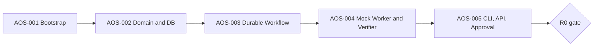
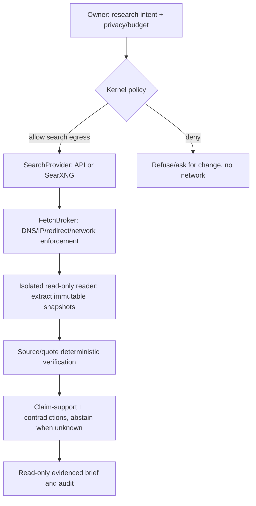

# AgentOS v0.6.1 — Consolidated Build Specifications (AOS-001–037)

**Note:** for convenient sequential review. Standalone `specs/AOS-NNN.md` files are the change-controlled implementation specs. Full target architecture remains in the package as a separate unchanged reference.


---

<!-- Source: architecture/00-DECISIONS-AND-INVARIANTS.md -->
# AgentOS Implementation Architecture — Decisions, Invariants and Provenance

**Version:** 0.6.1 implementation-spec pack, 2026-10-11. **Status:** implementation design, review required.  
**Normative baseline:** `../references/AgentOS_v0.6.1_Architecture_Baseline.md` (copied without modification).  
**Change control:** Freeze architectural principles; revise task specs and ADRs based on measured implementation results. Do not silently change the source baseline.

## Source-of-truth hierarchy
1. Explicit user/project safety requirements and approved architecture decisions.
2. The v0.6.1 master architecture (target capabilities and invariant constraints).
3. This package's versioned cross-component contracts; update through ADRs.
4. AOS-001–037 individual implementation specifications; each defines scope, acceptance and dependencies.
5. Actual implementation code/tests and observed hardware/provider behavior. When code diverges from a spec, file an ADR or defect; never quietly rewrite the spec to rationalize the code.

## Known implementation-asset caveat
The review reports an **existing Agent Skills bundle** containing `hardware-probe`, `claude-code-worker`, `verified-research-brief`, `egress-preflight`, `milestone-handoff`, `capture-learning`, and `goal-contract`. It also reports a tested `hwprobe.py` prototype on five simulated profiles. **Their actual source and test results were not attached to this session**, so this package does not assert they have been inspected or integrated. The first build plan must inventory actual files, hashes, tests, and licenses, then adopt/update rather than rebuilding. A status of `candidate-existing` is different from `integrated-and-tested`.

## Locked architecture invariants
- Kernel owns authoritative task, attempt, approval, policy, budget, side-effect and audit records. An LLM cannot authorize work.
- Goal-contract versions are immutable and acceptance checks must be executable, human-reviewed, or explicitly `unverifiable`; prose alone is not a passed check.
- **Trust** (project runtime certification), **privacy** (data sensitivity and allowed destinations), **autonomy** (action approval) are independently persisted and enforced; effective permission is their intersection with sandbox and provider scopes.
- Off-device work is opt-in and never a fallback for `RESTRICTED` content. Local model non-residency cannot stop deterministic kernel operations.
- Workers/harnesses and inference runtimes are replaceable; all status and artifacts remain platform-owned.
- Crash recovery does not imply exactly-once external effects. Unknown effects must enter `RECONCILING`, without automatic duplication.
- Repo files, skills, search results, MCP outputs and web text are untrusted. The isolation layer, not the prompt, enforces boundaries.
- Logs and accounting distinguish `known`, `estimated`, `unknown`; missing billing data is not zero.
- Every cloud report distinguishes `authorized`, `accessible`, and `observed` disclosures.
- Every implementation must have deterministic acceptance tests, failure tests, an owner-visible audit trail, and a rollback strategy.

## Platform stack policy
- Python 3.12+ managed by `uv`, FastAPI, SQLAlchemy 2 and Alembic, PostgreSQL; DBOS durable workflows. Versions pinned by lockfile after compatibility tests.
- `pytest`, Ruff, Mypy, Pydantic v2, testcontainers or ephemeral Postgres for integration. Tool suggestions are **proposed**, not claimed installed.
- Start with CLI + minimal loopback HTTP API, then introduce React/Vite and SSE. Observability uses OpenTelemetry and optionally local Phoenix. No mandatory SaaS.
- Ollama first, vLLM/SGLang benchmarked on actual hardware; AWS/cloud APIs and vendor CLI agents only through explicitly approved paths.
- No generic tool-installation or personal-data ingestion during the R0 synthetic proof.

## Release gates (change relative to frozen master)
- **R0 / Kernel Proof:** AOS-001–005, synthetic goal → durable mock worktree → verifier → approval, crash-tested, no real accounts or sensitive repo.
- **R1 / Personal Alpha:** Offline Ask + bounded Build using **one** hardened Claude Code worker; policy/sandbox gates AOS-006–012,014–018; minimal CLI/status UI. AOS-027 verifier/approval core is *pulled forward* in scoped form without changing its identity or presuming full R3 completion.
- **R2 / Research Alpha:** Read-only Delegate; AOS-013 and AOS-019–023; configurable search backend, network isolation, fetched-source provenance and support verification.
- **R3 / Multi-Agent Alpha:** AOS-024–030; Codex, two-worker scheduling, complete React Mission Control, Phoenix, full journey and chaos suite. AOS-027 completed in full here.
- **R4 / Intelligent Resources:** AOS-031–033 (Phase 2 capabilities).
- **R5 / Context & Desktop:** AOS-034–035 (Phase 3).
- **R6 / Evaluated Adaptation:** AOS-036 (Phase 4).
- **R7 / Open-Source Portability:** AOS-037 (Phase 5).

**R1 is not allowed to operate on real repositories/accounts until corresponding security gates pass**; R0 uses synthetic and mock resources. This release split is an implementation sequencing addendum, not a reduction of full SOTA requirements.

## New ADRs to be approved with implementation
- ADR-001: Adopt portable Agent Skills (`SKILL.md`) for procedural capabilities, plus separate AgentOS permission/IO manifest; skill validator and provenance gate.
- ADR-002: Approved search-provider interface: SearXNG and configurable commercial provider; each search is a network disclosure with stored telemetry; SearXNG itself may contact upstream engines.
- ADR-003: Public kernel API remains transport-agnostic so an opt-in MCP server can expose `submit_goal`, `get_status`, `get_artifacts`, `list_tasks` after R1. No MCP caller bypasses kernel policy; Hermes is one potential MCP client, not an OS-internal authority.
- ADR-004: Use DBOS initially with PostgreSQL, no promise of trivial Temporal substitution. Re-evaluate distributed executor only against actual multi-node needs.
- ADR-005: No brand selection on critical path; `agentos` is a **private codename**. Public name/CLI/PyPI/npm/GitHub/domain clearance before public beta.
- ADR-006: Explicit release ladder R0–R7. Every promotion is conditional on specified tests; no cross-project widening by trust-mode promotion.

## Build/plan-generation discipline
For each `AOS-NNN`, the implementation plan **must** name source files, migrations, integration points, tests, deployment operations, acceptance evidence and rollback. Distinguish existing code, source-backed fact, design proposal, and unresolved issue. No plan may infer that a skill or CLI flag works solely from this spec. Record the exact commit/SHA, runtime and vendor version that passed its acceptance suite.

## References
- Official DBOS durability and idempotency: https://docs.dbos.dev/python/tutorials/workflow-tutorial
- DBOS determinism, retries and recovery: https://docs.dbos.dev/architecture
- MCP tool specification (2026-07-28): https://github.com/modelcontextprotocol/modelcontextprotocol/blob/main/docs/specification/2026-07-28/server/tools.mdx
- Search API: https://docs.searxng.org/dev/search_api.html
- Agent Skills specification: https://agentskills.io/specification
- Claude CLI docs: https://code.claude.com/docs/en/cli-reference
- Anthropic security and compliance: https://code.claude.com/docs/en/legal-and-compliance
- OpenAI plan-use terms: https://openai.com/policies/sign-in-with-chatgpt-terms/


---

<!-- Source: architecture/01-CANONICAL-DATA-AND-API-CONTRACTS.md -->
# Canonical Contracts — Goals, Tasks, Attempts, Approvals, Evidence and Events

**Status:** proposed implementation contract; validate schemas via Alembic, Pydantic tests and DBOS adapter tests before binding public API. **Maintainer:** kernel. **Scope:** initial R0 contract plus forward-compatible target schemas (later migrations are *not* required to ship R0).

## 1. Data model and invariants

### Entity inventory

| Entity | Authoritative responsibilities | R0? |
|---|---|---|
| `principal` | Local owner identifier; auth identity, not subscription secret | yes, seeded |
| `project` | Root, owner, independent trust profile + version | lightweight R0, policy later |
| `goal` | Desired outcome, owner, selected contract version, lifecycle | yes |
| `goal_contract` | Immutable serialized version, content hash, acceptance plan | yes |
| `task` | Goal-linked DAG node, current state, priority, attempt counter | yes |
| `task_attempt` | Started worker, lease epoch, status, process ref, bounds | yes |
| `workflow_link` | DBOS workflow ID + task and attempt for recovery | yes |
| `acceptance_check` / `check_run` | Executable check definition and observed outcome | yes |
| `artifact` | Immutable evidence pointer + hash + privacy class | yes |
| `approval_request` | Digest-bound exact pending action, expiry, decision | yes |
| `event` | Replayable canonical task/goal events with monotonic ordering | yes |
| `side_effect` | External action idempotency, attempt, outcome/reconciliation | mock R0, harden R1 |
| `policy_decision` | Which rule granted/denied access with policy version | skeleton R0, R1 enforcement |
| `memory_item`, `memory_use_event` | Owner/project memory plus 5-stage attribution | schema R1 |
| `routing_decision/outcome` | Provider eligibility/selection and observed quality/cost | R1 evidence capture |
| `research_source`, `claim_evidence` | Fetched page snapshots, quote offsets, supported claims | R2 |
| `entitlement`, `usage_observation` | Provider plan/API authorized path, quota signal confidence | R4 |

### Identifiers and invariants
- Use UUIDv7 if an already-approved library is pinned and tested; UUIDv4 is an acceptable R0 simplification. Never derive identity from a user-provided pathname.
- Timestamps UTC with timezone; task and contract `schema_version` explicit. IDs never recycled; no mutable contract payload after approval.
- Source of truth is PostgreSQL; DBOS workflow tables are separate. Do not take a DBOS replay result as an authorization decision.
- `goal_contract` rows are append-only; a revision creates a new row with `(goal_id, version)` unique.
- `task_attempt` always belongs to a task; `(task_id, attempt_number)` and `(task_id, lease_epoch)` unique. A newer epoch fences an older worker from committing results.
- `event` append in the same transaction as its associated state change, with `(task_id, seq)` unique; SSE can duplicate but may not invent events.
- `approval_request` binds `effect_digest`, `policy_version`, `owner`, `project`, expiry and minimum actor identity; change to any of these invalidates it.
- `artifact.sha256` verifies bytes of stored artifact; content files reside outside a worker-writable root or are atomically copied to a protected store.
- Every persistence write checks owner/project scope. R0 has one seeded owner but schema is not built around implicit global tenancy.

## 2. Proposed v1 PostgreSQL migration blueprint

These are *illustrative domain tables* for writing the first real migration, not a claim of validated SQL. Use Alembic and test with the pinned PostgreSQL version, DBOS schema, and SQLAlchemy models. Prefer enum/check constraints consistent with code; no app writes to DBOS internal tables.

```sql
CREATE TABLE principal (
  id uuid PRIMARY KEY, display_name text NOT NULL,
  created_at timestamptz NOT NULL DEFAULT now()
);
CREATE TABLE project (
  id uuid PRIMARY KEY, owner_id uuid NOT NULL REFERENCES principal(id),
  root_path text, trust_profile_id text NOT NULL DEFAULT 'SYNTHETIC_DEV',
  trust_profile_version integer NOT NULL DEFAULT 1,
  created_at timestamptz NOT NULL DEFAULT now()
);
CREATE TABLE goal (
  id uuid PRIMARY KEY, owner_id uuid NOT NULL REFERENCES principal(id),
  project_id uuid REFERENCES project(id), intent text NOT NULL,
  status text NOT NULL CHECK (status IN ('CREATED','ACTIVE','COMPLETED','FAILED','CANCELLED')),
  approved_contract_version integer,
  created_at timestamptz NOT NULL DEFAULT now(), updated_at timestamptz NOT NULL DEFAULT now()
);
CREATE TABLE goal_contract (
  id uuid PRIMARY KEY, goal_id uuid NOT NULL REFERENCES goal(id),
  version integer NOT NULL CHECK (version > 0),
  schema_version integer NOT NULL DEFAULT 1,
  body jsonb NOT NULL, sha256 char(64) NOT NULL,
  approved_by uuid REFERENCES principal(id), approved_at timestamptz,
  created_at timestamptz NOT NULL DEFAULT now(),
  UNIQUE (goal_id,version)
);
CREATE TABLE task (
  id uuid PRIMARY KEY, goal_id uuid NOT NULL REFERENCES goal(id),
  contract_id uuid NOT NULL REFERENCES goal_contract(id),
  name text NOT NULL, state text NOT NULL,
  priority integer NOT NULL DEFAULT 0, lease_epoch bigint NOT NULL DEFAULT 0,
  next_event_seq bigint NOT NULL DEFAULT 1,
  created_at timestamptz NOT NULL DEFAULT now(), updated_at timestamptz NOT NULL DEFAULT now()
);
CREATE TABLE task_dependency (
  task_id uuid NOT NULL REFERENCES task(id), depends_on uuid NOT NULL REFERENCES task(id),
  PRIMARY KEY(task_id,depends_on), CHECK (task_id <> depends_on)
);
CREATE TABLE task_attempt (
  id uuid PRIMARY KEY, task_id uuid NOT NULL REFERENCES task(id),
  attempt_number integer NOT NULL, lease_epoch bigint NOT NULL,
  status text NOT NULL, adapter text NOT NULL, external_ref text,
  started_at timestamptz, heartbeat_at timestamptz, finished_at timestamptz,
  error_code text, UNIQUE(task_id,attempt_number), UNIQUE(task_id,lease_epoch)
);
CREATE TABLE workflow_link (
  task_id uuid NOT NULL REFERENCES task(id), attempt_id uuid NOT NULL REFERENCES task_attempt(id),
  dbos_workflow_id text NOT NULL UNIQUE, PRIMARY KEY(task_id,attempt_id)
);
CREATE TABLE acceptance_check (
  id uuid PRIMARY KEY, contract_id uuid NOT NULL REFERENCES goal_contract(id),
  check_key text NOT NULL, description text NOT NULL,
  verifier_type text NOT NULL, verifier_spec jsonb NOT NULL,
  required boolean NOT NULL DEFAULT true, UNIQUE(contract_id,check_key)
);
CREATE TABLE check_run (
  id uuid PRIMARY KEY, acceptance_check_id uuid NOT NULL REFERENCES acceptance_check(id),
  attempt_id uuid NOT NULL REFERENCES task_attempt(id),
  verdict text NOT NULL CHECK (verdict IN ('PASS','FAIL','UNKNOWN','ERROR')),
  evidence_artifact_id uuid, checked_at timestamptz NOT NULL DEFAULT now()
);
CREATE TABLE artifact (
  id uuid PRIMARY KEY, task_id uuid NOT NULL REFERENCES task(id), attempt_id uuid REFERENCES task_attempt(id),
  kind text NOT NULL, store_key text NOT NULL, sha256 char(64) NOT NULL,
  privacy_class text NOT NULL DEFAULT 'RESTRICTED', size_bytes bigint NOT NULL CHECK(size_bytes >= 0),
  created_at timestamptz NOT NULL DEFAULT now()
);
ALTER TABLE check_run ADD CONSTRAINT check_run_artifact_fk FOREIGN KEY(evidence_artifact_id) REFERENCES artifact(id);
CREATE TABLE approval_request (
  id uuid PRIMARY KEY, goal_id uuid NOT NULL REFERENCES goal(id), task_id uuid REFERENCES task(id),
  owner_id uuid NOT NULL REFERENCES principal(id), action_kind text NOT NULL,
  payload_hash char(64) NOT NULL, policy_version text NOT NULL,
  state text NOT NULL CHECK(state IN ('PENDING','APPROVED','DENIED','EXPIRED','REVOKED')),
  expires_at timestamptz NOT NULL, decided_at timestamptz, decided_by uuid REFERENCES principal(id),
  CHECK ((state='PENDING') OR (state='EXPIRED') OR (decided_at IS NOT NULL))
);
CREATE TABLE task_event (
  id uuid PRIMARY KEY, goal_id uuid NOT NULL REFERENCES goal(id), task_id uuid REFERENCES task(id),
  attempt_id uuid REFERENCES task_attempt(id), seq bigint,
  kind text NOT NULL, occurred_at timestamptz NOT NULL DEFAULT now(),
  actor text NOT NULL, trace_id text, payload jsonb NOT NULL DEFAULT '{}'::jsonb,
  UNIQUE(task_id,seq)
);
CREATE TABLE side_effect (
  id uuid PRIMARY KEY, task_id uuid NOT NULL REFERENCES task(id),
  effect_key text NOT NULL, target text NOT NULL, request_hash char(64) NOT NULL,
  state text NOT NULL CHECK(state IN ('PREPARED','EXECUTING','SUCCEEDED','FAILED','UNKNOWN','RECONCILING')),
  external_ref text, reconciliation_note text,
  UNIQUE(task_id,effect_key)
);
CREATE INDEX ix_task_goal ON task(goal_id);
CREATE INDEX ix_event_goal_time ON task_event(goal_id,occurred_at);
CREATE INDEX ix_approvals_owner_pending ON approval_request(owner_id,state,expires_at);
```

**Migration note:** The `task_event` nullable `task_id` represents goal-level events. PostgreSQL unique constraints permit multiple NULL values; goal-level events should use an additional per-goal sequence or another stable cursor for replay. Prefer a global database-generated `BIGINT IDENTITY` cursor or UUIDv7 plus `(created_at,id)` ordering and explicitly test ordering. The implementation plan must choose one strategy before writing SSE code.

## 3. Structured goal contract (replace prose-only acceptance)

```yaml
schema_version: 1
goal_id: <generated-uuid>
contract_version: 1
owner_id: <local-principal-uuid>
project_id: <approved-project-uuid>
intent: "Improve maintainability of the synthetic repository"
privacy_class: RESTRICTED
trust_profile_id: SYNTHETIC_DEV
autonomy_profile_ref: default-v1
constraints:
  allowed_paths: ["src/**", "tests/**"]
  forbidden_paths: [".env*", ".git/config", "secrets/**"]
  permitted_capabilities: ["scoped-file-edit", "trusted-test-runner"]
  cloud_egress: deny
budget:
  max_attempts_per_task: 2
  max_wall_seconds: 120
  max_api_usd: 0
acceptance:
  - id: AC-001
    description: "Trusted unit tests pass"
    verifier:
      type: trusted-command
      command_ref: synthetic-test-suite # resolved from reviewed registry
      expected_exit_code: 0
      timeout_seconds: 30
    evidence: {required: true, kind: test-report}
  - id: AC-002
    description: "No unauthorized paths modified"
    verifier:
      type: git-diff-path-check
      allowed_paths: ["src/**", "tests/**"]
    evidence: {required: true, kind: diff-report}
  - id: AC-003
    description: "Merge always requires approval"
    verifier:
      type: policy-decision
      action: protected-merge
      expected: approval-required
non_goals: ["production deployment", "dependency upgrades"]
```

**Validation rules:** no arbitrary `command` string from model/user under `trusted-command`; bounded resource limits; verified `project_root`, owner and policy; referenced checker exists and is signed/trusted; all required check definitions well-typed. `UNKNOWN` must not count as `PASS`.

## 4. Task state transitions and guard contract

Canonical states `CREATED`, `VALIDATING`, `READY`, `LEASED`, `RUNNING`, `WAITING_APPROVAL`, `VERIFYING`, `RETRY_WAIT`, `RECONCILING`, `CANCELLING`, `COMPLETED`, `FAILED`, `CANCELLED`, `REJECTED`.

- `CREATED→VALIDATING`: schema/owner/project/goal contract bound.
- `VALIDATING→READY` only if approved contract and relevant policy checks pass.
- `READY→LEASED` only if capacity, retry budget and lease epoch committed atomically.
- `LEASED→RUNNING`: confirmed worker process handle and valid epoch.
- `RUNNING→VERIFYING`: worker produced immutable candidate artifacts.
- `VERIFYING→COMPLETED`: every required verifier passed and any required effect approval is settled.
- `RUNNING→RECONCILING`: effect may have occurred but result unavailable. No blind retry.
- `WAITING_APPROVAL→READY`: approved exact digest and policy still valid.
- `RUNNING→CANCELLING→CANCELLED` only after effect reconciliation; otherwise hold `RECONCILING`.
- Transition guard writes event and state in one DB transaction; compare expected state/version + lease epoch.
- Terminal states are immutable except explicitly versioned administrative correction events; no worker can resurrect them.

**Error taxonomy:** `POLICY_DENIED`, `CONTRACT_INVALID`, `AUTH_REQUIRED`, `ENTITLEMENT_UNAVAILABLE`, `PROVIDER_THROTTLED`, `WORKER_FAILED`, `WORKER_LOST`, `VERIFY_FAILED`, `AMBIGUOUS_SIDE_EFFECT`, `BUDGET_EXCEEDED`, `CAPACITY_UNAVAILABLE`, `SOURCE_UNTRUSTED`, `DATA_LABEL_UNCERTAIN`, `INTERNAL_ERROR`. Errors carry recoverability, safe-to-retry flag, user-action-needed, and redacted diagnostic ID.

## 5. Worker adapter model and normalized events

```python
class WorkerAdapter(Protocol):
    async def capabilities(self) -> CapabilityManifest: ...
    async def validate(self, spec: JobSpec) -> ValidationResult: ...
    async def start(self, spec: JobSpec) -> ExecutionHandle: ...
    async def events(self, handle: ExecutionHandle) -> AsyncIterator[WorkerEvent]: ...
    async def observe(self, handle: ExecutionHandle) -> RunStatus: ...
    async def cancel(self, handle: ExecutionHandle) -> CancellationReceipt: ...
    async def collect(self, handle: ExecutionHandle) -> RunResult: ...
```

`JobSpec` contains goal, task, attempt, contract hash, lease epoch, workspace manifest, capabilities, trust/privacy/autonomy decision IDs, max cost/tokens/turns/duration, network destinations, backend ref, checkpoint/handoff ref, idempotency keys. Adapter `cancel()` returns `REQUESTED/ACKNOWLEDGED/UNKNOWN`, never conflates SIGTERM with durable task cancellation.

`WorkerEvent` normalized to `{event_id, goal_id, task_id, attempt_id, lease_epoch, kind, producer, occurred_at, policy_decision_id, privacy_class, trace_id, payload_ref, metadata}`. Unknown usage/cost encoded as `{status:"unknown", amount:null}`.

## 6. Loopback API v1 and browser security

| Endpoint | Method | First release | Guard |
|---|---|---|---|
| `/v1/goals` | POST | R0 | authenticated local owner, typed contract |
| `/v1/goals/{id}` | GET | R0 | owner/project scope |
| `/v1/goals/{id}/events?after={cursor}` | GET | R0, SSE later | scoped event replay |
| `/v1/approvals` | GET | R0 | local session |
| `/v1/approvals/{id}/decision` | POST | R0 | exact digest + CSRF + expiry + owner |
| `/v1/goals/{id}/cancel` | POST | R0 | audited request, not false success |
| `/v1/artifacts/{id}` | GET | R0 | owner/label, canonical filesystem path |
| `/v1/ask` | POST | R1 | offline-only guard + memory scope |
| `/v1/research` | POST | R2 | public-web + egress permission |
| `/v1/runtime/status` | GET | R1 | metadata only |
| `/v1/usage` | GET | R3 | confidence + unknown semantics |

API server binds loopback by default; require per-install strong authorization token or authenticated local session and protect browser mutations with origin/CSRF/Host validation. DNS rebinding prevention must validate Host and trusted-origin semantics independent of binding. Redact bodies and artifacts from low-privilege telemetry. No wildcard CORS.

## 7. Memory and learning telemetry contracts (forward schema)

```yaml
memory_use_event:
  memory_id: uuid
  task_id: uuid
  attempt_id: uuid?
  context_pack_id: uuid?
  stage: retrieved | included | used_by_worker | judged_unused | candidate_helped
  attribution_source: retrieval | agent_tool_event | verifier | user_correction
  confidence: 0.0..1.0
  occurred_at: RFC3339
routing_decision:
  task_id: uuid
  candidates: [{backend: string, allowed: bool, reason: string}]
  selected_backend: string?
  policy_version: string
  estimate_quality: known | estimated | unknown
  resource_snapshot_id: uuid?
  cost_estimate_usd: number?
research_source:
  source_id: uuid
  requested_url: string
  canonical_url: string
  redirect_chain: [string]
  fetched_at: RFC3339
  status: integer
  sha256: hex64
  extraction_version: string
  text_store_ref: string
claim_evidence:
  claim_id: uuid
  source_id: uuid
  start_offset: integer
  end_offset: integer
  quote_match: pass | fail | not_applicable
  support_verdict: supported | contradicted | insufficient | unknown
```

`candidate_helped` is *attribution*, not a causality claim. Full eval of memory lift requires matched tasks/ablation; do not infer from raw usage counts.

## 8. API/contract version policy

- Semantic public APIs under `/v1`; JSON `schema_version` on persisted payloads. Events include producer version.
- Database migrations forward-only with documented down/restore strategy (not blindly reversible when lossy). Backups are encrypted and validated by restore drill before risky migration.
- For adapters, exact CLI/SDK version is part of capability manifest; contract tests must pass against pinned version before deploy.
- Server and UI share generated types or a schema-derived client; avoid manually copied status enums.
- MCP exposure (after R1) wraps the same authorized public API; HTTP vs stdio transport never grants permission by itself.

## Acceptance for this shared contract
1. Alembic migration applies to clean PostgreSQL and survives one `upgrade -> simulated rollback/restore -> upgrade` drill.
2. Conflicting state writes cannot both succeed; stale epoch rejected; duplicate request ID returns existing task or a clear conflict.
3. A valid contract roundtrips unchanged with its hash; an edit creates a new immutable version.
4. Every check has a verifiable type and evidence rule; required UNKNOWN prevents completion.
5. Owner and project boundaries prevent unauthorized reads; logs contain no raw secret fields.
6. API restart + SSE replay preserves event ordering and shows correct authoritative status.

## Source pointers
- Master §5, §9, §10 and §17; `00-DECISIONS-AND-INVARIANTS.md`.
- DBOS workflow docs: https://docs.dbos.dev/python/tutorials/workflow-tutorial
- DBOS replay/determinism: https://docs.dbos.dev/architecture


---

<!-- Source: architecture/02-AGENT-SKILLS-AND-INTEROPERABILITY.md -->
# Agent Skills, Protocol Integration and Asset Reconciliation

## Design decision
Adopt the **portable Agent Skills `SKILL.md` convention** for reusable procedural capabilities, with a separate AgentOS-owned `capability.yaml` or equivalent permission manifest. SKILL.md instructions are **not trusted policy** and cannot grant filesystem/network authority.

The user review reports seven existing skills, but this session lacks their actual source bundle. Treat them as *candidate-existing, unverified* until independently read, hashed, linted, license-checked and executed in an isolated synthetic fixture.

## Skill adoption workflow
1. Inventory exact skill directories, SKILL.md frontmatter, scripts, references, assets, licenses and dependencies. Record hashes.
2. Validate SKILL.md syntax with a pinned validator; check metadata, clear invocation and no undocumented execution.
3. Scan dependencies and scripts; classify which permissions the capability really needs.
4. Create a separate `capability.yaml` with `capability_id`, `skill_ref_sha`, `input_schema`, `output_schema`, `required_tools`, `filesystem_scopes`, `network_allowlist`, `allowed_privacy_classes`, `max_runtime`, `secret_scopes`, `trust_profile_requirement`.
5. Test in `SYNTHETIC_DEV` sandbox and assert output schema, prohibited-network denial and no secret access.
6. Bind registry entry to approved version/hash. Load description on demand; provide full instructions only for a scoped task after authorization.
7. On upgrade, re-run security fixtures and emit versioned approval/rollback evidence.

| Reported asset | Backlog mapping | Required reconciliation |
|---|---|---|
| `hardware-probe` / `hwprobe.py` | AOS-015 | inspect code and five simulated profiles; benchmark actual machine |
| `claude-code-worker` | AOS-010 | verify safe/restricted settings, auth and malicious repo hook fixture |
| `verified-research-brief` | AOS-021 | add content hash + retained text offsets + unsupported claim rejection |
| `egress-preflight` | AOS-008/012/029 | distinguish authorized/accessible/observed; manifest never replaces network guard |
| `milestone-handoff` | AOS-025/027 | structured checkpoint IDs, clean git commit and verifier evidence |
| `capture-learning` | AOS-011/012/036 | five memory-use stages and provenance/consent |
| `goal-contract` | AOS-002/025 | structured machine-run verifiers, not prose-only acceptance |

**Spelling in shipping schema:** `accessible` (not `accesssible`).

## Interfaces and protocol positioning
- **Internal WorkerAdapter**: stable kernel contract. Worker-specific extensions do not change task policy.
- **MCP server (post-R1)**: exposes scoped platform tools to Hermes, other assistants, or an IDE. MVP tools: `submit_goal`, `get_goal_status`, `list_tasks`, `get_artifact`, later `request_approval` with user sign-in; no `approve_anything` tool.
- **MCP client (staged)**: consumes reviewed external tool servers with per-tool capabilities/approvals and source isolation.
- **ACP**: optional harness broker adapter for compatible coding agents; verify precise version/agent behavior before claiming conformance.
- **A2A**: future integration for full autonomous agent platforms; never bypass kernel policy on inbound agent messages.

## MCP security rules
- Treat all tool input and output as untrusted; server validates schemas, per-request auth, rate limits and output sanitization.
- A local stdio connection does not equal trusted user authorization; bind calls to a delegated owner/project/capability scope.
- HTTP transport requires current MCP authorization standard for negotiated protocol version; do not invent bearer forwarding/implicit token trust.
- Every mutation uses kernel API and project trust + data privacy + action autonomy check. An MCP client cannot promote its own policy.
- Hermes only becomes an alternative front-end after the kernel status/approval API is stable; do not fork Hermes to become kernel.

## Acceptance
- Every installed Skill validates, has a hashed approved version, and cannot gain privileges by modifying SKILL.md text.
- A malicious SKILL.md/tool description requesting data exfil does not cause a denied outbound call to execute.
- MCP client attempting to submit RESTRICTED data to cloud is rejected and audited; no unapproved actor can consume an approval token.
- Tool registry returns only installed approved capabilities matching a task's trust/privacy/action context.

## References
- Agent Skills: https://agentskills.io/specification
- MCP protocol spec 2026-07-28: https://github.com/modelcontextprotocol/modelcontextprotocol/blob/main/docs/specification/2026-07-28/basic/index.mdx
- MCP tools spec: https://github.com/modelcontextprotocol/modelcontextprotocol/blob/main/docs/specification/2026-07-28/server/tools.mdx
- Hermes Agent: https://github.com/NousResearch/hermes-agent


---

<!-- Source: architecture/03-SOTA-CAPABILITY-BLUEPRINT.md -->
# Full SOTA AgentOS Target — Capability Preservation and Implementation Boundaries

**Meaning of SOTA:** research-informed design ambition, not a measured industry leaderboard claim. No part of this target is deleted by R0–R3 reduction. The [full v0.6.1 architecture](../references/AgentOS_v0.6.1_Architecture_Baseline.md) is frozen; this file maps advanced capabilities into implementable interfaces and evidence gates.

| Full target capability | Required system behavior | Architectural owner | Initial slice | Full target story |
|---|---|---|---|---|
| Always-available steward | Local/private endpoint, hardware-aware model residency and safe fallback | intelligence/resources | AOS-015–018 | AOS-034 |
| Durable multi-agent work | DAG scheduling, checkpoint/recovery, external-effect reconciliation | kernel/execution | AOS-001–006 | AOS-025–026,037 |
| Multi-provider inference | Stable model capabilities, local/cloud entitlements and measured routing | token broker | AOS-016 | AOS-031–033 |
| Vendor harness ecosystem | Official CLI/SDK jobs via stable worker protocol | harness broker | AOS-010 | AOS-024,037 |
| Quota/cost optimizer | Explicit cost vs subscription allowance, confidence, reserve and limits | entitlements | AOS-012 | AOS-031–033 |
| Safe tool/MCP ecosystem | Discover, approve, pin and sandbox capabilities; no self-granted permissions | registry/policy | AOS-008/010 | AOS-036–037 |
| Long-running supervisor | Structured milestone contracts, reset context per milestone, bounded replan | intelligence | AOS-002/003 | AOS-025/036 |
| Verifier/evidence | Deterministic tests, source proof, judge with abstention, release gates | verification | AOS-004 | AOS-021–022/027/030 |
| Personal memory/RAG | Owner/project fact/event/skill stores, provenance, usage stages and controlled forgetting | memory | AOS-011/017 | AOS-034/036 |
| Context compiler | Harness-native context packs filtered by trust/privacy and skill versions | intelligence/memory | R1 minimal | AOS-034 |
| Hardware governor | Measured placement, CPU/GPU/thermal/resource priority, specialist scheduling | resources | AOS-015/018 | AOS-032–033 |
| Specialist model packs | Text/vision/ASR/TTS/image/coding capability-based optional install | inference+registry | Ollama text | AOS-034/036–037 |
| Research agent | Query approval, isolated search/fetch, evidence-backed claims | tools/verification | none until R2 | AOS-013,019–023 |
| Computer use and ambient integration | Explicit opt-in, observation/action split, per-app permissions, local-first | experience/tools | no | AOS-035 |
| Mission Control/voice | Fast Ask/Delegate/Build, live fleet/cost/security/quality views, voice/hotkey | experience | CLI R0/R1 | AOS-028–029/034 |
| Security/privacy/audit | Three policy axes, sandbox egress, cloud exposure, immutable audit, user approvals | kernel/policy | AOS-002/005 | AOS-006–014/037 |
| Learning and evaluation | Trusted corrections, replay, shadow candidates, approved promotion, rollback | evaluation | capture R1 | AOS-036 |
| Portable open-source distribution | No required account, Linux/macOS/CPU/GPU compatibility, signed builds, upgrades | deployment | Ubuntu dev | AOS-037 |

## Mandatory cross-cutting properties

1. **Portability:** No platform-specific CLI or GPU detail leaks into kernel task models; worker capability manifest mediates differences.
2. **Security before authority:** Each new tool/worker/model/API requires compatibility + policy conformance tests, not only a wrapper.
3. **Human control:** Project trust, data privacy and action autonomy are separate, and user-requested stop always stops new admissions immediately.
4. **Grounded outcomes:** An agent output is a *candidate* until executed acceptance and evidence checks pass; unsupported claims are flagged.
5. **Reproducibility:** Tasks, context packs, evidence and metrics include versions, hashes, source labels and actor/attempt IDs.
6. **Hardware courtesy:** AgentOS yields to foreground applications and survives resource pressure without losing task status.
7. **Economic reality:** API cash cost, subscription allowance, shadow/avoided cost, and unknown quota are different measures.
8. **No silent self-modification:** System permissions, tools, standing instructions and model changes are evaluated and approved before production promotion.

## Future epic expansion requirements
AOS-034,035,036,037 are intentionally high-level platform epics because actual hardware performance, user tasks, review/telemetry and upstream project health are not yet measured. Before implementing these stories, split them into child build specs with: concrete supported OS/hardware variants, API schema, negative security tests, benchmark dataset, operator/upgrade docs and rollback. This split **cannot remove** target requirements without explicit ADR.

## Evidence for deciding what to build next
- Need for SGLang/vLLM requires same-model throughput/quality study rather than the number of abstract agents.
- Need for Temporal requires observed distributed recovery/coordination requirements; DBOS remains initial approved executor.
- Need for Graphiti/Letta/Mem0 requires retrieval failure or memory lift evidence; PostgreSQL and documented memory facts remain authoritative.
- Need for LangGraph expansion requires reasoning control-flow complexity that structured planner cannot express cleanly.
- Need for LangSmith/Langfuse requires observability/observed eval limitations; OTel remains the stable telemetry contract.
- Need for specialist agent fleets or advanced MCP servers requires repeatable user tasks, approval capacity and security gates.

## Primary source starting points
- DBOS: https://docs.dbos.dev/python/tutorials/workflow-tutorial
- LangGraph persistence: https://docs.langchain.com/oss/python/langgraph/persistence
- vLLM: https://github.com/vllm-project/vllm
- SGLang: https://github.com/sgl-project/sglang
- Ollama: https://github.com/ollama/ollama
- Agent Skills: https://agentskills.io/specification
- MCP: https://github.com/modelcontextprotocol/modelcontextprotocol
- OpenTelemetry: https://opentelemetry.io/docs/
- Phoenix: https://github.com/Arize-ai/phoenix
- Temporal: https://github.com/temporalio/temporal
- Claude Code: https://code.claude.com/docs/en/cli-reference
- Codex CLI: https://github.com/openai/codex


---

<!-- Source: releases/R0-KERNEL-PROOF.md -->
# R0 Build Specification — AOS-001 through AOS-005

**Objective:** A real durable control-plane path, using only synthetic data/mock workers, passes restart/replay, verifies artifacts and requires exact user approval. This is **not** an authorization to put Claude Code, external secrets or a personal repository in the runtime.

**Source files:** [001](../specs/AOS-001.md) · [002](../specs/AOS-002.md) · [003](../specs/AOS-003.md) · [004](../specs/AOS-004.md) · [005](../specs/AOS-005.md); [shared domain contracts](../architecture/01-CANONICAL-DATA-AND-API-CONTRACTS.md).

## Milestones and dependency graph



**WIP limit:** one schema-changing task at a time; ship each vertical increment behind an integration test. Parallelize only documentation/security-fixture design while contracts stabilize. Avoid creating ten skeleton packages with zero executable test coverage.

## Module tree to implement

```text
apps/api/                  main.py, routes/{goals,approvals,artifacts,events}.py
apps/cli/                  main.py, commands/{goal,approval,artifact}.py
packages/contracts/        goal.py, task.py, worker.py, events.py, acceptance.py
packages/kernel/           goal_service.py, task_service.py, approvals.py, repository.py
packages/execution/        dbos_app.py, task_workflow.py, recovery.py
packages/brokers/harness/  mock_worker.py, base.py
packages/policy/           synthetic_policy.py, verifier_registry.py
packages/telemetry/        event_store.py, audit.py
packages/verifier/         trusted_runner.py, diff_check.py, evidence.py
migrations/versions/       0001_kernel_v1.py
examples/synthetic/        repo-template/, goal-contract.yaml, fixtures/
tests/                    unit/, migration/, contract/, integration/, chaos/, security/
deploy/compose/             postgres.yaml
```

This is a proposal for plan generation; if existing repository or Agent Skills code uses different paths, retain code and document mapping rather than duplicating modules.

## M0: bootstrap (AOS-001)
1. `uv` project with locked Python 3.12 and local-only FastAPI health endpoint. Do not include Node/frontend in the critical path.
2. Postgres Compose ephemeral test fixture and named local developer volume. Avoid adding long-lived Docker root privileges.
3. Lint/type/test/CI and `make r0-demo` placeholders; CI has no AI provider credentials.
4. Create readable `CONTRIBUTING.md`, `SECURITY.md`, `.env.example` with no real values.
**Exit:** fresh Ubuntu checkout runs tests and DB up/migration with only documented prerequisites.

## M1: contracts and migration (AOS-002)
1. Implement `GoalContract` acceptance union: trusted-command-ref, diff-path-check, policy-decision, human-approval. Model has immutable canonical SHA256.
2. SQL entities principal/project/goal/contract/task/attempt/approval/artifact/events/checks/workflow link; use real Postgres constraints and indexes.
3. Database repository with owner-scoped reads, expected-version mutations and atomic state+event writes.
4. A test must deliberately make two attempts update the same task; only one wins. Another must try to change an approved contract in place and fail.
**Exit:** migrations verified; goal/contract/task/check roundtrip; concurrency and DAG validation green.

## M2: DBOS execution (AOS-003)
1. Define a DBOS workflow that decides deterministic task state transitions; separate all I/O and nondeterminism into persisted DBOS steps.
2. Stable workflow ID linked to task and contract hash; duplicate submit returns same logical execution or explicit 409.
3. At start/restart, recover DBOS workflows and reconstruct UI state from AgentOS ledger; errors are explicit.
4. Use test barriers to SIGKILL at step boundaries and recover; document ambiguity around incomplete steps.
**Exit:** crash/restart test across 3–4 barriers passes and event sequence remains authoritative.

## M3: worker/evidence (AOS-004)
1. Mock adapter implements the full WorkerAdapter lifecycle. It is configured with one of `success`, `bad-test`, `bad-path`, `timeout`, `crash`, `artifact-corrupt` behaviors.
2. Synthesize a miniature Git repo in a disposable root, isolate attempt in fresh Git worktree, never use user HOME paths.
3. Register two verifiers: trusted known test command and diff path check. Capture artifact SHA256 and bounded stdout.
4. Worker narrative 'tests pass' must be ignored if tests actually fail.
**Exit:** mock fixtures deterministically pass/fail with immutable artifact evidence and safe cleanup.

## M4: API/CLI/approval (AOS-005)
1. Minimal loopback API with owner token/session, no wildcard CORS; CLI wraps OpenAPI-generated types.
2. `submit`, `status`, `events`, `show artifact`, `approve/deny`, `cancel` commands; exact-action payload hash and policy version bind approvals.
3. E2E harness submits synthetic task, observes running state, obtains diff/check evidence, approves, and sees completed result. Restart API before approval and prove result persisted.
4. Negative demo: deny/expired approval and changed payload never execute.
**Exit:** one reproducible command shows completed R0 workflow and another shows negative fixture rejection.

## R0 reference integration contract

```json
{
  "schema_version": 1,
  "kind": "synthetic-build",
  "goal_contract_ref": "goal_uuid/version_1",
  "task": {"worker": "mock", "privacy_class": "RESTRICTED", "network": "deny"},
  "acceptance": [
    {"type": "trusted-command", "command_ref": "synthetic-test-suite", "expected_exit_code": 0},
    {"type": "git-diff-path-check", "allowed_paths": ["src/**", "tests/**"]},
    {"type": "policy-decision", "action": "protected-merge", "expected": "approval-required"}
  ]
}
```

The executable `GoalContract` schema, not this illustrative JSON, is authoritative after AOS-002 passes its contract tests.

## Negative and failure gate matrix

| Test | Injected failure | Pass condition |
|---|---|---|
| CONTRACT-01 | change approved contract body | immutable version preserved; new version required |
| CONTRACT-02 | two state writes with same expected version | exactly one succeeds |
| DAG-01 | cycle or self-edge | plan rejected |
| WORKFLOW-01 | kill kernel before DBOS step completion | resumes/retries safely; no phantom success |
| WORKFLOW-02 | duplicate workflow request key | one logical workflow |
| WORKER-01 | wrong allowed path | check FAIL, task not COMPLETED |
| WORKER-02 | claimed success with failing test | verifier rejects |
| ARTIFACT-01 | mutate artifact bytes after hash | read refuses or flags tampering |
| APPROVAL-01 | approve changed/expired digest | DENY without effect |
| APPROVAL-02 | concurrent approve/deny | one atomically final decision |
| API-01 | wrong local owner/session | deny, log safe code |
| API-02 | API killed during approval wait | request and event replay intact |

**R0 threat envelope:** no real provider auth, no personal data, no trusted claim about sandboxing arbitrary code. The mock test runner may execute only developer-authored synthetic code, and CI must not have sensitive credentials. R1 security hardening is a blocker before relaxing this envelope.

## R0 artifact checklist
- Source code + pinned lockfile + `compose.yaml` and migration.
- Generated JSON schemas/OpenAPI + migration diagram/ERD.
- DBOS crash-test transcript and replay validation log.
- Synthetic worktree and verifier fixtures with expected output.
- CLI demo transcript, final task/event records and approval audit.
- `ARCHITECTURE.md` delta containing only implementation detail; no speculative new frameworks.
- ADR log for exact database event cursor, approval auth and workflow ID strategy.

## R0 plan-generation instruction
Generate a **small implementation plan for one AOS item at a time**. For each: map exact files, code interfaces, schema/SQL, unit + negative fixtures, integration steps, commands, review points and rollback. Prioritize a running test before broad abstract scaffolding. Record unknown current repository state and existing skill assets to inspect as the first plan task. Do not add R1–R7 features without a written dependency or blocker.


---

<!-- Source: releases/R1-PERSONAL-ALPHA.md -->
# R1 Build Specification — Useful Offline Ask + One Hardened Build Worker

**Goal:** Deliver a daily-use personal AgentOS before web research and parallel coding are necessary. Preserve all R0 gates, and extend from mock-only synthetic execution to controlled personal use **only after** the corresponding security tests pass.

## Critical-path stories
- **Hardening required before real access:** AOS-006 leases/effects; AOS-007 three-axis policy; AOS-008 OS sandbox; AOS-009 API/approval security; AOS-010 hardened Claude Code worker.
- **Evidence from the start:** AOS-011 memory and use stages; AOS-012 routing/feedback/exposure; AOS-014 events, traces, SSE.
- **Ask:** AOS-015 hardware probe (existing candidate `hwprobe.py` audit); AOS-016 offline inference; AOS-017 chat+memory; AOS-018 offline/pressure tests.
- **Build:** preliminary **R1-core AOS-027** single-agent test/diff verifier and protected merge approval (full AOS-027 remains in R3 after AOS-026). AOS-004 mock worker evolves to Claude via AOS-010.
- **Experience:** R0 CLI, optional very thin locally served status/approval page. Full React Mission Control is the R3 story AOS-028; do not let it delay R1.

## Product journeys
### Ask
1. User enters `agentos ask "..."` with project context. 2. Policy determines data label and local-only routing. 3. Hardware manifest selects local model, with load/unload state observed. 4. Owner-scoped memory is searched; source IDs and context-pack hashes recorded. 5. Reply streams with source-linked recall, TTFT and possible degraded mode.

**A-1 R1 gate:** network disabled at OS boundary; ten fixed questions (three recall, one hostile prompt to use unauthorized cloud); correct scope and zero observed outbound traffic. Report warm/cold TTFT and hardware details. The 3-second provisional warm p95 target from the baseline is conditional on actual Omen benchmark; mark **not met**, not falsely passed, when hardware cannot deliver it.

### Build
1. Owner selects `SYNTHETIC_DEV` project and explicit allowed root. 2. Kernel records structured GoalContract; tests defined by trusted command refs and path checks. 3. Claude Code worker launched under tested safe/restricted CLI profile, in an isolated worktree with sanitized repository configuration. 4. Candidate artifacts reviewed against deterministic verifier. 5. Exact commit/tree SHA requires explicit merge approval. 6. Crashes/retries reconcile unknown effects.

**B-single R1 gate:** synthetic repository proves crash recovery, failed-test rejection, unapproved path refusal, stale approval rejection, malicious `.claude/settings.json` and `.mcp.json` hooks never execute, and exact binary/version/auth mode compatibility. Real personal repos permitted only after this suite, OS sandbox and policy tests pass. No second worker required for R1.

## Data gates
- `memory_use_event`: retrieved, included, used_by_worker, judged_unused, candidate_helped (not causal proof).
- `routing_decision/outcome`: backend choices, rejected alternatives, policy reason, cost known/estimated/unknown.
- `cloud_exposure`: authorized, accessible and observed separately.
- `policy`: project-scoped trust version, independent data label and per-action autonomy.
- `approval`: exact effect digest/version, owner/project scope, expiry.

## Security fixtures
1. Malicious repo config creates marker or attempts network exfil during CLI startup → marker never written and denied egress logged.
2. Worker invokes unauthorized shell/network/tool while in restricted profile → OS enforcement denies.
3. Change only trust mode while holding privacy/autonomy fixed → no new remote route or send permission.
4. Private memory in Project A requested from Project B → no retrieval or derived context leakage.
5. Local web page attempts forged POST to loopback API → Host/Origin/CSRF/auth blocks.
6. Bounded effect response lost → enters RECONCILING; no duplicate action.

## Operational readiness
- One-command install/diagnose model/Claude CLI, no automatic driver installation.
- Clear offline/no-model/unknown-plan states.
- Model warm/cold and resource-pressure metrics on actual machine.
- User-visible audit and approval history; no mandatory telemetry export or hosted account.
- Runbook for provider CLI compatibility upgrade, restoring task from crash, rotating local API auth, and re-probing hardware.

## Explicitly later
R2 public-web Delegate; R3 Codex parallelism and full React UI; R4 vLLM/SGLang adaptive selection; R5 rich context/voice/desktop; R6 learning; R7 distributed open-source support.


---

<!-- Source: releases/R2-RESEARCH-ALPHA.md -->
# R2 Build Specification — Safe Read-only Delegate

**Goal:** Introduce exactly one non-coding delegation class: source-grounded public web research. No authenticated site access, sending, shell tools, model-triggered installations, browser session cookies, or arbitrary desktop interaction.

**Stories:** [AOS-013](../specs/AOS-013.md), [AOS-019](../specs/AOS-019.md), [AOS-020](../specs/AOS-020.md), [AOS-021](../specs/AOS-021.md), [AOS-022](../specs/AOS-022.md), [AOS-023](../specs/AOS-023.md).

## Bounded pipeline



## Search decision
`SearchProvider` interface supports configured SearXNG and one approved API implementation. The user's search query is recorded as outbound data, even when the local SearXNG frontend queries upstream engines. Select a provider explicitly at install/project level; never silently send an Internal/Confidential query to public search. No search-engine-specific logic in kernel.

## Fetch/network guarantees
- Validate URI scheme, hostname, IPv4/IPv6 resolved destination and port before connection; pin/revalidate address as redirects occur; block loopback, RFC1918, link-local, cloud metadata, multicast, IPv4-mapped IPv6, private IP DNS rebinding.
- Disable ambient proxies/cookies/client credentials; enforce byte/time/redirect/content-type limits, and OS-level egress restrictions.
- Renderer/reader has read-only FS and no private mounts/CLI tokens. Untrusted document instructions remain data; a separate synthesizer never receives action authority from them.

## Evidence semantics
1. Fetched source ID minted only by trusted retrieval layer; retention controlled by source policy.
2. Source has URL, redirect chain, time, status, MIME, SHA256 raw/text, extraction version, stable text offsets and privacy lineage.
3. Claim has one or more source passage references and a deterministic citation/exact-quote result.
4. Semantic support is a *separate* supported/insufficient/contradicted/unknown judgment; a second model alone does not prove correctness.
5. Unsupported claims must be removed, flagged, or marked uncertain—not promoted as fact.

## D-1 gate (fixtures + live smoke)
- Fabricated source pointer → fail.
- Real source but mismatched quote → fail.
- Real source but contradicted conclusion → unsupported/contradicted.
- Source page instructs `POST ~/.ssh` → no privileged tool available; egress denied.
- Public-looking URL redirects/DNS-rebinds to metadata/localhost → network denial.
- Truncated/PDF/table evidence → explicit incomplete status.
- One owner-approved live public brief shows fetched snapshot IDs, all cited claims, verification diagnostics and search-query cloud-exposure log.

## Rollback
Disabling Delegate must not disable R1 Ask or Build. A blocked fetch remains a recorded denial and does not trigger auto-provider switching. Evidence snapshots are versioned and retained for configured local period. Read-only mode must not support user-issued outbound email or browser macros as hidden tools.


---

<!-- Source: releases/R3-MULTI-AGENT-ALPHA.md -->
# R3 Build Specification — Multi-Agent Build + Mission Control

**Goal:** Demonstrate real concurrent work across two independently authenticated, policy-constrained coding harnesses, while making progress and approvals useful to a human.

**Stories:** [AOS-024](../specs/AOS-024.md), [AOS-025](../specs/AOS-025.md), [AOS-026](../specs/AOS-026.md), [AOS-027](../specs/AOS-027.md), [AOS-028](../specs/AOS-028.md), [AOS-029](../specs/AOS-029.md), [AOS-030](../specs/AOS-030.md).

## Execution topology
- Kernel planner emits typed task DAG with dependencies, bounded budgets, check definitions and candidate workers. LangGraph only when real bounded cyclic planning/review is required.
- Harness broker runs Claude Code and Codex through the same WorkerAdapter contract. Each has its own version/auth/sandbox manifest and a separate Git worktree.
- Scheduler leases independent READY tasks and checks resource, privacy, autonomy and capacity; two attempts can execute concurrently when permissions permit.
- Result integration checks conflict and final merged tree, re-runs deterministic tests, and requires approval for protected merge. Successful isolated tests are insufficient.
- DBOS persists authoritative retries/recovery; a timed-out external action enters RECONCILING before any repeat.

## UI core
- React/Vite Mission Control with 3 distinct intakes Ask/Delegate/Build, task/fleet status, artifact/test/diff view, exact bound approvals, errors/unknowns, egress exposure, and OTel/Phoenix trace drilldowns.
- SSE is replayable from persisted event cursor; UI reducer is not the state authority. UI reconnect passes outage and duplicate event fixtures.
- Controls must show reasons (waiting approval, quota unknown, resource cap, auth issue, offline) instead of fake progress.

## R3 security/quality
- Two simultaneous writes to same path are not auto-merged; conflicts reviewable.
- A provider auth/quota denial never triggers a fallback that violates data privacy/consent.
- A malicious repository hook cannot execute for either worker in certified profile.
- All approvals bind final tree SHA, not stale intermediate changes.
- Phoenix exporter outage does not stop execution; no sensitive payload/credential leaks.

## Complete MVP gate
`A-1` offline Ask; `D-1` read-only grounded research; `B-1` concurrent Build; independent three-axis policy negative tests; six chaos scenarios from frozen master §17; 14-day daily-use observation. Log results against code SHA, model/CLI version and hardware profile; no statistically unjustified claims on tiny sample sets.


---

<!-- Source: releases/R4-R7-SOTA-EXPANSION.md -->
# R4–R7 Expansion Specification — Preserve the Full SOTA Target

These releases expand a working platform; **none are removed from the target**. Adoption is gated by actual quality/resource/security evidence rather than a desire to collect frameworks.

## R4 — Advanced routing and compute (AOS-031–033)
- Subscription entitlement contract: plan usage only through officially supported routes; read-only trustworthy telemetry, background consent and conservative UNKNOWN states.
- Quota forecaster, budget reservation, hard eligibility filters before value-based optimization.
- Benchmark same model/quantization when technically possible using Ollama, vLLM and SGLang under 1/2/4/8/16 concurrency, cold/warm state, shared vs independent prefixes, measured success and foreground interference.
- Adaptive local resource governor, API limits and optional pinned/sandboxed gateway if demonstrated necessary.
- **Promotion:** no improper subscription use, no surprise spend, no unauthorized provider fallback, and a measured gain in quality-adjusted outcomes or cost.

## R5 — Memory, desktop and context (AOS-034–035)
- Cross-harness context compiler with project/source privacy lineage, skills context, precise token budgeting and attention to Claude safe-mode's ignored workspace CLAUDE.md.
- Hybrid RAG + memory lifecycle, project decisions, skills and episodes; retrieval lift evaluated against no-memory baseline before adopting complex engines.
- Push-to-talk/local STT, hotkey/tray, phone status and developer-tool integrations as consented surfaces; ambient recording off by default.
- Secure observation/action split for computer use and browser navigation; no automatically granted credentials.
- **Promotion:** useful repeated personal tasks, measured time saved, memory privacy/relevance tests and app-isolation security pass.

## R6 — Capability discovery and supervised learning (AOS-036)
- Candidate skill/tool/model registry with security manifest, hashes, permissions and user approval.
- Frozen replay evaluation, task/outcome corrections, held-out comparison and guarded promotion/rollback; no uncontrolled policy self-editing.
- Memory compaction with dry runs, pinned source retention, provenance-aware changes and honest forget/backup limits.
- Optional personalized local steward fine-tune **only** after sufficient consented decision samples and evaluation proof.
- **Promotion:** measurable held-out improvement, no gate-metric regression, reproducible revert.

## R7 — Open source, cross-platform and multi-machine (AOS-037)
- Ubuntu/NVIDIA, CPU-only, Apple Silicon compatibility; native inference on Apple host; platform-specific sandbox conformance.
- Signed releases, SBOM, pinned dependencies, license policy, threat model, migrations, offline package mode and no mandatory hosted account/telemetry.
- Potential distributed DBOS recovery/conductor or Temporal *only if architecture decision supported by operational evidence.*
- Public CLI/package/GitHub/domain naming and trademark screening; user-named personal steward.
- **Promotion:** independent fresh installs, restore/rollback, cross-OS sandbox tests, 14-day recovery soak and security review.

## SOTA research capabilities retained beyond initial backlog granularity
- Durable long-running supervisors, fresh-session milestone handoffs, verifier ensembles, independent tool/capability acquisition and agent-agent protocols.
- Multiple model runtimes including local dense/MoE/vision/embedding/ASR/TTS/specialist packs, proactive trigger integrations and desktop companion.
- Memory episode/fact/skill compaction, integrity and forgetting, RAG rerank/graph supplements only when benchmark-justified.
- Reproducible model/agent evals, versioned offline RL/adaptation candidates and software supply-chain defenses.
- Transparent cumulative cloud exposure and actual cost/plan savings, without claiming unknowable encrypted payloads.

For exhaustive target coverage, the **unchanged master architecture** is included in `../references/AgentOS_v0.6.1_Architecture_Baseline.md`, and the module-specific specs are [AOS-031](../specs/AOS-031.md) through [AOS-037](../specs/AOS-037.md).


---

<!-- Source: specs/AOS-001.md -->
# AOS-001 — Repository scaffold, developer toolchain, CI and local services

**Implementation specification:** AgentOS v0.6.1 | **Release:** R0 | **Status:** proposed, not executed  
**Dependencies:** None  
**Architecture:** [Decisions](../architecture/00-DECISIONS-AND-INVARIANTS.md) · [Canonical contracts](../architecture/01-CANONICAL-DATA-AND-API-CONTRACTS.md) · [Frozen v0.6.1 master](../references/AgentOS_v0.6.1_Architecture_Baseline.md)

## 1. Goal / business outcome
An unassisted developer can clone, bootstrap and test a modular-monolith project on supported Ubuntu without a cloud account or real model subscription.

**Definition of success:** completion is decided by the acceptance and negative tests below, not by an LLM report or a merged code patch alone.

## 2. In-scope functional requirements
- Use a Python 3.12+ `uv` workspace with packages `contracts/kernel/execution/brokers/policy/resources/memory/telemetry`, FastAPI app, and CLI app; reserve `apps/mission-control` for React/Vite later but do not require Node to execute the R0 API tests.
- Pin Python/Node dependencies, create `pyproject.toml`, lint/type/test commands, Alembic location, `.env.example` containing *only placeholders*, Docker Compose PostgreSQL with health check and persistent named volume.
- Document environment variable names, process modes, deterministic seeded synthetic project, local-only service binding, `make`/`just` commands and an offline dependency-cache strategy. No runtime arbitrary `pip install`.
- CI runs lint, type checks, unit and migration smoke tests; integration tests start an ephemeral DB and detect schema drift. Protect repo scripts from unreviewed auto-execution.

## 3. Required interfaces, contracts and ownership
- `make bootstrap`, `make test`, `make lint`, `make db-up`, `make db-migrate`, `make dev-api`, `make r0-demo`; stable exit codes and reproducible README steps.
- Provide `.python-version`, lockfile, Pydantic settings module, explicit package boundaries, and a typed `/healthz` endpoint with dependency status rather than secrets.

- **Owner boundary:** kernel persists authoritative state/decisions; relevant adapter/service is replaceable; frontend, if any, reads the same typed API.
- **Versioning:** persisted payloads carry `schema_version`; external CLI/SDK version is captured in compatibility evidence. Scope-sensitive API calls enforce project and user ownership.

## 4. Data model, migrations and evidence
- No production domain data yet; configuration has schema-version and deployment profile (`SYNTHETIC_DEV`) with loopback address. Persist local test DB in an explicitly named Docker volume; test teardown cannot delete real workspace paths.

Use additive migrations with constraints and indexes tested on real PostgreSQL. Backups/restore and forward-compatibility behavior must be documented for any destructive migration. Data sensitivity and source provenance survive derivation and logging.

## 5. Execution behavior and error handling
- Reject an invalid authorization/scope/contract before dispatch. Preserve a structured denial event with a safe diagnostic code.
- Bounded timeouts, resource caps, retries and cancellation must be defined for every external call; errors distinguish safe-to-retry from ambiguous side effects.
- On interruption, replay authoritative DB state and revalidate policy; no worker can commit after an invalidated lease or mutate an approved contract.
- Unknown data, usage, provider availability or verifier outcome are represented explicitly; they are not silently converted into successful states.
- Each critical action includes owner, project, task, attempt, policy version and trace IDs where applicable.

## 6. Acceptance criteria and automated test matrix
- Fresh Ubuntu VM bootstraps from clean checkout using documented commands.
- CI enforces Ruff, MyPy, Pytest, dependency-lock reproducibility and basic secret scanner; unit tests run without provider credentials.
- PostgreSQL service is healthy and migration check returns zero; API inaccessible from non-loopback interface; no unexpected egress during smoke test.
- Failing lint/test/prohibited dependency injection makes CI fail; no real keys in commit, build image or logs.

**Test classes required:** unit; database migration/contract; integration fixture; at least one negative security or failure-injection test; reproducibility on supported R-stage deployment. Record fixture inputs, expected outputs, CLI/SDK versions and observed results. Where physical GPU/provider credentials are needed, isolate optional live tests from offline CI.

## 7. Threat model and mandatory safeguards
- Supply-chain poisoning, secrets in `.env`, privileged Docker socket mount, exposed PostgreSQL, symlink-based destructive cleanup. Disallow docker.sock mount into any worker; restrict dev-only ports; versions/digests pinned after verification.

Use actual OS/database/API guards, not only model prompts. No test may access an unrelated real workspace, local tokens or external endpoints without explicitly granted user test authorization.

## 8. Operations, observability and rollout
- Write SETUP, CONTRIBUTING, SECURITY stub, support matrix (Ubuntu 22.04 baseline, macOS later), Makefile help and recovery for broken local DB. Baseline startup time and idle RSS. Provide `make reset-synthetic-data` that acts only on a named synthetic DB.

- Capture `task_id`, `attempt_id`, `worker/runtime_version`, `trace_id` and appropriate evidence IDs; redact secrets and respect privacy labels.
- Roll out behind a release-stage feature gate; on failure, disable new admissions, retain durable history and restore prior version. Do not erase the audit record during rollback.
- Link a runbook: setup, troubleshooting, cancellation, stuck-state recovery, test fixtures and resource effects.

## 9. Explicit non-goals
- No cloud deployment, no real coding agents, no full frontend, no GPU install, no public package publishing.

## 10. Decisions to confirm in implementation planning
- Exact supported Python 3.12 patch and CI provider; use testcontainers vs Compose as test fixture; licensing/copyright ownership and final public package/CLI name are ADRs.

**Existing skill/artifact reconciliation:** Existing skill bundle discovery is a prerequisite; do not mark any skill installed merely because a review names it.

## 11. Implementation-plan deliverables
A production-quality plan prepared from this specification must supply:
1. Exact code paths, module/API ownership and class/function signatures; account for existing code before creating new files.
2. SQL/Alembic migrations, Pydantic models and generated interface schemas (or explicit `not applicable`).
3. Sequenced tasks with prerequisites, estimated effort, review checkpoints and a **working end-to-end test at every stage**.
4. Deterministic positive, negative, security and crash tests with expected outputs; define explicit failure modes.
5. Runtime/sandbox/secret and provider terms implications; verify exact pinned dependency/CLI versions.
6. Observability fields, backup/rollback strategy and operator runbook; include resource baseline.
7. Acceptance evidence: command/test output references, CI run, manifest hashes, manual approvals and remaining risks.
8. An ADR for material changes to the frozen architecture instead of silently editing the master document.

### R0-specific sequencing and evidence
1. Create empty working tree and package layout. 2. Wire `uv` lock and minimal `pytest` fixture. 3. Start scoped Postgres under Compose. 4. Add health endpoint and Alembic scaffold. 5. Add `make r0-demo` target as a failing stub to drive following specs. 6. Run the build in fresh VM.

Record in PR: exact `uv sync --frozen` output (sanitized), all lock hashes, Compose health result, CI matrix, `git status --short` after bootstrap, loopback scan result and dependency license inventory. **Fail** if setup requires real AI credentials.

## 12. Supporting references
- See master architecture references and verify exact upstream versions at build time.
- Frozen master: `../references/AgentOS_v0.6.1_Architecture_Baseline.md` (backlog §16; applicable design sections).
- Shared contracts: `../architecture/01-CANONICAL-DATA-AND-API-CONTRACTS.md`.


---

<!-- Source: specs/AOS-002.md -->
# AOS-002 — Goal contracts, tasks, attempts and database migration v1

**Implementation specification:** AgentOS v0.6.1 | **Release:** R0 | **Status:** proposed, not executed  
**Dependencies:** [AOS-001](AOS-001.md)  
**Architecture:** [Decisions](../architecture/00-DECISIONS-AND-INVARIANTS.md) · [Canonical contracts](../architecture/01-CANONICAL-DATA-AND-API-CONTRACTS.md) · [Frozen v0.6.1 master](../references/AgentOS_v0.6.1_Architecture_Baseline.md)

## 1. Goal / business outcome
A goal is represented by an immutable, structured, validated contract, with a persisted task DAG and attempt history supporting optimistic concurrency and executable acceptance criteria.

**Definition of success:** completion is decided by the acceptance and negative tests below, not by an LLM report or a merged code patch alone.

## 2. In-scope functional requirements
- Implement Pydantic v2 models for principal/project/goal/GoalContractVersion/task/task dependency/attempt/check and artifact/approval IDs, normalizing UTC timestamps and rejecting unknown unsafe fields.
- Create Alembic migration for R0 entities in `01-CANONICAL-DATA-AND-API-CONTRACTS.md` with typed constraints, indexes, foreign keys, unique `(goal_id, version)` and guarded state transitions. Use one transaction to write state plus canonical event.
- Convert narrative acceptance lines into typed verifier nodes (`trusted-command-ref`, `git-diff-path-check`, `policy-decision`, `manual-evidence`); never accept worker-supplied shell as a trusted verifier.
- Implement deterministic contract hash via canonical serialization; revision creates a new version and invalidates approval tied to prior digest. DAG validation rejects cycles, self-links and unauthorized project references.

## 3. Required interfaces, contracts and ownership
- `POST /v1/goals` request/response schema; internal `create_goal`, `create_contract_version`, `create_task`, `compare_and_transition`, `attach_check`; generated OpenAPI and CLI roundtrip.
- Return 400 on invalid contract, 409 on conflict/stale version, 404 for foreign scoped resource, and audit ID on denial.

- **Owner boundary:** kernel persists authoritative state/decisions; relevant adapter/service is replaceable; frontend, if any, reads the same typed API.
- **Versioning:** persisted payloads carry `schema_version`; external CLI/SDK version is captured in compatibility evidence. Scope-sensitive API calls enforce project and user ownership.

## 4. Data model, migrations and evidence
- SQLAlchemy declarative models, Alembic version 0001, Pydantic models and JSON Schema; fields/indices in shared contract. R0 `project` trust profile defaults `SYNTHETIC_DEV` and does not imply a live sandbox certified in R0.

Use additive migrations with constraints and indexes tested on real PostgreSQL. Backups/restore and forward-compatibility behavior must be documented for any destructive migration. Data sensitivity and source provenance survive derivation and logging.

## 5. Execution behavior and error handling
- Reject an invalid authorization/scope/contract before dispatch. Preserve a structured denial event with a safe diagnostic code.
- Bounded timeouts, resource caps, retries and cancellation must be defined for every external call; errors distinguish safe-to-retry from ambiguous side effects.
- On interruption, replay authoritative DB state and revalidate policy; no worker can commit after an invalidated lease or mutate an approved contract.
- Unknown data, usage, provider availability or verifier outcome are represented explicitly; they are not silently converted into successful states.
- Each critical action includes owner, project, task, attempt, policy version and trace IDs where applicable.

## 6. Acceptance criteria and automated test matrix
- Roundtrip schema and canonical hash property tests; immutable approved version refuses UPDATE; foreign-owner access returns denial.
- Concurrent updates same expected version: exactly one wins. DAG cycles and malformed verifier nodes fail admission. Missing/UNKNOWN required check blocks completion.
- Migration applies to empty DB, rejects invalid constraints; documented restore drill; error payloads do not leak private root.

**Test classes required:** unit; database migration/contract; integration fixture; at least one negative security or failure-injection test; reproducibility on supported R-stage deployment. Record fixture inputs, expected outputs, CLI/SDK versions and observed results. Where physical GPU/provider credentials are needed, isolate optional live tests from offline CI.

## 7. Threat model and mandatory safeguards
- Mass assignment (`approved_at` set by user), SQL injection, path traversal, worker changing contract, unbounded JSON size, policy downgrade through API body; contract approval bound to authenticated actor.

Use actual OS/database/API guards, not only model prompts. No test may access an unrelated real workspace, local tokens or external endpoints without explicitly granted user test authorization.

## 8. Operations, observability and rollout
- Define migration ownership and backup protocol; capture slow-query plans for goal/task lookups; measure baseline DB footprint; keep exported schema snapshot in `docs/contracts`. SQL downgrade is optional only after data-preserving proof.

- Capture `task_id`, `attempt_id`, `worker/runtime_version`, `trace_id` and appropriate evidence IDs; redact secrets and respect privacy labels.
- Roll out behind a release-stage feature gate; on failure, disable new admissions, retain durable history and restore prior version. Do not erase the audit record during rollback.
- Link a runbook: setup, troubleshooting, cancellation, stuck-state recovery, test fixtures and resource effects.

## 9. Explicit non-goals
- No multi-tenant hosted identity service, no quota pricing, no inferred natural-language rubric as a pass condition.

## 10. Decisions to confirm in implementation planning
- Pick UUIDv4/v7 generation and event cursor design before database lock; decide goal lifecycle vs task lifecycle representation; ensure DBOS system schema is separate.

**Existing skill/artifact reconciliation:** `goal-contract` reported existing; inspect and port structured acceptance checks; version provenance required.

## 11. Implementation-plan deliverables
A production-quality plan prepared from this specification must supply:
1. Exact code paths, module/API ownership and class/function signatures; account for existing code before creating new files.
2. SQL/Alembic migrations, Pydantic models and generated interface schemas (or explicit `not applicable`).
3. Sequenced tasks with prerequisites, estimated effort, review checkpoints and a **working end-to-end test at every stage**.
4. Deterministic positive, negative, security and crash tests with expected outputs; define explicit failure modes.
5. Runtime/sandbox/secret and provider terms implications; verify exact pinned dependency/CLI versions.
6. Observability fields, backup/rollback strategy and operator runbook; include resource baseline.
7. Acceptance evidence: command/test output references, CI run, manifest hashes, manual approvals and remaining risks.
8. An ADR for material changes to the frozen architecture instead of silently editing the master document.

### R0-specific transaction and schema edge cases
Implement a transaction wrapper with `expected_version`, `actor`, `policy_version`, `correlation_id`; insertion of `TaskEvent` and state change happen atomically. `GoalContractVersion.body` must be canonicalized before SHA256; define handling of floating point, time, null and field order. Acceptance can only become PASSED through an approved verifier that creates a `check_run` and evidence artifact.

Required dataset: valid contract; malformed path; unknown trusted-command ref; duplicate `(goal_id,version)`; concurrent status mutation; orphan attempt; dependency cycle; attempt with stale epoch; artifact hash mismatch. Include Alembic migration SQL output and restoration evidence.

## 12. Supporting references
- See master architecture references and verify exact upstream versions at build time.
- Frozen master: `../references/AgentOS_v0.6.1_Architecture_Baseline.md` (backlog §16; applicable design sections).
- Shared contracts: `../architecture/01-CANONICAL-DATA-AND-API-CONTRACTS.md`.


---

<!-- Source: specs/AOS-003.md -->
# AOS-003 — DBOS-backed durable single-task execution and recovery

**Implementation specification:** AgentOS v0.6.1 | **Release:** R0 | **Status:** proposed, not executed  
**Dependencies:** [AOS-002](AOS-002.md)  
**Architecture:** [Decisions](../architecture/00-DECISIONS-AND-INVARIANTS.md) · [Canonical contracts](../architecture/01-CANONICAL-DATA-AND-API-CONTRACTS.md) · [Frozen v0.6.1 master](../references/AgentOS_v0.6.1_Architecture_Baseline.md)

## 1. Goal / business outcome
An accepted synthetic goal runs through a DBOS workflow and recovers after sudden process death while preserving authoritative task state and auditable events.

**Definition of success:** completion is decided by the acceptance and negative tests below, not by an LLM report or a merged code patch alone.

## 2. In-scope functional requirements
- Implement a `run_task_workflow(task_id, contract_hash)` whose *workflow body remains replay-deterministic*. All time, random IDs, database I/O, worker spawn, and network calls occur in separately checkpointed steps/transactions.
- Persist a stable DBOS workflow ID tied to goal/task; repeated start by same key returns prior handle or deliberate conflict. Workflow only runs an authorized current contract version. Separate engine-owned replay logs from app-owned task ledger.
- Implement explicit `CREATED→VALIDATING→READY→LEASED→RUNNING→VERIFYING→COMPLETED` happy path and terminal/error states. Add controlled pause, cancellation requested, retry-wait and reconciliation states as modeled; R0 mock activity never uses real external side effects.
- At process startup invoke approved DBOS recovery/launch sequence and reconcile DBOS execution with task ledger; do not falsely mark a process gone as completed.

## 3. Required interfaces, contracts and ownership
- `RunTask(task_id)`, `GetExecutionStatus(task_id)`, `RecoverPending()` and normalized `task.state_changed`, `workflow.started/recovered/failed` events; contract fields in shared file.
- DBOS step IDs and workflow IDs mapped to task/attempt; retry policy configurable by classified error. Explicit timeouts for every worker/step.

- **Owner boundary:** kernel persists authoritative state/decisions; relevant adapter/service is replaceable; frontend, if any, reads the same typed API.
- **Versioning:** persisted payloads carry `schema_version`; external CLI/SDK version is captured in compatibility evidence. Scope-sensitive API calls enforce project and user ownership.

## 4. Data model, migrations and evidence
- `workflow_link` row, `task.state`, `task_attempt`, atomic event log. DBOS internal schema managed by DBOS, not custom migrations. A `recovery_instance` identity is logged for audit.

Use additive migrations with constraints and indexes tested on real PostgreSQL. Backups/restore and forward-compatibility behavior must be documented for any destructive migration. Data sensitivity and source provenance survive derivation and logging.

## 5. Execution behavior and error handling
- Reject an invalid authorization/scope/contract before dispatch. Preserve a structured denial event with a safe diagnostic code.
- Bounded timeouts, resource caps, retries and cancellation must be defined for every external call; errors distinguish safe-to-retry from ambiguous side effects.
- On interruption, replay authoritative DB state and revalidate policy; no worker can commit after an invalidated lease or mutate an approved contract.
- Unknown data, usage, provider availability or verifier outcome are represented explicitly; they are not silently converted into successful states.
- Each critical action includes owner, project, task, attempt, policy version and trace IDs where applicable.

## 6. Acceptance criteria and automated test matrix
- Kill server before step completes, after DB state commit and after step checkpoint; restart and assert final task result and monotonic event stream.
- Two concurrent duplicate submissions with same idempotency key produce one logical task; no double artifact. Non-deterministic workflow body test catches bad pattern.
- Database unavailable: no speculative state transitions; recover cleanly on reconnect. Uncaught terminal exception becomes FAILED and remains inspectable rather than silently restarting forever.

**Test classes required:** unit; database migration/contract; integration fixture; at least one negative security or failure-injection test; reproducibility on supported R-stage deployment. Record fixture inputs, expected outputs, CLI/SDK versions and observed results. Where physical GPU/provider credentials are needed, isolate optional live tests from offline CI.

## 7. Threat model and mandatory safeguards
- Exactly-once misunderstanding: DBOS replays incomplete steps; real effects require AOS-006. Misordered event/DBOS writes, stale process heartbeat and swallowed exceptions. Require explicit failure classification and persisted diagnostics.

Use actual OS/database/API guards, not only model prompts. No test may access an unrelated real workspace, local tokens or external endpoints without explicitly granted user test authorization.

## 8. Operations, observability and rollout
- Document recovery command, DBOS version pin and migration compatibility; structured logs with goal/task/workflow ID; observe unfinished workflows, retry counts, and recovery latency. Add chaos-test script with deterministic signal barriers.

- Capture `task_id`, `attempt_id`, `worker/runtime_version`, `trace_id` and appropriate evidence IDs; redact secrets and respect privacy labels.
- Roll out behind a release-stage feature gate; on failure, disable new admissions, retain durable history and restore prior version. Do not erase the audit record during rollback.
- Link a runbook: setup, troubleshooting, cancellation, stuck-state recovery, test fixtures and resource effects.

## 9. Explicit non-goals
- No Temporal, no distributed production queues, no live provider task, no external actions; later AOS-006 adds leases/outbox.

## 10. Decisions to confirm in implementation planning
- Verify DBOS exact lifecycle and background-enqueue API against pinned release; choose transaction isolation for dual app/DBOS stores; disaster restore target TBD.

**Existing skill/artifact reconciliation:** None identified

## 11. Implementation-plan deliverables
A production-quality plan prepared from this specification must supply:
1. Exact code paths, module/API ownership and class/function signatures; account for existing code before creating new files.
2. SQL/Alembic migrations, Pydantic models and generated interface schemas (or explicit `not applicable`).
3. Sequenced tasks with prerequisites, estimated effort, review checkpoints and a **working end-to-end test at every stage**.
4. Deterministic positive, negative, security and crash tests with expected outputs; define explicit failure modes.
5. Runtime/sandbox/secret and provider terms implications; verify exact pinned dependency/CLI versions.
6. Observability fields, backup/rollback strategy and operator runbook; include resource baseline.
7. Acceptance evidence: command/test output references, CI run, manifest hashes, manual approvals and remaining risks.
8. An ADR for material changes to the frozen architecture instead of silently editing the master document.

### R0-specific controlled crash protocol
Use a test worker with controllable barriers `BEFORE_STEP`, `AFTER_SIDE_EFFECT_BEFORE_COMMIT`, `AFTER_STEP_COMMIT`, `BEFORE_VERIFY`. Kill the application PID at each barrier, restart the *same pinned build*, and query both DBOS workflow state and AgentOS task state. Each experiment must end in a coherent, reconciled status. A worker failure must not be swallowed as a successful workflow.

**DBOS semantics warning:** step completion is checkpointed, but a step interrupted before checkpoint can rerun. For any future external action the executor must call AOS-006 side-effect intent/reconciliation. The R0 synthetic action should be designed idempotently and must not claim real external exactly-once semantics.

## 12. Supporting references
- https://docs.dbos.dev/python/tutorials/workflow-tutorial
- https://docs.dbos.dev/architecture
- Frozen master: `../references/AgentOS_v0.6.1_Architecture_Baseline.md` (backlog §16; applicable design sections).
- Shared contracts: `../architecture/01-CANONICAL-DATA-AND-API-CONTRACTS.md`.


---

<!-- Source: specs/AOS-004.md -->
# AOS-004 — Synthetic worker, isolated Git workspace and deterministic verification

**Implementation specification:** AgentOS v0.6.1 | **Release:** R0 | **Status:** proposed, not executed  
**Dependencies:** [AOS-003](AOS-003.md)  
**Architecture:** [Decisions](../architecture/00-DECISIONS-AND-INVARIANTS.md) · [Canonical contracts](../architecture/01-CANONICAL-DATA-AND-API-CONTRACTS.md) · [Frozen v0.6.1 master](../references/AgentOS_v0.6.1_Architecture_Baseline.md)

## 1. Goal / business outcome
A single mock worker edits only synthetic test files, emits normalized events, and generates immutable diff/test evidence verified without model judgment.

**Definition of success:** completion is decided by the acceptance and negative tests below, not by an LLM report or a merged code patch alone.

## 2. In-scope functional requirements
- Implement WorkerAdapter Protocol `capabilities/validate/start/events/observe/cancel/collect` and a mock adapter with scripted progress, delay, failure and crash modes.
- Construct a toy Git repository in a temporary root with known initial commit; create a per-attempt `git worktree` under a sandbox-controlled directory, never at user-supplied absolute paths. Do not represent a worktree as a security boundary: R0 is mock-only and has no secrets/network credentials.
- Trusted test commands reference a reviewed command registry with fixed arguments; capture stdout/stderr with byte limit and timeout. Produce diff path report, test report, artifact hashes and provenance; atomically publish artifacts only for current attempt epoch.
- A result is accepted iff all required typed acceptance verifiers PASS; worker narrative does not override failing deterministic checks.

## 3. Required interfaces, contracts and ownership
- `MockWorkerAdapter`, `ArtifactStore.put_immutable`, `TrustedVerifier.run(check_def, workspace, attempt)`, `WorktreeManager.create/cleanup` plus structured worker events.
- Fixtures: successful patch, failing test, forbidden-path edit, symlink escape, hung test, killed worker, oversized output.

- **Owner boundary:** kernel persists authoritative state/decisions; relevant adapter/service is replaceable; frontend, if any, reads the same typed API.
- **Versioning:** persisted payloads carry `schema_version`; external CLI/SDK version is captured in compatibility evidence. Scope-sensitive API calls enforce project and user ownership.

## 4. Data model, migrations and evidence
- Artifacts include producer attempt, SHA256, byte count, privacy label; file data stored outside worktree after verification. R0 source project has `SYNTHETIC_DEV` trust class and mock zero-cost backend.

Use additive migrations with constraints and indexes tested on real PostgreSQL. Backups/restore and forward-compatibility behavior must be documented for any destructive migration. Data sensitivity and source provenance survive derivation and logging.

## 5. Execution behavior and error handling
- Reject an invalid authorization/scope/contract before dispatch. Preserve a structured denial event with a safe diagnostic code.
- Bounded timeouts, resource caps, retries and cancellation must be defined for every external call; errors distinguish safe-to-retry from ambiguous side effects.
- On interruption, replay authoritative DB state and revalidate policy; no worker can commit after an invalidated lease or mutate an approved contract.
- Unknown data, usage, provider availability or verifier outcome are represented explicitly; they are not silently converted into successful states.
- Each critical action includes owner, project, task, attempt, policy version and trace IDs where applicable.

## 6. Acceptance criteria and automated test matrix
- Synthetic success produces one modified allowed file, a test PASS and immutable diff with matching hashes.
- Failing test, path outside allowlist, symlink escape and timeout never yield COMPLETED. Stale epoch cannot publish candidate artifact.
- Cancel a hung mock process: task reports cancellation request and actual termination state distinctly. Rerun same seeded fixture yields deterministic acceptance verdict.

**Test classes required:** unit; database migration/contract; integration fixture; at least one negative security or failure-injection test; reproducibility on supported R-stage deployment. Record fixture inputs, expected outputs, CLI/SDK versions and observed results. Where physical GPU/provider credentials are needed, isolate optional live tests from offline CI.

## 7. Threat model and mandatory safeguards
- Malicious test script, symlink/external path, Git config hooks, shell injection via `command_ref`, path unescaping on worktree cleanup. Disable Git hooks/config injection and use strict root containment; real untrusted repos deferred to AOS-008.

Use actual OS/database/API guards, not only model prompts. No test may access an unrelated real workspace, local tokens or external endpoints without explicitly granted user test authorization.

## 8. Operations, observability and rollout
- Record worktree owner, TTL, cleanup outcome, disk use and orphan detection. Keep failed worktree evidence in protected artifact store when configured; cleanup cannot traverse symlink beyond sandbox root.

- Capture `task_id`, `attempt_id`, `worker/runtime_version`, `trace_id` and appropriate evidence IDs; redact secrets and respect privacy labels.
- Roll out behind a release-stage feature gate; on failure, disable new admissions, retain durable history and restore prior version. Do not erase the audit record during rollback.
- Link a runbook: setup, troubleshooting, cancellation, stuck-state recovery, test fixtures and resource effects.

## 9. Explicit non-goals
- No real Claude Code/Codex; no claims of secure arbitrary-code sandbox until AOS-008; no unrestricted shell commands.

## 10. Decisions to confirm in implementation planning
- Choose artifact-store medium (local content-addressed filesystem is enough R0) and bounded stdout policy; exact Git invocation allowlist requires tests.

**Existing skill/artifact reconciliation:** `claude-code-worker` not used for mock worker; inventory as candidate for AOS-010. `milestone-handoff` future input.

## 11. Implementation-plan deliverables
A production-quality plan prepared from this specification must supply:
1. Exact code paths, module/API ownership and class/function signatures; account for existing code before creating new files.
2. SQL/Alembic migrations, Pydantic models and generated interface schemas (or explicit `not applicable`).
3. Sequenced tasks with prerequisites, estimated effort, review checkpoints and a **working end-to-end test at every stage**.
4. Deterministic positive, negative, security and crash tests with expected outputs; define explicit failure modes.
5. Runtime/sandbox/secret and provider terms implications; verify exact pinned dependency/CLI versions.
6. Observability fields, backup/rollback strategy and operator runbook; include resource baseline.
7. Acceptance evidence: command/test output references, CI run, manifest hashes, manual approvals and remaining risks.
8. An ADR for material changes to the frozen architecture instead of silently editing the master document.

### R0-specific worker contract fixtures
A fixture worker emits event sequence `started, progress, artifact.created, verifying, finished` with UUID and attempt epoch. The test runner is selected by `trusted-command-ref`, never agent-generated command lines. Worktree path containment uses `realpath()` and component-based checks; fail on symlink escape and Unix permissions mismatch. Verify all outputs copied into immutable artifact store before cleaning sandbox.

Provide a negative fixture where the worker writes `README.md` outside allowed paths and falsely claims all tests passed. The verifier must return FAIL and preserve the exact offending path and test exit code in an evidence artifact.

## 12. Supporting references
- See master architecture references and verify exact upstream versions at build time.
- Frozen master: `../references/AgentOS_v0.6.1_Architecture_Baseline.md` (backlog §16; applicable design sections).
- Shared contracts: `../architecture/01-CANONICAL-DATA-AND-API-CONTRACTS.md`.


---

<!-- Source: specs/AOS-005.md -->
# AOS-005 — Minimal goal/approval API and CLI end-to-end synthetic slice

**Implementation specification:** AgentOS v0.6.1 | **Release:** R0 | **Status:** proposed, not executed  
**Dependencies:** [AOS-003](AOS-003.md), [AOS-004](AOS-004.md)  
**Architecture:** [Decisions](../architecture/00-DECISIONS-AND-INVARIANTS.md) · [Canonical contracts](../architecture/01-CANONICAL-DATA-AND-API-CONTRACTS.md) · [Frozen v0.6.1 master](../references/AgentOS_v0.6.1_Architecture_Baseline.md)

## 1. Goal / business outcome
A user can submit a synthetic goal, observe authoritative progress, review exact evidence, approve or deny a bound action, and recover across server restart.

**Definition of success:** completion is decided by the acceptance and negative tests below, not by an LLM report or a merged code patch alone.

## 2. In-scope functional requirements
- FastAPI endpoints `/v1/goals`, `/v1/goals/{id}`, `/v1/goals/{id}/events`, `/v1/artifacts/{id}`, `/v1/approvals`, `/v1/approvals/{id}/decision`, `/v1/goals/{id}/cancel`, plus loopback-only health.
- CLI: `agentos goal submit --contract path.yaml`, `goal status`, `goal events`, `approve <id>`, `deny <id>`, `artifact show`, `goal cancel`, `r0-demo`. CLI accepts explicit goal id and prints artifact hashes and check verdicts, never hidden approvals.
- Approval binds exact action kind, payload hash, owner/project, policy version and expiration. Deduplicate decisions; rejected/expired approvals do not execute. The approval UI is terminal-first for R0; web can be a read-only minimal view.
- Persist event cursors for replay; HTTP local auth must be sufficient to prevent arbitrary local processes and browser-origin attacks, hardened further by AOS-009 before real access.

## 3. Required interfaces, contracts and ownership
- REST OpenAPI is source of truth for CLI transport; `ApprovalService.decide(id, actor, expected_digest, decision)` atomic transaction.
- Canonical JSON errors `{code,message,correlation_id,retryable}`; CLI returns nonzero on denied/failed/unknown and never fabricates success.

- **Owner boundary:** kernel persists authoritative state/decisions; relevant adapter/service is replaceable; frontend, if any, reads the same typed API.
- **Versioning:** persisted payloads carry `schema_version`; external CLI/SDK version is captured in compatibility evidence. Scope-sensitive API calls enforce project and user ownership.

## 4. Data model, migrations and evidence
- Link goal→task→attempt→check_run→artifact→approval and audit event. Approval decision/replay event written atomically. Session or bearer identity seeded for local owner and not stored in logs.

Use additive migrations with constraints and indexes tested on real PostgreSQL. Backups/restore and forward-compatibility behavior must be documented for any destructive migration. Data sensitivity and source provenance survive derivation and logging.

## 5. Execution behavior and error handling
- Reject an invalid authorization/scope/contract before dispatch. Preserve a structured denial event with a safe diagnostic code.
- Bounded timeouts, resource caps, retries and cancellation must be defined for every external call; errors distinguish safe-to-retry from ambiguous side effects.
- On interruption, replay authoritative DB state and revalidate policy; no worker can commit after an invalidated lease or mutate an approved contract.
- Unknown data, usage, provider availability or verifier outcome are represented explicitly; they are not silently converted into successful states.
- Each critical action includes owner, project, task, attempt, policy version and trace IDs where applicable.

## 6. Acceptance criteria and automated test matrix
- A fresh environment runs `make r0-demo`; CLI creates goal, shows RUNNING, returns verifier result, requests approval, and moves to COMPLETED only after approved synthetic action.
- Kill API before approval, restart, decide once: exact action executes once in mock; altered payload/expired request denied.
- HTTP from unauthorized origin and wrong Host denied in basic test; AOS-009 later completes browser/DNS rebinding adversarial matrix.
- CLI sees correct state after reconnect, including canonical event cursor and artifact SHA256.

**Test classes required:** unit; database migration/contract; integration fixture; at least one negative security or failure-injection test; reproducibility on supported R-stage deployment. Record fixture inputs, expected outputs, CLI/SDK versions and observed results. Where physical GPU/provider credentials are needed, isolate optional live tests from offline CI.

## 7. Threat model and mandatory safeguards
- CSRF/local API cross-origin, approval replay, session leakage, erroneous `COMPLETED` when action remains unknown. Bind loopback and require auth now even for synthetic R0.

Use actual OS/database/API guards, not only model prompts. No test may access an unrelated real workspace, local tokens or external endpoints without explicitly granted user test authorization.

## 8. Operations, observability and rollout
- Document demo runbook, DB reset, audit inspection and troubleshooting. Record CLI compatibility with Linux terminal and isolated tests without UI/browser automation.

- Capture `task_id`, `attempt_id`, `worker/runtime_version`, `trace_id` and appropriate evidence IDs; redact secrets and respect privacy labels.
- Roll out behind a release-stage feature gate; on failure, disable new admissions, retain durable history and restore prior version. Do not erase the audit record during rollback.
- Link a runbook: setup, troubleshooting, cancellation, stuck-state recovery, test fixtures and resource effects.

## 9. Explicit non-goals
- No polished React UI, no multi-agent scheduler, no real external effects, no auth provider accounts.

## 10. Decisions to confirm in implementation planning
- Choose CLI UX library (Typer proposed) and local auth mechanism; validate API path names with shared contracts before public release.

**Existing skill/artifact reconciliation:** None identified

## 11. Implementation-plan deliverables
A production-quality plan prepared from this specification must supply:
1. Exact code paths, module/API ownership and class/function signatures; account for existing code before creating new files.
2. SQL/Alembic migrations, Pydantic models and generated interface schemas (or explicit `not applicable`).
3. Sequenced tasks with prerequisites, estimated effort, review checkpoints and a **working end-to-end test at every stage**.
4. Deterministic positive, negative, security and crash tests with expected outputs; define explicit failure modes.
5. Runtime/sandbox/secret and provider terms implications; verify exact pinned dependency/CLI versions.
6. Observability fields, backup/rollback strategy and operator runbook; include resource baseline.
7. Acceptance evidence: command/test output references, CI run, manifest hashes, manual approvals and remaining risks.
8. An ADR for material changes to the frozen architecture instead of silently editing the master document.

### R0-specific user journey and acceptance transcript
1. `agentos goal submit --contract examples/synthetic-goal.yaml` returns goal ID. 2. `agentos goal status` returns state from PostgreSQL. 3. `agentos goal events` shows process progress. 4. `agentos artifact show` displays hash/diff/test evidence. 5. `agentos approve <approval-id> --digest <sha256>` consumes a bound approval. 6. `agentos goal status` shows completion. 7. Kill API/server and repeat `status` to prove state durability.

Negative journeys: missing approval → WAITING; deny → CANCELLED or documented terminal; stale digest → DENIED; process down → CLI returns actionable retryable error, not success.

## 12. Supporting references
- See master architecture references and verify exact upstream versions at build time.
- Frozen master: `../references/AgentOS_v0.6.1_Architecture_Baseline.md` (backlog §16; applicable design sections).
- Shared contracts: `../architecture/01-CANONICAL-DATA-AND-API-CONTRACTS.md`.


---

<!-- Source: specs/AOS-006.md -->
# AOS-006 — Lease fencing, retry bounds, outbox and external-action reconciliation

**Implementation specification:** AgentOS v0.6.1 | **Release:** R1 | **Status:** proposed, not executed  
**Dependencies:** [AOS-003](AOS-003.md)  
**Architecture:** [Decisions](../architecture/00-DECISIONS-AND-INVARIANTS.md) · [Canonical contracts](../architecture/01-CANONICAL-DATA-AND-API-CONTRACTS.md) · [Frozen v0.6.1 master](../references/AgentOS_v0.6.1_Architecture_Baseline.md)

## 1. Goal / business outcome
A lost or stale worker cannot publish results, and ambiguous remote effects are reconciled instead of blindly retried.

**Definition of success:** completion is decided by the acceptance and negative tests below, not by an LLM report or a merged code patch alone.

## 2. In-scope functional requirements
- Lease epoch monotonic per task, compare-and-swap transition on epoch; heartbeat TTL and abandoned-attempt reclamation with recovery record.
- Append outbox intent and side-effect idempotency key in DB transaction before dispatch. Classify effects as read-only, idempotent-with-key, reconcile-by-query, compensatable, or non-retryable.
- On timeout/transport drop mark effect UNKNOWN → RECONCILING; run target query with stable fingerprint before retry; unresolved effects require owner approval.
- Per-task max attempts, capped exponential backoff plus jitter, retry budget and no hot-loop on 429/denied policies.

## 3. Required interfaces, contracts and ownership
- `LeaseService.acquire/heartbeat/release`, `SideEffectService.prepare/execute/reconcile`, `OutboxDispatcher`, `Reconciler` and `task.reconciling` events; leases persisted and indexed.

- **Owner boundary:** kernel persists authoritative state/decisions; relevant adapter/service is replaceable; frontend, if any, reads the same typed API.
- **Versioning:** persisted payloads carry `schema_version`; external CLI/SDK version is captured in compatibility evidence. Scope-sensitive API calls enforce project and user ownership.

## 4. Data model, migrations and evidence
- `side_effect` unique `(task,effect_key)`; normalized external receipt and request digest; epoch plus attempt attribution; reconciliation result/provenance.

Use additive migrations with constraints and indexes tested on real PostgreSQL. Backups/restore and forward-compatibility behavior must be documented for any destructive migration. Data sensitivity and source provenance survive derivation and logging.

## 5. Execution behavior and error handling
- Reject an invalid authorization/scope/contract before dispatch. Preserve a structured denial event with a safe diagnostic code.
- Bounded timeouts, resource caps, retries and cancellation must be defined for every external call; errors distinguish safe-to-retry from ambiguous side effects.
- On interruption, replay authoritative DB state and revalidate policy; no worker can commit after an invalidated lease or mutate an approved contract.
- Unknown data, usage, provider availability or verifier outcome are represented explicitly; they are not silently converted into successful states.
- Each critical action includes owner, project, task, attempt, policy version and trace IDs where applicable.

## 6. Acceptance criteria and automated test matrix
- Two workers race: stale epoch update refused; heartbeat expiry does not claim external cancellation.
- Mock PR created then response lost: exactly one PR recognized after recovery; unqueryable external operation remains paused for approval.
- Replay duplicate outbox row does not repeat non-idempotent action; runaway retry max enforced.

**Test classes required:** unit; database migration/contract; integration fixture; at least one negative security or failure-injection test; reproducibility on supported R-stage deployment. Record fixture inputs, expected outputs, CLI/SDK versions and observed results. Where physical GPU/provider credentials are needed, isolate optional live tests from offline CI.

## 7. Threat model and mandatory safeguards
- Duplicate paid/send effects, stale worker race, clock skew, incorrect reconciliation query collisions. Prefer provider idempotency token when supported; otherwise conservative UNKNOWN.

Use actual OS/database/API guards, not only model prompts. No test may access an unrelated real workspace, local tokens or external endpoints without explicitly granted user test authorization.

## 8. Operations, observability and rollout
- Outbox backlog, reconciliation age, fenced-write denials, retry exhaustion metrics; daily reconciliation runbook; operator-facing UNKNOWN label.

- Capture `task_id`, `attempt_id`, `worker/runtime_version`, `trace_id` and appropriate evidence IDs; redact secrets and respect privacy labels.
- Roll out behind a release-stage feature gate; on failure, disable new admissions, retain durable history and restore prior version. Do not erase the audit record during rollback.
- Link a runbook: setup, troubleshooting, cancellation, stuck-state recovery, test fixtures and resource effects.

## 9. Explicit non-goals
- No impossible guarantee of exactly-once for arbitrary internet APIs; no automatic compensation without verified safety.

## 10. Decisions to confirm in implementation planning
- Where dual writes cross DBOS/app transaction boundaries require ADR; mock effect API to remain fully deterministic in CI.

**Existing skill/artifact reconciliation:** None identified

## 11. Implementation-plan deliverables
A production-quality plan prepared from this specification must supply:
1. Exact code paths, module/API ownership and class/function signatures; account for existing code before creating new files.
2. SQL/Alembic migrations, Pydantic models and generated interface schemas (or explicit `not applicable`).
3. Sequenced tasks with prerequisites, estimated effort, review checkpoints and a **working end-to-end test at every stage**.
4. Deterministic positive, negative, security and crash tests with expected outputs; define explicit failure modes.
5. Runtime/sandbox/secret and provider terms implications; verify exact pinned dependency/CLI versions.
6. Observability fields, backup/rollback strategy and operator runbook; include resource baseline.
7. Acceptance evidence: command/test output references, CI run, manifest hashes, manual approvals and remaining risks.
8. An ADR for material changes to the frozen architecture instead of silently editing the master document.

## 12. Supporting references
- See master architecture references and verify exact upstream versions at build time.
- Frozen master: `../references/AgentOS_v0.6.1_Architecture_Baseline.md` (backlog §16; applicable design sections).
- Shared contracts: `../architecture/01-CANONICAL-DATA-AND-API-CONTRACTS.md`.


---

<!-- Source: specs/AOS-007.md -->
# AOS-007 — Independent project trust, data privacy and autonomy policy model

**Implementation specification:** AgentOS v0.6.1 | **Release:** R1 | **Status:** proposed, not executed  
**Dependencies:** [AOS-002](AOS-002.md)  
**Architecture:** [Decisions](../architecture/00-DECISIONS-AND-INVARIANTS.md) · [Canonical contracts](../architecture/01-CANONICAL-DATA-AND-API-CONTRACTS.md) · [Frozen v0.6.1 master](../references/AgentOS_v0.6.1_Architecture_Baseline.md)

## 1. Goal / business outcome
Effective authority is the intersection of three independently versioned policy axes, with a denied axis always taking precedence.

**Definition of success:** completion is decided by the acceptance and negative tests below, not by an LLM report or a merged code patch alone.

## 2. In-scope functional requirements
- Project trust profile controls tested runtime envelope (`SYNTHETIC_DEV`, `PERSONAL_SANDBOX`, `TRUSTED_PROJECT`, `HARDENED_WORKSPACE`); promotion needs versioned security test evidence and owner approval.
- Privacy label flows from source to snippets, embeddings, prompts, derived artifacts and traces; derived joins inherit most restrictive relevant label unless explicit reviewed downgrade.
- Autonomy policy is per-action (read/edit/tool-install/external-send/spend/merge/delete/policy-change) with observe/suggest/approve-first/act-and-report/act-silently when permitted.
- Policy engine emits versioned decision, enforcement requirements, denied reasons; neither LLM nor client supplies trusted `approval_granted` booleans.

## 3. Required interfaces, contracts and ownership
- `PolicyEngine.authorize(request, context)->Permit|Deny|ApprovalNeeded`; `DataLabel.propagate`, `TrustProfile.promote`, `ActionPolicy.update`; output bound to attempt and sandbox manifest.

- **Owner boundary:** kernel persists authoritative state/decisions; relevant adapter/service is replaceable; frontend, if any, reads the same typed API.
- **Versioning:** persisted payloads carry `schema_version`; external CLI/SDK version is captured in compatibility evidence. Scope-sensitive API calls enforce project and user ownership.

## 4. Data model, migrations and evidence
- `project_trust_profile`, `project_action_policy`, `data_label` and `policy_decision` versioned records; request captures owner/project/capability/destination/data hashes/policy versions.

Use additive migrations with constraints and indexes tested on real PostgreSQL. Backups/restore and forward-compatibility behavior must be documented for any destructive migration. Data sensitivity and source provenance survive derivation and logging.

## 5. Execution behavior and error handling
- Reject an invalid authorization/scope/contract before dispatch. Preserve a structured denial event with a safe diagnostic code.
- Bounded timeouts, resource caps, retries and cancellation must be defined for every external call; errors distinguish safe-to-retry from ambiguous side effects.
- On interruption, replay authoritative DB state and revalidate policy; no worker can commit after an invalidated lease or mutate an approved contract.
- Unknown data, usage, provider availability or verifier outcome are represented explicitly; they are not silently converted into successful states.
- Each critical action includes owner, project, task, attempt, policy version and trace IDs where applicable.

## 6. Acceptance criteria and automated test matrix
- Property-test every pair of axes; raising trust with same privacy/autonomy does not enable send or egress; privacy downgrade does not grant file write.
- Two projects cannot share policy/profile by implicit filesystem path; policy update invalidates stale approval; RESTRICTED→cloud always DENY.
- Missing/uncertain classification denies or requests user decision, not silently PUBLIC.

**Test classes required:** unit; database migration/contract; integration fixture; at least one negative security or failure-injection test; reproducibility on supported R-stage deployment. Record fixture inputs, expected outputs, CLI/SDK versions and observed results. Where physical GPU/provider credentials are needed, isolate optional live tests from offline CI.

## 7. Threat model and mandatory safeguards
- Confused deputy, privilege escalation by model-authored contract, unsafe policy defaults, privacy laundering through summaries/embeddings, agent self-editing policies.

Use actual OS/database/API guards, not only model prompts. No test may access an unrelated real workspace, local tokens or external endpoints without explicitly granted user test authorization.

## 8. Operations, observability and rollout
- Versioned policy fixture catalog, decision audit, explicit warnings for sensitive operations, test gate IDs attached to profile promotion. Report denied vs approval-needed separately.

- Capture `task_id`, `attempt_id`, `worker/runtime_version`, `trace_id` and appropriate evidence IDs; redact secrets and respect privacy labels.
- Roll out behind a release-stage feature gate; on failure, disable new admissions, retain durable history and restore prior version. Do not erase the audit record during rollback.
- Link a runbook: setup, troubleshooting, cancellation, stuck-state recovery, test fixtures and resource effects.

## 9. Explicit non-goals
- No automated privilege self-promotion; no single ambiguous `safe_mode` slider combining three axes.

## 10. Decisions to confirm in implementation planning
- OPA sidecar may be integrated now or later; implement deterministic policy contract and conformance tests regardless of engine selection.

**Existing skill/artifact reconciliation:** None identified

## 11. Implementation-plan deliverables
A production-quality plan prepared from this specification must supply:
1. Exact code paths, module/API ownership and class/function signatures; account for existing code before creating new files.
2. SQL/Alembic migrations, Pydantic models and generated interface schemas (or explicit `not applicable`).
3. Sequenced tasks with prerequisites, estimated effort, review checkpoints and a **working end-to-end test at every stage**.
4. Deterministic positive, negative, security and crash tests with expected outputs; define explicit failure modes.
5. Runtime/sandbox/secret and provider terms implications; verify exact pinned dependency/CLI versions.
6. Observability fields, backup/rollback strategy and operator runbook; include resource baseline.
7. Acceptance evidence: command/test output references, CI run, manifest hashes, manual approvals and remaining risks.
8. An ADR for material changes to the frozen architecture instead of silently editing the master document.

## 12. Supporting references
- See master architecture references and verify exact upstream versions at build time.
- Frozen master: `../references/AgentOS_v0.6.1_Architecture_Baseline.md` (backlog §16; applicable design sections).
- Shared contracts: `../architecture/01-CANONICAL-DATA-AND-API-CONTRACTS.md`.


---

<!-- Source: specs/AOS-008.md -->
# AOS-008 — Sandbox profiles, mount validation and enforceable outbound controls

**Implementation specification:** AgentOS v0.6.1 | **Release:** R1 | **Status:** proposed, not executed  
**Dependencies:** [AOS-004](AOS-004.md), [AOS-007](AOS-007.md)  
**Architecture:** [Decisions](../architecture/00-DECISIONS-AND-INVARIANTS.md) · [Canonical contracts](../architecture/01-CANONICAL-DATA-AND-API-CONTRACTS.md) · [Frozen v0.6.1 master](../references/AgentOS_v0.6.1_Architecture_Baseline.md)

## 1. Goal / business outcome
Worker filesystem, process, resource and network access are constrained at OS boundaries before any real repository or vendor account is used.

**Definition of success:** completion is decided by the acceptance and negative tests below, not by an LLM report or a merged code patch alone.

## 2. In-scope functional requirements
- Define `mock-no-network`, `read-only-research`, `scoped-code-edit`, `restricted-offline` profiles with specific mount allowlist, process UID, cgroups/seccomp where supported, destination allowlist, capability flags, CPU/RAM/time bounds.
- Use Linux namespaces/bubblewrap or Docker with explicit hardening selected by threat model. Worktrees isolated but not trusted as sole security boundary; vendor CLIs may require authorized network egress to their endpoints.
- Protect against bind mount escapes, symlinks, hardlinks, Git hooks, known private credential paths, `/proc` escapes, shell config and unexpected proxies; test sandbox startup fail-closed.
- Disallow privileged containers, host Docker socket mounts and broad `$HOME` visibility; separate vendor CLI auth state from untrusted worktree filesystem.

## 3. Required interfaces, contracts and ownership
- `SandboxRuntime.create(profile, mounts, network_policy, budget)`, `verify_effective_policy`, `destroy`; emits effective enforcement manifest, not just intended config.

- **Owner boundary:** kernel persists authoritative state/decisions; relevant adapter/service is replaceable; frontend, if any, reads the same typed API.
- **Versioning:** persisted payloads carry `schema_version`; external CLI/SDK version is captured in compatibility evidence. Scope-sensitive API calls enforce project and user ownership.

## 4. Data model, migrations and evidence
- `sandbox_profile` ID+version, network policy IDs, mount manifest hashes, runtime process ID, audit denial events. Protected outputs copied through validated artifact broker.

Use additive migrations with constraints and indexes tested on real PostgreSQL. Backups/restore and forward-compatibility behavior must be documented for any destructive migration. Data sensitivity and source provenance survive derivation and logging.

## 5. Execution behavior and error handling
- Reject an invalid authorization/scope/contract before dispatch. Preserve a structured denial event with a safe diagnostic code.
- Bounded timeouts, resource caps, retries and cancellation must be defined for every external call; errors distinguish safe-to-retry from ambiguous side effects.
- On interruption, replay authoritative DB state and revalidate policy; no worker can commit after an invalidated lease or mutate an approved contract.
- Unknown data, usage, provider availability or verifier outcome are represented explicitly; they are not silently converted into successful states.
- Each critical action includes owner, project, task, attempt, policy version and trace IDs where applicable.

## 6. Acceptance criteria and automated test matrix
- Attempt read `~/.ssh`, `/etc/shadow`, parent of worktree, follow symlink outside root and resolve 127.0.0.1/169.254.169.254: blocked at OS/network boundary.
- Network disallowed profile demonstrably cannot open remote or localhost socket; worker cannot mount broader filesystem or launch privileged container.
- Sandbox failure means task FAIL/DENY, not unconfined fallback.

**Test classes required:** unit; database migration/contract; integration fixture; at least one negative security or failure-injection test; reproducibility on supported R-stage deployment. Record fixture inputs, expected outputs, CLI/SDK versions and observed results. Where physical GPU/provider credentials are needed, isolate optional live tests from offline CI.

## 7. Threat model and mandatory safeguards
- Kernel escape, network namespace leakage, environment credential injection, userns/AppArmor incompatibility on Ubuntu LTS, OS migration differences; treat all runtime variants as separately certified.

Use actual OS/database/API guards, not only model prompts. No test may access an unrelated real workspace, local tokens or external endpoints without explicitly granted user test authorization.

## 8. Operations, observability and rollout
- CI Linux sandbox capability probe, error diagnostics without exposing secrets, deny-count metrics; recovery cleans orphan process groups; explicit compatibility matrix Linux vs macOS.

- Capture `task_id`, `attempt_id`, `worker/runtime_version`, `trace_id` and appropriate evidence IDs; redact secrets and respect privacy labels.
- Roll out behind a release-stage feature gate; on failure, disable new admissions, retain durable history and restore prior version. Do not erase the audit record during rollback.
- Link a runbook: setup, troubleshooting, cancellation, stuck-state recovery, test fixtures and resource effects.

## 9. Explicit non-goals
- Not a guarantee of hostile binary safety for arbitrary software on unpatched kernel; stronger VM tier planned later.

## 10. Decisions to confirm in implementation planning
- Choose container/bubblewrap approach per host and vendor client constraints; verify effective network enforcement under user session and VPN/proxy configurations.

**Existing skill/artifact reconciliation:** `egress-preflight` candidate skill must be integrated as evidence, not as the only enforcement boundary.

## 11. Implementation-plan deliverables
A production-quality plan prepared from this specification must supply:
1. Exact code paths, module/API ownership and class/function signatures; account for existing code before creating new files.
2. SQL/Alembic migrations, Pydantic models and generated interface schemas (or explicit `not applicable`).
3. Sequenced tasks with prerequisites, estimated effort, review checkpoints and a **working end-to-end test at every stage**.
4. Deterministic positive, negative, security and crash tests with expected outputs; define explicit failure modes.
5. Runtime/sandbox/secret and provider terms implications; verify exact pinned dependency/CLI versions.
6. Observability fields, backup/rollback strategy and operator runbook; include resource baseline.
7. Acceptance evidence: command/test output references, CI run, manifest hashes, manual approvals and remaining risks.
8. An ADR for material changes to the frozen architecture instead of silently editing the master document.

## 12. Supporting references
- See master architecture references and verify exact upstream versions at build time.
- Frozen master: `../references/AgentOS_v0.6.1_Architecture_Baseline.md` (backlog §16; applicable design sections).
- Shared contracts: `../architecture/01-CANONICAL-DATA-AND-API-CONTRACTS.md`.


---

<!-- Source: specs/AOS-009.md -->
# AOS-009 — Loopback API authentication, host/origin hardening and approvals

**Implementation specification:** AgentOS v0.6.1 | **Release:** R1 | **Status:** proposed, not executed  
**Dependencies:** [AOS-005](AOS-005.md), [AOS-007](AOS-007.md)  
**Architecture:** [Decisions](../architecture/00-DECISIONS-AND-INVARIANTS.md) · [Canonical contracts](../architecture/01-CANONICAL-DATA-AND-API-CONTRACTS.md) · [Frozen v0.6.1 master](../references/AgentOS_v0.6.1_Architecture_Baseline.md)

## 1. Goal / business outcome
Even local browser pages or untrusted network content cannot submit AgentOS actions, invoke approvals or hijack a localhost API.

**Definition of success:** completion is decided by the acceptance and negative tests below, not by an LLM report or a merged code patch alone.

## 2. In-scope functional requirements
- Enforce loopback bind, allowlisted Host, trusted Origin, session auth, anti-CSRF on mutations, no wildcard CORS and browser security headers. Detect DNS rebinding via Host validation and trusted origin checks.
- Approval is exact `(owner, project, task, effect_hash, action, policy_version, expiry)` and single-consumption. Mutating operation checks policy again on execution; approve button never executes a different payload.
- Rate-limit endpoints and cap body sizes; API content-type/schema validation; prevent cached sensitive artifact responses. Implement non-browser CLI auth without bypassing owner identity.
- Do not expose remotely except user-configured Tailscale/SSH binding with explicit stronger auth and threat review.

## 3. Required interfaces, contracts and ownership
- FastAPI auth dependency, middleware for Host/Origin/CSRF, approval service, replay/idempotency keys; normalized `AUTH_REQUIRED`, `FORBIDDEN_ORIGIN`, `APPROVAL_STALE` responses.

- **Owner boundary:** kernel persists authoritative state/decisions; relevant adapter/service is replaceable; frontend, if any, reads the same typed API.
- **Versioning:** persisted payloads carry `schema_version`; external CLI/SDK version is captured in compatibility evidence. Scope-sensitive API calls enforce project and user ownership.

## 4. Data model, migrations and evidence
- Versioned local credential/session storage permissions; audit decision & denied reason; no bearer tokens in logs; revocation and expiry tested.

Use additive migrations with constraints and indexes tested on real PostgreSQL. Backups/restore and forward-compatibility behavior must be documented for any destructive migration. Data sensitivity and source provenance survive derivation and logging.

## 5. Execution behavior and error handling
- Reject an invalid authorization/scope/contract before dispatch. Preserve a structured denial event with a safe diagnostic code.
- Bounded timeouts, resource caps, retries and cancellation must be defined for every external call; errors distinguish safe-to-retry from ambiguous side effects.
- On interruption, replay authoritative DB state and revalidate policy; no worker can commit after an invalidated lease or mutate an approved contract.
- Unknown data, usage, provider availability or verifier outcome are represented explicitly; they are not silently converted into successful states.
- Each critical action includes owner, project, task, attempt, policy version and trace IDs where applicable.

## 6. Acceptance criteria and automated test matrix
- Foreign origin POST, wrong Host, DNS rebinding host, expired and duplicate approval denied.
- Contract mutation after approval invalidates old digest; race approving/rejecting has one final result.
- Authorized local CLI unaffected; referrer/CSRF bypass tests and websocket/SSE origin cases covered.

**Test classes required:** unit; database migration/contract; integration fixture; at least one negative security or failure-injection test; reproducibility on supported R-stage deployment. Record fixture inputs, expected outputs, CLI/SDK versions and observed results. Where physical GPU/provider credentials are needed, isolate optional live tests from offline CI.

## 7. Threat model and mandatory safeguards
- Cross-site request forgery, DNS rebinding, local malware, bearer leakage, origin bypass via absent header, replay, localhost exposure via reverse proxy.

Use actual OS/database/API guards, not only model prompts. No test may access an unrelated real workspace, local tokens or external endpoints without explicitly granted user test authorization.

## 8. Operations, observability and rollout
- Security headers/allowlist runbook; rotation for local secret and recovery after lost auth; clear guidance that local malicious process threat requires OS isolation too.

- Capture `task_id`, `attempt_id`, `worker/runtime_version`, `trace_id` and appropriate evidence IDs; redact secrets and respect privacy labels.
- Roll out behind a release-stage feature gate; on failure, disable new admissions, retain durable history and restore prior version. Do not erase the audit record during rollback.
- Link a runbook: setup, troubleshooting, cancellation, stuck-state recovery, test fixtures and resource effects.

## 9. Explicit non-goals
- No remote account system, SSO, OAuth brokerage or arbitrary unauthenticated localhost API.

## 10. Decisions to confirm in implementation planning
- Choose first-party local-browser auth cookie vs bearer token; establish explicit CLI token storage; test browser behavior against actual frontend once available.

**Existing skill/artifact reconciliation:** None identified

## 11. Implementation-plan deliverables
A production-quality plan prepared from this specification must supply:
1. Exact code paths, module/API ownership and class/function signatures; account for existing code before creating new files.
2. SQL/Alembic migrations, Pydantic models and generated interface schemas (or explicit `not applicable`).
3. Sequenced tasks with prerequisites, estimated effort, review checkpoints and a **working end-to-end test at every stage**.
4. Deterministic positive, negative, security and crash tests with expected outputs; define explicit failure modes.
5. Runtime/sandbox/secret and provider terms implications; verify exact pinned dependency/CLI versions.
6. Observability fields, backup/rollback strategy and operator runbook; include resource baseline.
7. Acceptance evidence: command/test output references, CI run, manifest hashes, manual approvals and remaining risks.
8. An ADR for material changes to the frozen architecture instead of silently editing the master document.

## 12. Supporting references
- See master architecture references and verify exact upstream versions at build time.
- Frozen master: `../references/AgentOS_v0.6.1_Architecture_Baseline.md` (backlog §16; applicable design sections).
- Shared contracts: `../architecture/01-CANONICAL-DATA-AND-API-CONTRACTS.md`.


---

<!-- Source: specs/AOS-010.md -->
# AOS-010 — Hardened Claude Code worker adapter and hostile-repository tests

**Implementation specification:** AgentOS v0.6.1 | **Release:** R1 | **Status:** proposed, not executed  
**Dependencies:** [AOS-004](AOS-004.md), [AOS-008](AOS-008.md), [AOS-009](AOS-009.md)  
**Architecture:** [Decisions](../architecture/00-DECISIONS-AND-INVARIANTS.md) · [Canonical contracts](../architecture/01-CANONICAL-DATA-AND-API-CONTRACTS.md) · [Frozen v0.6.1 master](../references/AgentOS_v0.6.1_Architecture_Baseline.md)

## 1. Goal / business outcome
One official Claude Code worker can perform a bounded, authorized code task without executing hostile repository-provided hooks, MCP servers, or plugin initialization.

**Definition of success:** completion is decided by the acceptance and negative tests below, not by an LLM report or a merged code patch alone.

## 2. In-scope functional requirements
- Inventory and validate any existing `claude-code-worker` skill. Pin Claude CLI version and auto-updater policy; probe `claude auth status` without extracting credentials.
- Implement subscription-compatible startup profiles. Test `--safe-mode` for disabling project customizations; it may ignore `CLAUDE.md`, so trusted context enters via documented prompt-file interface. Evaluate `--restricted` against the pinned build and explicit tool list; fallback to controlled `--setting-sources`, `--settings`, `--strict-mcp-config` only if behavior proven. `--bare` is API-only; do not imply subscription access.
- Use dedicated Claude config directory owned by user; worker sees only scope-necessary CLI state; sandbox-protect from repo contents. Explicit permission mode, no interactive prompt expectation, max turns/wall time, runtime cancel/status semantics.
- Parse versioned streamed JSON defensively; normalize events; fail closed on unknown event/privilege request or missing auth. Disable auto-execution from `.claude/`, `.mcp.json` and `.claude/settings.json` on test fixture.

## 3. Required interfaces, contracts and ownership
- `ClaudeCodeAdapter(WorkerAdapter)`, `AuthProbe`, `CliModeProfile`, `ContextPackInput`, `ParseEvent`, `CancelReceipt`; capability descriptor marks plan eligibility as versioned/verified rather than guaranteed.

- **Owner boundary:** kernel persists authoritative state/decisions; relevant adapter/service is replaceable; frontend, if any, reads the same typed API.
- **Versioning:** persisted payloads carry `schema_version`; external CLI/SDK version is captured in compatibility evidence. Scope-sensitive API calls enforce project and user ownership.

## 4. Data model, migrations and evidence
- Capture CLI version, tested flags, auth type only (never token), selected context pack SHA, sanitized workspace manifest, emitted model usage status known/estimated/unknown.

Use additive migrations with constraints and indexes tested on real PostgreSQL. Backups/restore and forward-compatibility behavior must be documented for any destructive migration. Data sensitivity and source provenance survive derivation and logging.

## 5. Execution behavior and error handling
- Reject an invalid authorization/scope/contract before dispatch. Preserve a structured denial event with a safe diagnostic code.
- Bounded timeouts, resource caps, retries and cancellation must be defined for every external call; errors distinguish safe-to-retry from ambiguous side effects.
- On interruption, replay authoritative DB state and revalidate policy; no worker can commit after an invalidated lease or mutate an approved contract.
- Unknown data, usage, provider availability or verifier outcome are represented explicitly; they are not silently converted into successful states.
- Each critical action includes owner, project, task, attempt, policy version and trace IDs where applicable.

## 6. Acceptance criteria and automated test matrix
- Malicious `SessionStart` and `PreToolUse` hooks and MCP definitions with exfil sentinel never execute.
- Safe-mode context comes through approved prompt file, not ignored workspace `CLAUDE.md`; scope of safe/restricted modes confirmed against installed CLI.
- No-tools mode cannot call shell; Build profile explicitly permits bounded Bash inside sandbox; auth-required and quota errors handled without retry storm.
- Cancel/timeout produces correct status; structured-output schema fixture tests cover partial/truncated JSON.

**Test classes required:** unit; database migration/contract; integration fixture; at least one negative security or failure-injection test; reproducibility on supported R-stage deployment. Record fixture inputs, expected outputs, CLI/SDK versions and observed results. Where physical GPU/provider credentials are needed, isolate optional live tests from offline CI.

## 7. Threat model and mandatory safeguards
- Untrusted project config, CLI auto-update changes, prompts with elevated privileges, provider login/session misuse, accidental subscription→API billing, inherited plugins and secrets in environment.

Use actual OS/database/API guards, not only model prompts. No test may access an unrelated real workspace, local tokens or external endpoints without explicitly granted user test authorization.

## 8. Operations, observability and rollout
- Adapter conformance CI pinned binary/version, feature-probe matrix, redacted diagnostics, upgrade canary; terms review on cadence and before release. Fail closed when unsupported flag changes.

- Capture `task_id`, `attempt_id`, `worker/runtime_version`, `trace_id` and appropriate evidence IDs; redact secrets and respect privacy labels.
- Roll out behind a release-stage feature gate; on failure, disable new admissions, retain durable history and restore prior version. Do not erase the audit record during rollback.
- Link a runbook: setup, troubleshooting, cancellation, stuck-state recovery, test fixtures and resource effects.

## 9. Explicit non-goals
- No third-party subscription-token proxy, no bare mode with plan credentials, no automatic unsafe fallback to API key.

## 10. Decisions to confirm in implementation planning
- Confirm exact `--permission-prompts none`, auth config env, `--safe-mode`, `--restricted` behavior on installed CLI; record provider terms and user express consent requirements.

**Existing skill/artifact reconciliation:** `claude-code-worker` candidate-existing; update/reuse only after SHA, tests, license, CLI version verified.

## 11. Implementation-plan deliverables
A production-quality plan prepared from this specification must supply:
1. Exact code paths, module/API ownership and class/function signatures; account for existing code before creating new files.
2. SQL/Alembic migrations, Pydantic models and generated interface schemas (or explicit `not applicable`).
3. Sequenced tasks with prerequisites, estimated effort, review checkpoints and a **working end-to-end test at every stage**.
4. Deterministic positive, negative, security and crash tests with expected outputs; define explicit failure modes.
5. Runtime/sandbox/secret and provider terms implications; verify exact pinned dependency/CLI versions.
6. Observability fields, backup/rollback strategy and operator runbook; include resource baseline.
7. Acceptance evidence: command/test output references, CI run, manifest hashes, manual approvals and remaining risks.
8. An ADR for material changes to the frozen architecture instead of silently editing the master document.

## 12. Supporting references
- https://code.claude.com/docs/en/cli-reference
- https://code.claude.com/docs/en/headless
- https://code.claude.com/docs/en/legal-and-compliance
- Frozen master: `../references/AgentOS_v0.6.1_Architecture_Baseline.md` (backlog §16; applicable design sections).
- Shared contracts: `../architecture/01-CANONICAL-DATA-AND-API-CONTRACTS.md`.


---

<!-- Source: specs/AOS-011.md -->
# AOS-011 — Source-linked personal memory schema and five-stage use events

**Implementation specification:** AgentOS v0.6.1 | **Release:** R1 | **Status:** proposed, not executed  
**Dependencies:** [AOS-002](AOS-002.md)  
**Architecture:** [Decisions](../architecture/00-DECISIONS-AND-INVARIANTS.md) · [Canonical contracts](../architecture/01-CANONICAL-DATA-AND-API-CONTRACTS.md) · [Frozen v0.6.1 master](../references/AgentOS_v0.6.1_Architecture_Baseline.md)

## 1. Goal / business outcome
Offline Ask can retrieve owner/project-scoped memory with provenance, while every retrieval stage creates audit-ready data for later measurable personalization.

**Definition of success:** completion is decided by the acceptance and negative tests below, not by an LLM report or a merged code patch alone.

## 2. In-scope functional requirements
- Create normalized `memory_item`, `memory_source`, `memory_revision`, `memory_use_event` and optional `context_pack` tables, owner/project/privacy/provenance/validity and retention fields. R1 starts with PostgreSQL full-text search, deterministic ranking baseline; pgvector optional with model-version metadata.
- Record distinct `retrieved`, `included`, `used_by_worker`, `judged_unused`, `candidate_helped` stages with source/observer/confidence; do not auto-equate inclusion with use or successful task with causality.
- Restrict memory writes to user-submitted facts or verified explicit task outputs in R1; model-inferred changes proposed for approval. No automatic deletion based on unvalidated utility score.
- Protect memory from cross-owner/project leakage through application checks and, if feasible, PostgreSQL row-level security tests. Retrieval returns source IDs and relevance explanations.

## 3. Required interfaces, contracts and ownership
- `MemoryStore.add/revise/retrieve`, `RecordMemoryUse`, `ContextPack.compose` (simple R1), CLI `agentos memory add/search`; API read owner-scoped. `MemoryItem` includes embedding dimension/version only if corresponding vector store design chosen.

- **Owner boundary:** kernel persists authoritative state/decisions; relevant adapter/service is replaceable; frontend, if any, reads the same typed API.
- **Versioning:** persisted payloads carry `schema_version`; external CLI/SDK version is captured in compatibility evidence. Scope-sensitive API calls enforce project and user ownership.

## 4. Data model, migrations and evidence
- Typed fact/source IDs, source SHA, `valid_from/to`, provenance, conflict status, privacy, provenance lineage. Upsert deduplicates by source+fact fingerprint but does not collapse conflicting assertions.

Use additive migrations with constraints and indexes tested on real PostgreSQL. Backups/restore and forward-compatibility behavior must be documented for any destructive migration. Data sensitivity and source provenance survive derivation and logging.

## 5. Execution behavior and error handling
- Reject an invalid authorization/scope/contract before dispatch. Preserve a structured denial event with a safe diagnostic code.
- Bounded timeouts, resource caps, retries and cancellation must be defined for every external call; errors distinguish safe-to-retry from ambiguous side effects.
- On interruption, replay authoritative DB state and revalidate policy; no worker can commit after an invalidated lease or mutate an approved contract.
- Unknown data, usage, provider availability or verifier outcome are represented explicitly; they are not silently converted into successful states.
- Each critical action includes owner, project, task, attempt, policy version and trace IDs where applicable.

## 6. Acceptance criteria and automated test matrix
- Query returns correct project-local preference and evidence; another project's secret cannot appear, even through semantic similarity.
- Five event stages each persist and survive restart, including explicit judged-unused; nonobserved stages remain unknown rather than inferred.
- Invalid/superseded facts suppressed from current recall but lineage preserved; injection in retrieved content never upgrades policy.

**Test classes required:** unit; database migration/contract; integration fixture; at least one negative security or failure-injection test; reproducibility on supported R-stage deployment. Record fixture inputs, expected outputs, CLI/SDK versions and observed results. Where physical GPU/provider credentials are needed, isolate optional live tests from offline CI.

## 7. Threat model and mandatory safeguards
- Data poisoning, inference of sensitive user facts, embedding leakage, cross-project retrieval, provenance loss, accidental deletion of pinned instructions.

Use actual OS/database/API guards, not only model prompts. No test may access an unrelated real workspace, local tokens or external endpoints without explicitly granted user test authorization.

## 8. Operations, observability and rollout
- Export/import and user correction affordances, retention policy placeholders, memory DB restore tests; metrics retrieved/include/use ratios with uncertainty.

- Capture `task_id`, `attempt_id`, `worker/runtime_version`, `trace_id` and appropriate evidence IDs; redact secrets and respect privacy labels.
- Roll out behind a release-stage feature gate; on failure, disable new admissions, retain durable history and restore prior version. Do not erase the audit record during rollback.
- Link a runbook: setup, troubleshooting, cancellation, stuck-state recovery, test fixtures and resource effects.

## 9. Explicit non-goals
- No Graphiti/Letta/Mem0 adoption yet, no automatic half-life deletion, no on-device fine-tuning.

## 10. Decisions to confirm in implementation planning
- Existing capture-learning event format must be reconciled; select FTS language/index and embedding migration design based on real retrieval set.

**Existing skill/artifact reconciliation:** `capture-learning` requires five-stage event update; `goal-contract` captures explicit user memory bounds.

## 11. Implementation-plan deliverables
A production-quality plan prepared from this specification must supply:
1. Exact code paths, module/API ownership and class/function signatures; account for existing code before creating new files.
2. SQL/Alembic migrations, Pydantic models and generated interface schemas (or explicit `not applicable`).
3. Sequenced tasks with prerequisites, estimated effort, review checkpoints and a **working end-to-end test at every stage**.
4. Deterministic positive, negative, security and crash tests with expected outputs; define explicit failure modes.
5. Runtime/sandbox/secret and provider terms implications; verify exact pinned dependency/CLI versions.
6. Observability fields, backup/rollback strategy and operator runbook; include resource baseline.
7. Acceptance evidence: command/test output references, CI run, manifest hashes, manual approvals and remaining risks.
8. An ADR for material changes to the frozen architecture instead of silently editing the master document.

## 12. Supporting references
- See master architecture references and verify exact upstream versions at build time.
- Frozen master: `../references/AgentOS_v0.6.1_Architecture_Baseline.md` (backlog §16; applicable design sections).
- Shared contracts: `../architecture/01-CANONICAL-DATA-AND-API-CONTRACTS.md`.


---

<!-- Source: specs/AOS-012.md -->
# AOS-012 — Routing outcomes, corrections and cloud-exposure event contracts

**Implementation specification:** AgentOS v0.6.1 | **Release:** R1 | **Status:** proposed, not executed  
**Dependencies:** [AOS-002](AOS-002.md), [AOS-007](AOS-007.md)  
**Architecture:** [Decisions](../architecture/00-DECISIONS-AND-INVARIANTS.md) · [Canonical contracts](../architecture/01-CANONICAL-DATA-AND-API-CONTRACTS.md) · [Frozen v0.6.1 master](../references/AgentOS_v0.6.1_Architecture_Baseline.md)

## 1. Goal / business outcome
Every future routing/personalization decision has minimally sufficient evidence from the earliest real tasks, without claiming unavailable cost/quota data.

**Definition of success:** completion is decided by the acceptance and negative tests below, not by an LLM report or a merged code patch alone.

## 2. In-scope functional requirements
- Persist eligible/denied backend candidates, reason, capability class, policy IDs, selected route, expected cost/risk and uncertainty; post-execution task outcome references deterministic verifier/user acceptance.
- Record `user_correction` as diff/rejection/explicit text with output version, owner consent and sensitivity. Do not train or infer preferences merely from passive prompt data.
- Store three separate outbound-data dimensions: `authorized` (policy), `accessible` (files/prompt scope), `observed` (OS/process network metadata); encrypted CLI contents may be unknowable.
- Cost and quota observations use `known/estimated/unknown` with null amount for unknown; event schemas are versioned for eventual subscriptions optimizer.

## 3. Required interfaces, contracts and ownership
- `RoutingRecorder.record_candidate_decision/record_outcome`, `UserCorrection.capture`, `ExposureLedger.authorize/accessible/observed`; link to trace/task/attempt and event cursor.

- **Owner boundary:** kernel persists authoritative state/decisions; relevant adapter/service is replaceable; frontend, if any, reads the same typed API.
- **Versioning:** persisted payloads carry `schema_version`; external CLI/SDK version is captured in compatibility evidence. Scope-sensitive API calls enforce project and user ownership.

## 4. Data model, migrations and evidence
- Append-only source events, provider destination and data-class lineage; immutable content hash for payload/preflight manifests; explicit consent ref where applicable.

Use additive migrations with constraints and indexes tested on real PostgreSQL. Backups/restore and forward-compatibility behavior must be documented for any destructive migration. Data sensitivity and source provenance survive derivation and logging.

## 5. Execution behavior and error handling
- Reject an invalid authorization/scope/contract before dispatch. Preserve a structured denial event with a safe diagnostic code.
- Bounded timeouts, resource caps, retries and cancellation must be defined for every external call; errors distinguish safe-to-retry from ambiguous side effects.
- On interruption, replay authoritative DB state and revalidate policy; no worker can commit after an invalidated lease or mutate an approved contract.
- Unknown data, usage, provider availability or verifier outcome are represented explicitly; they are not silently converted into successful states.
- Each critical action includes owner, project, task, attempt, policy version and trace IDs where applicable.

## 6. Acceptance criteria and automated test matrix
- After process restart reconstruct route selection and rejection reasons from DB alone.
- Unknown quota yields null, not 0 or unlimited; possible egress reported accessible but not observed with correct distinction.
- User correction cannot overwrite immutable original answer artifact; denied route remains denied after another agent suggests it.

**Test classes required:** unit; database migration/contract; integration fixture; at least one negative security or failure-injection test; reproducibility on supported R-stage deployment. Record fixture inputs, expected outputs, CLI/SDK versions and observed results. Where physical GPU/provider credentials are needed, isolate optional live tests from offline CI.

## 7. Threat model and mandatory safeguards
- Secrets in debug spans, quota misuse, laundering remote work as local, false certainty from inaccessible provider telemetry, unconsented data capture.

Use actual OS/database/API guards, not only model prompts. No test may access an unrelated real workspace, local tokens or external endpoints without explicitly granted user test authorization.

## 8. Operations, observability and rollout
- Retention and configurable redaction; user view exports per-destination ledger; schema migration evolution tested for old events.

- Capture `task_id`, `attempt_id`, `worker/runtime_version`, `trace_id` and appropriate evidence IDs; redact secrets and respect privacy labels.
- Roll out behind a release-stage feature gate; on failure, disable new admissions, retain durable history and restore prior version. Do not erase the audit record during rollback.
- Link a runbook: setup, troubleshooting, cancellation, stuck-state recovery, test fixtures and resource effects.

## 9. Explicit non-goals
- No adaptive Thompson sampling in R1, no inferred subscription savings reported as cash savings.

## 10. Decisions to confirm in implementation planning
- Define privacy-preserving correction capture and opt-out; decide whether raw prompts are retained at all under Restricted class.

**Existing skill/artifact reconciliation:** `capture-learning` candidate; adapt to normalized event version 1. `egress-preflight` generates accessible manifest.

## 11. Implementation-plan deliverables
A production-quality plan prepared from this specification must supply:
1. Exact code paths, module/API ownership and class/function signatures; account for existing code before creating new files.
2. SQL/Alembic migrations, Pydantic models and generated interface schemas (or explicit `not applicable`).
3. Sequenced tasks with prerequisites, estimated effort, review checkpoints and a **working end-to-end test at every stage**.
4. Deterministic positive, negative, security and crash tests with expected outputs; define explicit failure modes.
5. Runtime/sandbox/secret and provider terms implications; verify exact pinned dependency/CLI versions.
6. Observability fields, backup/rollback strategy and operator runbook; include resource baseline.
7. Acceptance evidence: command/test output references, CI run, manifest hashes, manual approvals and remaining risks.
8. An ADR for material changes to the frozen architecture instead of silently editing the master document.

## 12. Supporting references
- See master architecture references and verify exact upstream versions at build time.
- Frozen master: `../references/AgentOS_v0.6.1_Architecture_Baseline.md` (backlog §16; applicable design sections).
- Shared contracts: `../architecture/01-CANONICAL-DATA-AND-API-CONTRACTS.md`.


---

<!-- Source: specs/AOS-013.md -->
# AOS-013 — Research source snapshots, hashes, passage spans and claim evidence

**Implementation specification:** AgentOS v0.6.1 | **Release:** R2 | **Status:** proposed, not executed  
**Dependencies:** [AOS-002](AOS-002.md), [AOS-008](AOS-008.md)  
**Architecture:** [Decisions](../architecture/00-DECISIONS-AND-INVARIANTS.md) · [Canonical contracts](../architecture/01-CANONICAL-DATA-AND-API-CONTRACTS.md) · [Frozen v0.6.1 master](../references/AgentOS_v0.6.1_Architecture_Baseline.md)

## 1. Goal / business outcome
A research claim is traceable to an actual retained and fetched source, with exact text offset and source content hash, not just a URL in generated prose.

**Definition of success:** completion is decided by the acceptance and negative tests below, not by an LLM report or a merged code patch alone.

## 2. In-scope functional requirements
- Schema `research_source_snapshot` includes request URL, verified terminal URL, redirects, timestamp, status, type, byte limit, SHA-256 raw fetch hash, normalized text hash, extractor version, privacy class and encrypted/protected store key.
- Retain source text with stable UTF-8 offsets and extractor-specific mapping to original bytes where possible; passages referenced as `(source_id,start,end,normalization_version)`.
- `claim_evidence` stores claim text/hash, one-to-many source passage refs, quote-match status, support verdict, conflict set and source-fetch errors.
- Canonical source IDs only minted by trusted reader, not model text; static corpus fixtures for redirects, corrupted/truncated content, table extraction ambiguity.

## 3. Required interfaces, contracts and ownership
- `SourceStore.commit_fetch`, `TextExtractor.extract`, `EvidenceRef.resolve`, `ClaimEvidenceVerifier.validate_refs`; source version and immutable artifacts flow to Delegate.

- **Owner boundary:** kernel persists authoritative state/decisions; relevant adapter/service is replaceable; frontend, if any, reads the same typed API.
- **Versioning:** persisted payloads carry `schema_version`; external CLI/SDK version is captured in compatibility evidence. Scope-sensitive API calls enforce project and user ownership.

## 4. Data model, migrations and evidence
- Source snapshots and derived claim records inherit maximum sensitivity of input/query and source; content hash verified at write and read; empty/unavailable source never counted as citation.

Use additive migrations with constraints and indexes tested on real PostgreSQL. Backups/restore and forward-compatibility behavior must be documented for any destructive migration. Data sensitivity and source provenance survive derivation and logging.

## 5. Execution behavior and error handling
- Reject an invalid authorization/scope/contract before dispatch. Preserve a structured denial event with a safe diagnostic code.
- Bounded timeouts, resource caps, retries and cancellation must be defined for every external call; errors distinguish safe-to-retry from ambiguous side effects.
- On interruption, replay authoritative DB state and revalidate policy; no worker can commit after an invalidated lease or mutate an approved contract.
- Unknown data, usage, provider availability or verifier outcome are represented explicitly; they are not silently converted into successful states.
- Each critical action includes owner, project, task, attempt, policy version and trace IDs where applicable.

## 6. Acceptance criteria and automated test matrix
- Invalid source ID, missing passage, offset outside snapshot, changed source body, and fabricated URL all rejected.
- Exact-quote fixture passes only when normalization recorded; page with truncated table marked insufficient, not invented.
- Fetch records immutable; claim verdict references explicit extractor version and source hash.

**Test classes required:** unit; database migration/contract; integration fixture; at least one negative security or failure-injection test; reproducibility on supported R-stage deployment. Record fixture inputs, expected outputs, CLI/SDK versions and observed results. Where physical GPU/provider credentials are needed, isolate optional live tests from offline CI.

## 7. Threat model and mandatory safeguards
- Source poisoning, forged provenance, malicious embedded HTML/PDF, anchor-based citation confusion, content hash mismatch, sensitive query logging.

Use actual OS/database/API guards, not only model prompts. No test may access an unrelated real workspace, local tokens or external endpoints without explicitly granted user test authorization.

## 8. Operations, observability and rollout
- Disk quota, retention and compression policy, immutable artifact store backed by protected path, extraction errors and source size telemetry.

- Capture `task_id`, `attempt_id`, `worker/runtime_version`, `trace_id` and appropriate evidence IDs; redact secrets and respect privacy labels.
- Roll out behind a release-stage feature gate; on failure, disable new admissions, retain durable history and restore prior version. Do not erase the audit record during rollback.
- Link a runbook: setup, troubleshooting, cancellation, stuck-state recovery, test fixtures and resource effects.

## 9. Explicit non-goals
- No automatic truth claim from URL existence; no storage of full copyrighted work beyond approved/necessary source snapshots and retention rules.

## 10. Decisions to confirm in implementation planning
- Select article/PDF extraction libraries and documented text normalization rules; map offsets after Unicode normalization and HTML entity decode.

**Existing skill/artifact reconciliation:** `verified-research-brief` requires source hashes/offset updates before integration.

## 11. Implementation-plan deliverables
A production-quality plan prepared from this specification must supply:
1. Exact code paths, module/API ownership and class/function signatures; account for existing code before creating new files.
2. SQL/Alembic migrations, Pydantic models and generated interface schemas (or explicit `not applicable`).
3. Sequenced tasks with prerequisites, estimated effort, review checkpoints and a **working end-to-end test at every stage**.
4. Deterministic positive, negative, security and crash tests with expected outputs; define explicit failure modes.
5. Runtime/sandbox/secret and provider terms implications; verify exact pinned dependency/CLI versions.
6. Observability fields, backup/rollback strategy and operator runbook; include resource baseline.
7. Acceptance evidence: command/test output references, CI run, manifest hashes, manual approvals and remaining risks.
8. An ADR for material changes to the frozen architecture instead of silently editing the master document.

## 12. Supporting references
- See master architecture references and verify exact upstream versions at build time.
- Frozen master: `../references/AgentOS_v0.6.1_Architecture_Baseline.md` (backlog §16; applicable design sections).
- Shared contracts: `../architecture/01-CANONICAL-DATA-AND-API-CONTRACTS.md`.


---

<!-- Source: specs/AOS-014.md -->
# AOS-014 — OpenTelemetry correlation, canonical event replay and SSE

**Implementation specification:** AgentOS v0.6.1 | **Release:** R1 | **Status:** proposed, not executed  
**Dependencies:** [AOS-003](AOS-003.md), [AOS-012](AOS-012.md)  
**Architecture:** [Decisions](../architecture/00-DECISIONS-AND-INVARIANTS.md) · [Canonical contracts](../architecture/01-CANONICAL-DATA-AND-API-CONTRACTS.md) · [Frozen v0.6.1 master](../references/AgentOS_v0.6.1_Architecture_Baseline.md)

## 1. Goal / business outcome
Trace and UI streams explain every decision without becoming the source of task truth; disconnected clients can replay missed events reliably.

**Definition of success:** completion is decided by the acceptance and negative tests below, not by an LLM report or a merged code patch alone.

## 2. In-scope functional requirements
- Add OpenTelemetry instrumentation to API, kernel, DBOS step, worker adapter and verifier, using propagated trace IDs and task/attempt correlation IDs. Never export content by default.
- Canonical events persisted in DB before fanout; event cursor monotonically ordered and stable across restart. SSE supports reconnect and `Last-Event-ID` with scoped ownership/authorization.
- Audit events retain actor, policy decision ID, effect ID, event digest and optional hash-chain reference; privacy-aware structured logging with sensitive fields redacted.
- Phoenix export optional at R1, required by R3 if it still meets footprint. Unknown model usage logs as unknown.

## 3. Required interfaces, contracts and ownership
- `EventBus.persist_publish`, `EventRepository.after(cursor)`, `/v1/goals/{id}/events`, OTel span contract, SSE serializer + replay client fixture.

- **Owner boundary:** kernel persists authoritative state/decisions; relevant adapter/service is replaceable; frontend, if any, reads the same typed API.
- **Versioning:** persisted payloads carry `schema_version`; external CLI/SDK version is captured in compatibility evidence. Scope-sensitive API calls enforce project and user ownership.

## 4. Data model, migrations and evidence
- Global DB event cursor (identity/bigint) plus per-task sequence and UUID; event payload schema version and privacy class; no streamed-only state.

Use additive migrations with constraints and indexes tested on real PostgreSQL. Backups/restore and forward-compatibility behavior must be documented for any destructive migration. Data sensitivity and source provenance survive derivation and logging.

## 5. Execution behavior and error handling
- Reject an invalid authorization/scope/contract before dispatch. Preserve a structured denial event with a safe diagnostic code.
- Bounded timeouts, resource caps, retries and cancellation must be defined for every external call; errors distinguish safe-to-retry from ambiguous side effects.
- On interruption, replay authoritative DB state and revalidate policy; no worker can commit after an invalidated lease or mutate an approved contract.
- Unknown data, usage, provider availability or verifier outcome are represented explicitly; they are not silently converted into successful states.
- Each critical action includes owner, project, task, attempt, policy version and trace IDs where applicable.

## 6. Acceptance criteria and automated test matrix
- Disconnect SSE after N events and reconnect: receive every unique event, no false completion; duplicate delivery safe.
- Trace ID joins API→DBOS→adapter→verifier; secret sentinel never appears in JSON event or Phoenix exporter.
- A child attempt event from stale epoch cannot mutate current task; exported traces honor Restricted local-only policy.

**Test classes required:** unit; database migration/contract; integration fixture; at least one negative security or failure-injection test; reproducibility on supported R-stage deployment. Record fixture inputs, expected outputs, CLI/SDK versions and observed results. Where physical GPU/provider credentials are needed, isolate optional live tests from offline CI.

## 7. Threat model and mandatory safeguards
- Trace poisoning, exfiltration via telemetry exporters, unbounded event payloads and log amplification, ordering assumptions, accidental event truncation.

Use actual OS/database/API guards, not only model prompts. No test may access an unrelated real workspace, local tokens or external endpoints without explicitly granted user test authorization.

## 8. Operations, observability and rollout
- Telemetry opt-in export, local data retention, trace sampling of metadata not critical audit, exporter failure cannot stop kernel; alerts for stalled attempt and verification false-done.

- Capture `task_id`, `attempt_id`, `worker/runtime_version`, `trace_id` and appropriate evidence IDs; redact secrets and respect privacy labels.
- Roll out behind a release-stage feature gate; on failure, disable new admissions, retain durable history and restore prior version. Do not erase the audit record during rollback.
- Link a runbook: setup, troubleshooting, cancellation, stuck-state recovery, test fixtures and resource effects.

## 9. Explicit non-goals
- No SIEM service, no obligatory cloud LangSmith, no complete React UI before R3.

## 10. Decisions to confirm in implementation planning
- Select event cursor schema and audit hash-chaining throughput strategy; trace exporters and service names are config-driven.

**Existing skill/artifact reconciliation:** None identified

## 11. Implementation-plan deliverables
A production-quality plan prepared from this specification must supply:
1. Exact code paths, module/API ownership and class/function signatures; account for existing code before creating new files.
2. SQL/Alembic migrations, Pydantic models and generated interface schemas (or explicit `not applicable`).
3. Sequenced tasks with prerequisites, estimated effort, review checkpoints and a **working end-to-end test at every stage**.
4. Deterministic positive, negative, security and crash tests with expected outputs; define explicit failure modes.
5. Runtime/sandbox/secret and provider terms implications; verify exact pinned dependency/CLI versions.
6. Observability fields, backup/rollback strategy and operator runbook; include resource baseline.
7. Acceptance evidence: command/test output references, CI run, manifest hashes, manual approvals and remaining risks.
8. An ADR for material changes to the frozen architecture instead of silently editing the master document.

## 12. Supporting references
- See master architecture references and verify exact upstream versions at build time.
- Frozen master: `../references/AgentOS_v0.6.1_Architecture_Baseline.md` (backlog §16; applicable design sections).
- Shared contracts: `../architecture/01-CANONICAL-DATA-AND-API-CONTRACTS.md`.


---

<!-- Source: specs/AOS-015.md -->
# AOS-015 — Hardware probe integration and versioned capability manifest

**Implementation specification:** AgentOS v0.6.1 | **Release:** R1 | **Status:** proposed, not executed  
**Dependencies:** [AOS-001](AOS-001.md)  
**Architecture:** [Decisions](../architecture/00-DECISIONS-AND-INVARIANTS.md) · [Canonical contracts](../architecture/01-CANONICAL-DATA-AND-API-CONTRACTS.md) · [Frozen v0.6.1 master](../references/AgentOS_v0.6.1_Architecture_Baseline.md)

## 1. Goal / business outcome
AgentOS accurately measures installed CPU/GPU/RAM/disk/power and chooses feasible local model candidates without treating simulated specs as real.

**Definition of success:** completion is decided by the acceptance and negative tests below, not by an LLM report or a merged code patch alone.

## 2. In-scope functional requirements
- Inventory existing `hardware-probe` skill and `hwprobe.py` source/tests; verify claimed five simulated profiles, provenance and license. Run read-only OS probes (`nvidia-smi`, CPU info, RAM, upower, ROCm/macOS when available); missing tool reported unsupported, not 0 resources.
- Define signed/versioned `HardwareManifest` with OS/kernel, accelerator type, total/free VRAM, RAM, driver/runtime, measured/estimated bandwidth, thermal/battery/AC status, time and permissions; avoid privileged probing.
- A model-role catalog estimates resident memory as weights + KV + overhead, capability and license; no guaranteed tok/s from bandwidth estimate. Select steward by safe fit then benchmark actual TTFT/throughput.
- Re-probe on install/boot/drivers/catalog changes and preserve previous manifest for before/after comparison; allow user pin with an explicit degraded warning.

## 3. Required interfaces, contracts and ownership
- `HardwareProbe.collect`, `ModelCatalog.candidates`, `PlacementPlanner.propose`, `HardwareManifest.schema.json`; install CLI `agentos hardware probe/report/benchmark`. Backends must use manifests, not hard-coded RTX model guesses.

- **Owner boundary:** kernel persists authoritative state/decisions; relevant adapter/service is replaceable; frontend, if any, reads the same typed API.
- **Versioning:** persisted payloads carry `schema_version`; external CLI/SDK version is captured in compatibility evidence. Scope-sensitive API calls enforce project and user ownership.

## 4. Data model, migrations and evidence
- Manifest includes probe method/source and uncertainty, driver hash, selected model, quantization, runtime and benchmark metadata; no unrequested hardware identifiers uploaded.

Use additive migrations with constraints and indexes tested on real PostgreSQL. Backups/restore and forward-compatibility behavior must be documented for any destructive migration. Data sensitivity and source provenance survive derivation and logging.

## 5. Execution behavior and error handling
- Reject an invalid authorization/scope/contract before dispatch. Preserve a structured denial event with a safe diagnostic code.
- Bounded timeouts, resource caps, retries and cancellation must be defined for every external call; errors distinguish safe-to-retry from ambiguous side effects.
- On interruption, replay authoritative DB state and revalidate policy; no worker can commit after an invalidated lease or mutate an approved contract.
- Unknown data, usage, provider availability or verifier outcome are represented explicitly; they are not silently converted into successful states.
- Each critical action includes owner, project, task, attempt, policy version and trace IDs where applicable.

## 6. Acceptance criteria and automated test matrix
- Run probe on actual Omen: record GPU name and real VRAM, RAM, driver and power; missing nvidia-smi gives explicit fallback.
- Five existing simulated profile fixtures (if verified) pass expected placement/low-memory degradation; no silent cloud selection for Restricted work.
- Non-privileged probe doesn't change NVIDIA driver/prime config; manifests parse from fresh JSON Schema.

**Test classes required:** unit; database migration/contract; integration fixture; at least one negative security or failure-injection test; reproducibility on supported R-stage deployment. Record fixture inputs, expected outputs, CLI/SDK versions and observed results. Where physical GPU/provider credentials are needed, isolate optional live tests from offline CI.

## 7. Threat model and mandatory safeguards
- Unsafe OS probe command, hardware fingerprint leakage, picking model too large and OOM, treating CPU-offload bandwidth formula as benchmark.

Use actual OS/database/API guards, not only model prompts. No test may access an unrelated real workspace, local tokens or external endpoints without explicitly granted user test authorization.

## 8. Operations, observability and rollout
- Operator diagnostic when unsupported GPU/driver; manifest diff on boot; resource watchdog fallback to CPU steward when configured; maintain compatibility table Linux/macOS.

- Capture `task_id`, `attempt_id`, `worker/runtime_version`, `trace_id` and appropriate evidence IDs; redact secrets and respect privacy labels.
- Roll out behind a release-stage feature gate; on failure, disable new admissions, retain durable history and restore prior version. Do not erase the audit record during rollback.
- Link a runbook: setup, troubleshooting, cancellation, stuck-state recovery, test fixtures and resource effects.

## 9. Explicit non-goals
- No installation of GPU drivers inside AgentOS; no guarantee of simulated tokens per second; no Mac Studio benchmark until hardware available.

## 10. Decisions to confirm in implementation planning
- Physical Omen GPU unknown; first implementation task is to locate existing scripts and inspect outputs; decide model-catalog source governance.

**Existing skill/artifact reconciliation:** `hardware-probe` and `hwprobe.py` reported existing; integrate after verifying code/tests and five simulated machine results.

## 11. Implementation-plan deliverables
A production-quality plan prepared from this specification must supply:
1. Exact code paths, module/API ownership and class/function signatures; account for existing code before creating new files.
2. SQL/Alembic migrations, Pydantic models and generated interface schemas (or explicit `not applicable`).
3. Sequenced tasks with prerequisites, estimated effort, review checkpoints and a **working end-to-end test at every stage**.
4. Deterministic positive, negative, security and crash tests with expected outputs; define explicit failure modes.
5. Runtime/sandbox/secret and provider terms implications; verify exact pinned dependency/CLI versions.
6. Observability fields, backup/rollback strategy and operator runbook; include resource baseline.
7. Acceptance evidence: command/test output references, CI run, manifest hashes, manual approvals and remaining risks.
8. An ADR for material changes to the frozen architecture instead of silently editing the master document.

## 12. Supporting references
- See master architecture references and verify exact upstream versions at build time.
- Frozen master: `../references/AgentOS_v0.6.1_Architecture_Baseline.md` (backlog §16; applicable design sections).
- Shared contracts: `../architecture/01-CANONICAL-DATA-AND-API-CONTRACTS.md`.


---

<!-- Source: specs/AOS-016.md -->
# AOS-016 — Local inference adapter and warm/cold/pressure benchmarking

**Implementation specification:** AgentOS v0.6.1 | **Release:** R1 | **Status:** proposed, not executed  
**Dependencies:** [AOS-011](AOS-011.md), [AOS-015](AOS-015.md)  
**Architecture:** [Decisions](../architecture/00-DECISIONS-AND-INVARIANTS.md) · [Canonical contracts](../architecture/01-CANONICAL-DATA-AND-API-CONTRACTS.md) · [Frozen v0.6.1 master](../references/AgentOS_v0.6.1_Architecture_Baseline.md)

## 1. Goal / business outcome
A user can invoke an offline steward locally, measure response speed and memory use on the actual GPU, and fail conservatively when inference is unavailable.

**Definition of success:** completion is decided by the acceptance and negative tests below, not by an LLM report or a merged code patch alone.

## 2. In-scope functional requirements
- Implement `InferenceProvider` contract for chat/generate/stream/embed with capability manifest, model version, context/token budget, retries and actual/unknown resource usage; first implementation Ollama with local endpoint.
- Choose a small legal-to-distribute instruct model from measured hardware catalog; run bounded prompt, disable cloud fallback when offline/Restricted. Warm and cold start benchmark; TTFT, tokens/s, completion and GPU/CPU RSS measured.
- Overload guard: queue/cancel at capacity, avoid multiple resident copies, CPU deterministic fallback for status/routing, communicate unavailable instead of silently calling API.
- Tie inference events to task/trace and preserve memory-source citations if used by Ask.

## 3. Required interfaces, contracts and ownership
- `InferenceProvider.generate/stream/capabilities`, `ModelManager.load/unload/status`, `BenchmarkRunner.run(profile)`, `/v1/runtime/status` model field.

- **Owner boundary:** kernel persists authoritative state/decisions; relevant adapter/service is replaceable; frontend, if any, reads the same typed API.
- **Versioning:** persisted payloads carry `schema_version`; external CLI/SDK version is captured in compatibility evidence. Scope-sensitive API calls enforce project and user ownership.

## 4. Data model, migrations and evidence
- Persist model id/hash/license/quantization, inference runtime/version, prompt hash, TTFT p50/p95, token/s, RAM/VRAM, error/pressure modes; no fake token-meter data when backend omits it.

Use additive migrations with constraints and indexes tested on real PostgreSQL. Backups/restore and forward-compatibility behavior must be documented for any destructive migration. Data sensitivity and source provenance survive derivation and logging.

## 5. Execution behavior and error handling
- Reject an invalid authorization/scope/contract before dispatch. Preserve a structured denial event with a safe diagnostic code.
- Bounded timeouts, resource caps, retries and cancellation must be defined for every external call; errors distinguish safe-to-retry from ambiguous side effects.
- On interruption, replay authoritative DB state and revalidate policy; no worker can commit after an invalidated lease or mutate an approved contract.
- Unknown data, usage, provider availability or verifier outcome are represented explicitly; they are not silently converted into successful states.
- Each critical action includes owner, project, task, attempt, policy version and trace IDs where applicable.

## 6. Acceptance criteria and automated test matrix
- Full network disabled: steward answers bounded local prompts and emits no external requests.
- Warm and cold runs reported separately on physical Omen, with model size and actual VRAM; memory overload refuses safely and recovers.
- Timeout and model unload mid-stream lead to explicit degraded/unavailable status, not half a success event.

**Test classes required:** unit; database migration/contract; integration fixture; at least one negative security or failure-injection test; reproducibility on supported R-stage deployment. Record fixture inputs, expected outputs, CLI/SDK versions and observed results. Where physical GPU/provider credentials are needed, isolate optional live tests from offline CI.

## 7. Threat model and mandatory safeguards
- Ollama listening to public network, model supply-chain issues, outbound model downloads mistaken for offline, runaway VRAM, embedding sensitive content with remote backend.

Use actual OS/database/API guards, not only model prompts. No test may access an unrelated real workspace, local tokens or external endpoints without explicitly granted user test authorization.

## 8. Operations, observability and rollout
- Runbook model pull with opt-in download, offline cache, runtime restart and version pins; metrics p95 TTFT and resource pressure; preserve local system responsiveness.

- Capture `task_id`, `attempt_id`, `worker/runtime_version`, `trace_id` and appropriate evidence IDs; redact secrets and respect privacy labels.
- Roll out behind a release-stage feature gate; on failure, disable new admissions, retain durable history and restore prior version. Do not erase the audit record during rollback.
- Link a runbook: setup, troubleshooting, cancellation, stuck-state recovery, test fixtures and resource effects.

## 9. Explicit non-goals
- No vLLM or SGLang performance claims until AOS-032; no model fine-tuning yet.

## 10. Decisions to confirm in implementation planning
- Actual RTX VRAM and memory bandwidth determine selected model; choose warm TTFT target using hardware ADR instead of hard-coded vendor benchmarks.

**Existing skill/artifact reconciliation:** None identified

## 11. Implementation-plan deliverables
A production-quality plan prepared from this specification must supply:
1. Exact code paths, module/API ownership and class/function signatures; account for existing code before creating new files.
2. SQL/Alembic migrations, Pydantic models and generated interface schemas (or explicit `not applicable`).
3. Sequenced tasks with prerequisites, estimated effort, review checkpoints and a **working end-to-end test at every stage**.
4. Deterministic positive, negative, security and crash tests with expected outputs; define explicit failure modes.
5. Runtime/sandbox/secret and provider terms implications; verify exact pinned dependency/CLI versions.
6. Observability fields, backup/rollback strategy and operator runbook; include resource baseline.
7. Acceptance evidence: command/test output references, CI run, manifest hashes, manual approvals and remaining risks.
8. An ADR for material changes to the frozen architecture instead of silently editing the master document.

## 12. Supporting references
- See master architecture references and verify exact upstream versions at build time.
- Frozen master: `../references/AgentOS_v0.6.1_Architecture_Baseline.md` (backlog §16; applicable design sections).
- Shared contracts: `../architecture/01-CANONICAL-DATA-AND-API-CONTRACTS.md`.


---

<!-- Source: specs/AOS-017.md -->
# AOS-017 — Offline Ask and source-scoped memory interaction

**Implementation specification:** AgentOS v0.6.1 | **Release:** R1 | **Status:** proposed, not executed  
**Dependencies:** [AOS-011](AOS-011.md), [AOS-016](AOS-016.md)  
**Architecture:** [Decisions](../architecture/00-DECISIONS-AND-INVARIANTS.md) · [Canonical contracts](../architecture/01-CANONICAL-DATA-AND-API-CONTRACTS.md) · [Frozen v0.6.1 master](../references/AgentOS_v0.6.1_Architecture_Baseline.md)

## 1. Goal / business outcome
A user can quickly ask the primary local AI offline and retrieve previously approved project memory without leaking information across scopes.

**Definition of success:** completion is decided by the acceptance and negative tests below, not by an LLM report or a merged code patch alone.

## 2. In-scope functional requirements
- Build CLI `agentos ask` and thin HTTP API; classify request, select local model, retrieve memory using owner/project filters and compile small context pack with source refs and untrusted-content wrapping.
- No internet or subscription required to boot or answer; user sees cold-start/unavailable errors and provenance when memory used. Provide optional lightweight web Ask input if interface scaffold exists; not a frontend gate.
- Use deterministic intent bounds and timeouts; avoid prompt-only privacy decisions. Store only consented content, with corrections captured separately from responses.

## 3. Required interfaces, contracts and ownership
- `POST /v1/ask` with project, question, privacy mode, request id; streaming option with terminal status; memory search handler and provenance annotations; idempotent request tracking for future evaluation.

- **Owner boundary:** kernel persists authoritative state/decisions; relevant adapter/service is replaceable; frontend, if any, reads the same typed API.
- **Versioning:** persisted payloads carry `schema_version`; external CLI/SDK version is captured in compatibility evidence. Scope-sensitive API calls enforce project and user ownership.

## 4. Data model, migrations and evidence
- Question privacy scope and memory-use stages; response ID, model ID, TTFT, context pack hash, referenced source IDs, correction linkage. No ambient screenshot/audio capture.

Use additive migrations with constraints and indexes tested on real PostgreSQL. Backups/restore and forward-compatibility behavior must be documented for any destructive migration. Data sensitivity and source provenance survive derivation and logging.

## 5. Execution behavior and error handling
- Reject an invalid authorization/scope/contract before dispatch. Preserve a structured denial event with a safe diagnostic code.
- Bounded timeouts, resource caps, retries and cancellation must be defined for every external call; errors distinguish safe-to-retry from ambiguous side effects.
- On interruption, replay authoritative DB state and revalidate policy; no worker can commit after an invalidated lease or mutate an approved contract.
- Unknown data, usage, provider availability or verifier outcome are represented explicitly; they are not silently converted into successful states.
- Each critical action includes owner, project, task, attempt, policy version and trace IDs where applicable.

## 6. Acceptance criteria and automated test matrix
- A-1: 10 fixed queries offline including 3 project-memory recalls and malicious 'enable cloud' prompt; no observed/accessible outbound inference.
- Latency distribution measured on actual hardware; provisional warm p95 TTFT ≤3 s only if hardware ADR confirms feasibility.
- Different project memory never retrieved; missing local model returns actionable error, not unauthorized cloud response.

**Test classes required:** unit; database migration/contract; integration fixture; at least one negative security or failure-injection test; reproducibility on supported R-stage deployment. Record fixture inputs, expected outputs, CLI/SDK versions and observed results. Where physical GPU/provider credentials are needed, isolate optional live tests from offline CI.

## 7. Threat model and mandatory safeguards
- Prompt injection in memory, implicit cross-project personalization, unknown-cost API fallback, log retention of sensitive user questions.

Use actual OS/database/API guards, not only model prompts. No test may access an unrelated real workspace, local tokens or external endpoints without explicitly granted user test authorization.

## 8. Operations, observability and rollout
- Clear CLI help, model warm/cold status, ability to remove user memory and see source; store latency/quality baseline for later evaluation.

- Capture `task_id`, `attempt_id`, `worker/runtime_version`, `trace_id` and appropriate evidence IDs; redact secrets and respect privacy labels.
- Roll out behind a release-stage feature gate; on failure, disable new admissions, retain durable history and restore prior version. Do not erase the audit record during rollback.
- Link a runbook: setup, troubleshooting, cancellation, stuck-state recovery, test fixtures and resource effects.

## 9. Explicit non-goals
- No autonomous web research, no voice/hotkey/ambient context, no fine-tuning in R1.

## 10. Decisions to confirm in implementation planning
- Need user preference on conversation retention and explicit memory writes; choose smallest adequate context compiler for R1.

**Existing skill/artifact reconciliation:** None identified

## 11. Implementation-plan deliverables
A production-quality plan prepared from this specification must supply:
1. Exact code paths, module/API ownership and class/function signatures; account for existing code before creating new files.
2. SQL/Alembic migrations, Pydantic models and generated interface schemas (or explicit `not applicable`).
3. Sequenced tasks with prerequisites, estimated effort, review checkpoints and a **working end-to-end test at every stage**.
4. Deterministic positive, negative, security and crash tests with expected outputs; define explicit failure modes.
5. Runtime/sandbox/secret and provider terms implications; verify exact pinned dependency/CLI versions.
6. Observability fields, backup/rollback strategy and operator runbook; include resource baseline.
7. Acceptance evidence: command/test output references, CI run, manifest hashes, manual approvals and remaining risks.
8. An ADR for material changes to the frozen architecture instead of silently editing the master document.

## 12. Supporting references
- See master architecture references and verify exact upstream versions at build time.
- Frozen master: `../references/AgentOS_v0.6.1_Architecture_Baseline.md` (backlog §16; applicable design sections).
- Shared contracts: `../architecture/01-CANONICAL-DATA-AND-API-CONTRACTS.md`.


---

<!-- Source: specs/AOS-018.md -->
# AOS-018 — Offline, degraded-mode and foreground-resource safety tests

**Implementation specification:** AgentOS v0.6.1 | **Release:** R1 | **Status:** proposed, not executed  
**Dependencies:** [AOS-015](AOS-015.md), [AOS-016](AOS-016.md), [AOS-017](AOS-017.md)  
**Architecture:** [Decisions](../architecture/00-DECISIONS-AND-INVARIANTS.md) · [Canonical contracts](../architecture/01-CANONICAL-DATA-AND-API-CONTRACTS.md) · [Frozen v0.6.1 master](../references/AgentOS_v0.6.1_Architecture_Baseline.md)

## 1. Goal / business outcome
Offline Ask remains useful without cloud/network, while CPU/GPU pressure does not cause resource starvation or corrupt task state.

**Definition of success:** completion is decided by the acceptance and negative tests below, not by an LLM report or a merged code patch alone.

## 2. In-scope functional requirements
- Build OS-level no-network test harness and optional network namespace; assert no DNS, HTTP or provider CLI fallback for local-only work. Test model cold load, unload and abort during response.
- Sample GPU VRAM/compute, CPU, RAM, battery/AC, thermal flags and active-foreground policy; implement conservative admission ceiling and a deterministic steward control fallback if GPU unavailable.
- Test prompt/time budget, OOM recovery, model process restart, disk pressure and cloud account absence. Distinguish intentional queue from hung service.

## 3. Required interfaces, contracts and ownership
- `RuntimeGovernor.admit/observe/degrade`, offline test scripts and stable `DegradedReason` enum exposed to CLI/status.

- **Owner boundary:** kernel persists authoritative state/decisions; relevant adapter/service is replaceable; frontend, if any, reads the same typed API.
- **Versioning:** persisted payloads carry `schema_version`; external CLI/SDK version is captured in compatibility evidence. Scope-sensitive API calls enforce project and user ownership.

## 4. Data model, migrations and evidence
- Resource observations with timestamps, model runtime, pressure decision/reason, task state and queued work outcome persisted; secrets and foreground app names excluded unless explicitly consented.

Use additive migrations with constraints and indexes tested on real PostgreSQL. Backups/restore and forward-compatibility behavior must be documented for any destructive migration. Data sensitivity and source provenance survive derivation and logging.

## 5. Execution behavior and error handling
- Reject an invalid authorization/scope/contract before dispatch. Preserve a structured denial event with a safe diagnostic code.
- Bounded timeouts, resource caps, retries and cancellation must be defined for every external call; errors distinguish safe-to-retry from ambiguous side effects.
- On interruption, replay authoritative DB state and revalidate policy; no worker can commit after an invalidated lease or mutate an approved contract.
- Unknown data, usage, provider availability or verifier outcome are represented explicitly; they are not silently converted into successful states.
- Each critical action includes owner, project, task, attempt, policy version and trace IDs where applicable.

## 6. Acceptance criteria and automated test matrix
- No egress in network-disabled A-1, including DNS and model auto-download.
- Under synthetic GPU allocation pressure, heavy inference waits/steps down and existing durable tasks remain recoverable.
- Battery mode and disabled GPU produce explicit CPU or unavailable states without silent cloud fallbacks.

**Test classes required:** unit; database migration/contract; integration fixture; at least one negative security or failure-injection test; reproducibility on supported R-stage deployment. Record fixture inputs, expected outputs, CLI/SDK versions and observed results. Where physical GPU/provider credentials are needed, isolate optional live tests from offline CI.

## 7. Threat model and mandatory safeguards
- Battery drain, VRAM thrash, overheated laptop, resource sampling privilege overreach, false confidence from mere prompt denial.

Use actual OS/database/API guards, not only model prompts. No test may access an unrelated real workspace, local tokens or external endpoints without explicitly granted user test authorization.

## 8. Operations, observability and rollout
- Thresholds configurable and tuned on actual hardware; alert on rising RSS/VRAM; provide `agentos runtime diagnostics` and safe stop/unload commands.

- Capture `task_id`, `attempt_id`, `worker/runtime_version`, `trace_id` and appropriate evidence IDs; redact secrets and respect privacy labels.
- Roll out behind a release-stage feature gate; on failure, disable new admissions, retain durable history and restore prior version. Do not erase the audit record during rollback.
- Link a runbook: setup, troubleshooting, cancellation, stuck-state recovery, test fixtures and resource effects.

## 9. Explicit non-goals
- Not full phase-2 adaptive scheduler with workload prediction; just safe initial resource limits.

## 10. Decisions to confirm in implementation planning
- Which host API reliably detects foreground video calls on each OS; default to conservative user-configurable manual mode until verified.

**Existing skill/artifact reconciliation:** None identified

## 11. Implementation-plan deliverables
A production-quality plan prepared from this specification must supply:
1. Exact code paths, module/API ownership and class/function signatures; account for existing code before creating new files.
2. SQL/Alembic migrations, Pydantic models and generated interface schemas (or explicit `not applicable`).
3. Sequenced tasks with prerequisites, estimated effort, review checkpoints and a **working end-to-end test at every stage**.
4. Deterministic positive, negative, security and crash tests with expected outputs; define explicit failure modes.
5. Runtime/sandbox/secret and provider terms implications; verify exact pinned dependency/CLI versions.
6. Observability fields, backup/rollback strategy and operator runbook; include resource baseline.
7. Acceptance evidence: command/test output references, CI run, manifest hashes, manual approvals and remaining risks.
8. An ADR for material changes to the frozen architecture instead of silently editing the master document.

## 12. Supporting references
- See master architecture references and verify exact upstream versions at build time.
- Frozen master: `../references/AgentOS_v0.6.1_Architecture_Baseline.md` (backlog §16; applicable design sections).
- Shared contracts: `../architecture/01-CANONICAL-DATA-AND-API-CONTRACTS.md`.


---

<!-- Source: specs/AOS-019.md -->
# AOS-019 — Search abstraction and SSRF-safe web retrieval broker

**Implementation specification:** AgentOS v0.6.1 | **Release:** R2 | **Status:** proposed, not executed  
**Dependencies:** [AOS-008](AOS-008.md), [AOS-009](AOS-009.md), [AOS-013](AOS-013.md)  
**Architecture:** [Decisions](../architecture/00-DECISIONS-AND-INVARIANTS.md) · [Canonical contracts](../architecture/01-CANONICAL-DATA-AND-API-CONTRACTS.md) · [Frozen v0.6.1 master](../references/AgentOS_v0.6.1_Architecture_Baseline.md)

## 1. Goal / business outcome
AgentOS can search approved public web sources and fetch URLs without resolving or redirecting into internal endpoints, exposing secrets, or mixing reader and actor privileges.

**Definition of success:** completion is decided by the acceptance and negative tests below, not by an LLM report or a merged code patch alone.

## 2. In-scope functional requirements
- Define `SearchProvider.search(query, constraints)` for configured API and optional SearXNG. Search query is off-device disclosure (including SearXNG upstream engines), recorded with consent/provider/labels. No search from Restricted tasks unless explicitly local-only index.
- `FetchBroker.fetch(url)` validates scheme, port, hostname, resolved IP sets (IPv4/IPv6), redirects, proxy bypass, content type, max bytes/time/redirects and protocol downgrade; deny private/loopback/link-local/metadata/multicast and IPv4-mapped IPv6 as appropriate. Re-resolve/validate on every redirect and connect to pinned, checked address to resist DNS rebinding.
- Network isolation must enforce the decision below application-level URL parser; no ambient browser cookies, cloud auth headers or arbitrary URL schemes.
- Results are untrusted candidates; no page text can request a new tool privilege or broaden egress.

## 3. Required interfaces, contracts and ownership
- `SearchProvider` adapters with `SearchResult`; `FetchBroker` returns `FetchReceipt(snapshot_ref,redirect_chain,destination_ips,policy_id)`; normalized `FETCH_DENIED`, `SEARCH_PROVIDER_UNAVAILABLE` errors.

- **Owner boundary:** kernel persists authoritative state/decisions; relevant adapter/service is replaceable; frontend, if any, reads the same typed API.
- **Versioning:** persisted payloads carry `schema_version`; external CLI/SDK version is captured in compatibility evidence. Scope-sensitive API calls enforce project and user ownership.

## 4. Data model, migrations and evidence
- Query log hash and privacy class, search provider/account consent, actual destination, status/redirects/bytes, source ID and policy decision. No raw restricted query in hosted telemetry.

Use additive migrations with constraints and indexes tested on real PostgreSQL. Backups/restore and forward-compatibility behavior must be documented for any destructive migration. Data sensitivity and source provenance survive derivation and logging.

## 5. Execution behavior and error handling
- Reject an invalid authorization/scope/contract before dispatch. Preserve a structured denial event with a safe diagnostic code.
- Bounded timeouts, resource caps, retries and cancellation must be defined for every external call; errors distinguish safe-to-retry from ambiguous side effects.
- On interruption, replay authoritative DB state and revalidate policy; no worker can commit after an invalidated lease or mutate an approved contract.
- Unknown data, usage, provider availability or verifier outcome are represented explicitly; they are not silently converted into successful states.
- Each critical action includes owner, project, task, attempt, policy version and trace IDs where applicable.

## 6. Acceptance criteria and automated test matrix
- SSRF fixture: 127.0.0.1, RFC1918, 169.254.169.254, DNS rebinding, IPv6 loopback, redirect to internal IP, alternative encoding blocked in resolver and sandbox.
- Invalid content-type/oversized response safely terminated; search API failure not silently retried to a different provider.
- SearXNG JSON 403 when not configured becomes explicit setup error; tests prove query count recorded as outbound disclosure.

**Test classes required:** unit; database migration/contract; integration fixture; at least one negative security or failure-injection test; reproducibility on supported R-stage deployment. Record fixture inputs, expected outputs, CLI/SDK versions and observed results. Where physical GPU/provider credentials are needed, isolate optional live tests from offline CI.

## 7. Threat model and mandatory safeguards
- DNS rebinding, proxy environmental variables, private endpoint via redirect, server-side forged HTTP Host, dangerous downloaded payloads, unbounded crawling.

Use actual OS/database/API guards, not only model prompts. No test may access an unrelated real workspace, local tokens or external endpoints without explicitly granted user test authorization.

## 8. Operations, observability and rollout
- Configure allowed provider and network policy; track result counts, blocked destinations and fetch latency; emergency disable web ability without affecting Ask/Build.

- Capture `task_id`, `attempt_id`, `worker/runtime_version`, `trace_id` and appropriate evidence IDs; redact secrets and respect privacy labels.
- Roll out behind a release-stage feature gate; on failure, disable new admissions, retain durable history and restore prior version. Do not erase the audit record during rollback.
- Link a runbook: setup, troubleshooting, cancellation, stuck-state recovery, test fixtures and resource effects.

## 9. Explicit non-goals
- No authenticated private web access, no autonomous browser actions, no execution of downloaded files in R2.

## 10. Decisions to confirm in implementation planning
- Choose default search provider via ADR; public search provider policies and rate limits need versioned verification before release.

**Existing skill/artifact reconciliation:** None identified

## 11. Implementation-plan deliverables
A production-quality plan prepared from this specification must supply:
1. Exact code paths, module/API ownership and class/function signatures; account for existing code before creating new files.
2. SQL/Alembic migrations, Pydantic models and generated interface schemas (or explicit `not applicable`).
3. Sequenced tasks with prerequisites, estimated effort, review checkpoints and a **working end-to-end test at every stage**.
4. Deterministic positive, negative, security and crash tests with expected outputs; define explicit failure modes.
5. Runtime/sandbox/secret and provider terms implications; verify exact pinned dependency/CLI versions.
6. Observability fields, backup/rollback strategy and operator runbook; include resource baseline.
7. Acceptance evidence: command/test output references, CI run, manifest hashes, manual approvals and remaining risks.
8. An ADR for material changes to the frozen architecture instead of silently editing the master document.

## 12. Supporting references
- https://docs.searxng.org/dev/search_api.html
- Frozen master: `../references/AgentOS_v0.6.1_Architecture_Baseline.md` (backlog §16; applicable design sections).
- Shared contracts: `../architecture/01-CANONICAL-DATA-AND-API-CONTRACTS.md`.


---

<!-- Source: specs/AOS-020.md -->
# AOS-020 — Quarantined web reader and immutable source provenance

**Implementation specification:** AgentOS v0.6.1 | **Release:** R2 | **Status:** proposed, not executed  
**Dependencies:** [AOS-013](AOS-013.md), [AOS-019](AOS-019.md)  
**Architecture:** [Decisions](../architecture/00-DECISIONS-AND-INVARIANTS.md) · [Canonical contracts](../architecture/01-CANONICAL-DATA-AND-API-CONTRACTS.md) · [Frozen v0.6.1 master](../references/AgentOS_v0.6.1_Architecture_Baseline.md)

## 1. Goal / business outcome
Every Delegate result is grounded in immutable fetched source snapshots processed by a sandboxed reader that has no privileged outbound-action tools.

**Definition of success:** completion is decided by the acceptance and negative tests below, not by an LLM report or a merged code patch alone.

## 2. In-scope functional requirements
- Implement read-only `ReaderWorker` process/container with only fetch API capability; convert approved HTML/plain-text documents to normalized text with source ID, canonical URL, content hash, extractor version and passage offsets.
- Segregate reader from synthesis worker, which gets structured text observations not executable page instructions; reader has no private mounts, Git repo, secrets, agent provider auth or general tool dispatch.
- Reject truncated/malformed extract rather than claim complete source; record content limitations for tables/PDF/scripted sites. Avoid open-ended crawling; bound max pages, bytes and depth.

## 3. Required interfaces, contracts and ownership
- `ReaderWorker.read(fetch_receipt)->SourceSnapshot`, `ExtractorRegistry.extract`, `SourceStore.commit`, `SourcePassage.get`; snapshot output addressable by ID/hash and read-only to model.

- **Owner boundary:** kernel persists authoritative state/decisions; relevant adapter/service is replaceable; frontend, if any, reads the same typed API.
- **Versioning:** persisted payloads carry `schema_version`; external CLI/SDK version is captured in compatibility evidence. Scope-sensitive API calls enforce project and user ownership.

## 4. Data model, migrations and evidence
- Snapshot metadata from AOS-013, extracted text with stable offsets, retrieval error status, privacy lineage and content fingerprint; raw/page text separated from logs.

Use additive migrations with constraints and indexes tested on real PostgreSQL. Backups/restore and forward-compatibility behavior must be documented for any destructive migration. Data sensitivity and source provenance survive derivation and logging.

## 5. Execution behavior and error handling
- Reject an invalid authorization/scope/contract before dispatch. Preserve a structured denial event with a safe diagnostic code.
- Bounded timeouts, resource caps, retries and cancellation must be defined for every external call; errors distinguish safe-to-retry from ambiguous side effects.
- On interruption, replay authoritative DB state and revalidate policy; no worker can commit after an invalidated lease or mutate an approved contract.
- Unknown data, usage, provider availability or verifier outcome are represented explicitly; they are not silently converted into successful states.
- Each critical action includes owner, project, task, attempt, policy version and trace IDs where applicable.

## 6. Acceptance criteria and automated test matrix
- Every displayed citation resolves to a retained source snapshot. Corrupt/changed source hash causes refusal.
- Malicious webpage asks for shell command/exfil: no actor gets request and no privileged tool invoked.
- Extraction truncation and nontext document yield explicit incomplete evidence; duplicate URL fetches create versioned snapshots.

**Test classes required:** unit; database migration/contract; integration fixture; at least one negative security or failure-injection test; reproducibility on supported R-stage deployment. Record fixture inputs, expected outputs, CLI/SDK versions and observed results. Where physical GPU/provider credentials are needed, isolate optional live tests from offline CI.

## 7. Threat model and mandatory safeguards
- Prompt injection in raw source, HTML parser exploits, document decompression bombs, filesystem write escape, malicious Unicode control characters.

Use actual OS/database/API guards, not only model prompts. No test may access an unrelated real workspace, local tokens or external endpoints without explicitly granted user test authorization.

## 8. Operations, observability and rollout
- Reader resource caps, cache retention, extractor version notes, synthetic corpus and allowlist of MIME types; source replay supported offline in CI.

- Capture `task_id`, `attempt_id`, `worker/runtime_version`, `trace_id` and appropriate evidence IDs; redact secrets and respect privacy labels.
- Roll out behind a release-stage feature gate; on failure, disable new admissions, retain durable history and restore prior version. Do not erase the audit record during rollback.
- Link a runbook: setup, troubleshooting, cancellation, stuck-state recovery, test fixtures and resource effects.

## 9. Explicit non-goals
- No live browser automation or arbitrary JS execution; any advanced browser extraction deferred to desktop/computer-use epic.

## 10. Decisions to confirm in implementation planning
- Decide PDF extraction scope for R2, copyright retention and allowed source storage policy; initial HTML/text sufficient.

**Existing skill/artifact reconciliation:** None identified

## 11. Implementation-plan deliverables
A production-quality plan prepared from this specification must supply:
1. Exact code paths, module/API ownership and class/function signatures; account for existing code before creating new files.
2. SQL/Alembic migrations, Pydantic models and generated interface schemas (or explicit `not applicable`).
3. Sequenced tasks with prerequisites, estimated effort, review checkpoints and a **working end-to-end test at every stage**.
4. Deterministic positive, negative, security and crash tests with expected outputs; define explicit failure modes.
5. Runtime/sandbox/secret and provider terms implications; verify exact pinned dependency/CLI versions.
6. Observability fields, backup/rollback strategy and operator runbook; include resource baseline.
7. Acceptance evidence: command/test output references, CI run, manifest hashes, manual approvals and remaining risks.
8. An ADR for material changes to the frozen architecture instead of silently editing the master document.

## 12. Supporting references
- See master architecture references and verify exact upstream versions at build time.
- Frozen master: `../references/AgentOS_v0.6.1_Architecture_Baseline.md` (backlog §16; applicable design sections).
- Shared contracts: `../architecture/01-CANONICAL-DATA-AND-API-CONTRACTS.md`.


---

<!-- Source: specs/AOS-021.md -->
# AOS-021 — Deterministic source citation and exact quotation verifier

**Implementation specification:** AgentOS v0.6.1 | **Release:** R2 | **Status:** proposed, not executed  
**Dependencies:** [AOS-020](AOS-020.md)  
**Architecture:** [Decisions](../architecture/00-DECISIONS-AND-INVARIANTS.md) · [Canonical contracts](../architecture/01-CANONICAL-DATA-AND-API-CONTRACTS.md) · [Frozen v0.6.1 master](../references/AgentOS_v0.6.1_Architecture_Baseline.md)

## 1. Goal / business outcome
A research brief cannot mark a factual claim evidenced unless every cited source actually exists and quoted passages exactly match the retained source text under documented normalization.

**Definition of success:** completion is decided by the acceptance and negative tests below, not by an LLM report or a merged code patch alone.

## 2. In-scope functional requirements
- Integrate candidate `verified-research-brief` skill after inspection. Parse brief into structured claims, citations, quotations and passage offsets; reject source IDs not minted from retained fetches.
- Exact quote normalization policy must specify Unicode NFKC or NFC choice, whitespace collapsing, HTML entity handling, punctuation and case behavior; retain both original and normalized snippets, and never normalize away substantive edits.
- Each claim uses real `source_id`, `start/end` and extractor version; offsets checked against source SHA. `SUPPORTED` requires subsequent AOS-022 semantic check; citation check alone yields `EVIDENCE_PRESENT`, not factual support.
- Deterministic verifier must operate without remote model and be rerunnable against immutable fixtures.

## 3. Required interfaces, contracts and ownership
- `CitationVerifier.validate_source_ids`, `QuoteVerifier.match(snapshot,offset,quote)`, `EvidenceReport` with per-claim status and diagnostic reason; CLI `agentos evidence verify` for fixtures.

- **Owner boundary:** kernel persists authoritative state/decisions; relevant adapter/service is replaceable; frontend, if any, reads the same typed API.
- **Versioning:** persisted payloads carry `schema_version`; external CLI/SDK version is captured in compatibility evidence. Scope-sensitive API calls enforce project and user ownership.

## 4. Data model, migrations and evidence
- Persist claim and source bindings with quotation normalization version, offsets/hash, exactness verdict and error codes; never silently repair invented citations.

Use additive migrations with constraints and indexes tested on real PostgreSQL. Backups/restore and forward-compatibility behavior must be documented for any destructive migration. Data sensitivity and source provenance survive derivation and logging.

## 5. Execution behavior and error handling
- Reject an invalid authorization/scope/contract before dispatch. Preserve a structured denial event with a safe diagnostic code.
- Bounded timeouts, resource caps, retries and cancellation must be defined for every external call; errors distinguish safe-to-retry from ambiguous side effects.
- On interruption, replay authoritative DB state and revalidate policy; no worker can commit after an invalidated lease or mutate an approved contract.
- Unknown data, usage, provider availability or verifier outcome are represented explicitly; they are not silently converted into successful states.
- Each critical action includes owner, project, task, attempt, policy version and trace IDs where applicable.

## 6. Acceptance criteria and automated test matrix
- Pass exact quote with expected Unicode/whitespace normalization; reject fabricated quotation, out-of-range passage, URL-only citation and hash mismatch.
- Claim with real source but unrelated passage passes source/quote check only and remains awaiting support review.
- Fixtures are deterministic across process restarts; re-extraction with new version records new mapping not silent overwrite.

**Test classes required:** unit; database migration/contract; integration fixture; at least one negative security or failure-injection test; reproducibility on supported R-stage deployment. Record fixture inputs, expected outputs, CLI/SDK versions and observed results. Where physical GPU/provider credentials are needed, isolate optional live tests from offline CI.

## 7. Threat model and mandatory safeguards
- Citation laundering (real source wrong passage), Unicode spoofing, malicious markdown link, source ID collisions, untrusted PDF extraction.

Use actual OS/database/API guards, not only model prompts. No test may access an unrelated real workspace, local tokens or external endpoints without explicitly granted user test authorization.

## 8. Operations, observability and rollout
- Preserve verifier logs without copying full source to telemetry; cache validation by immutable SHA, review false-negative quote-match cases.

- Capture `task_id`, `attempt_id`, `worker/runtime_version`, `trace_id` and appropriate evidence IDs; redact secrets and respect privacy labels.
- Roll out behind a release-stage feature gate; on failure, disable new admissions, retain durable history and restore prior version. Do not erase the audit record during rollback.
- Link a runbook: setup, troubleshooting, cancellation, stuck-state recovery, test fixtures and resource effects.

## 9. Explicit non-goals
- Not a factual truth oracle; semantic support belongs to AOS-022.

## 10. Decisions to confirm in implementation planning
- Confirm citation syntax and source offset convention used by the existing skill; write backward compatibility migration for old citation events.

**Existing skill/artifact reconciliation:** `verified-research-brief` pre-existing reported; update to source SHA + stable text offsets and adversarial fixtures.

## 11. Implementation-plan deliverables
A production-quality plan prepared from this specification must supply:
1. Exact code paths, module/API ownership and class/function signatures; account for existing code before creating new files.
2. SQL/Alembic migrations, Pydantic models and generated interface schemas (or explicit `not applicable`).
3. Sequenced tasks with prerequisites, estimated effort, review checkpoints and a **working end-to-end test at every stage**.
4. Deterministic positive, negative, security and crash tests with expected outputs; define explicit failure modes.
5. Runtime/sandbox/secret and provider terms implications; verify exact pinned dependency/CLI versions.
6. Observability fields, backup/rollback strategy and operator runbook; include resource baseline.
7. Acceptance evidence: command/test output references, CI run, manifest hashes, manual approvals and remaining risks.
8. An ADR for material changes to the frozen architecture instead of silently editing the master document.

## 12. Supporting references
- See master architecture references and verify exact upstream versions at build time.
- Frozen master: `../references/AgentOS_v0.6.1_Architecture_Baseline.md` (backlog §16; applicable design sections).
- Shared contracts: `../architecture/01-CANONICAL-DATA-AND-API-CONTRACTS.md`.


---

<!-- Source: specs/AOS-022.md -->
# AOS-022 — Claim-support adjudication, contradiction and uncertainty labeling

**Implementation specification:** AgentOS v0.6.1 | **Release:** R2 | **Status:** proposed, not executed  
**Dependencies:** [AOS-021](AOS-021.md), [AOS-016](AOS-016.md)  
**Architecture:** [Decisions](../architecture/00-DECISIONS-AND-INVARIANTS.md) · [Canonical contracts](../architecture/01-CANONICAL-DATA-AND-API-CONTRACTS.md) · [Frozen v0.6.1 master](../references/AgentOS_v0.6.1_Architecture_Baseline.md)

## 1. Goal / business outcome
A separately validated verifier distinguishes source presence from actual evidential support, flags conflicts, and refuses false certainty.

**Definition of success:** completion is decided by the acceptance and negative tests below, not by an LLM report or a merged code patch alone.

## 2. In-scope functional requirements
- Create a labeled fixture set with supported, unsupported, partially supported, conflicting and opinion/interpretation claims; calibrate adjudicator rubric with actual human labels.
- Use deterministic checks first. For semantic entailment, choose an independent model family where policy/hardware allow; on local-only hardware use local verifier with explicitly lower confidence and `UNKNOWN` when insufficient.
- Allow abstention. Treat multiple sources that repeat the same unsupported assertion as correlated, not independent corroboration. Do not claim 100% factual correctness from a second LLM.
- User output surfaces per-claim support verdict, uncertainty, evidence passage, contradiction IDs and human corrections.

## 3. Required interfaces, contracts and ownership
- `ClaimSupportVerifier.check(claim,evidence_list)->supported/contradicted/insufficient/unknown` plus evidence references and calibrated confidence; `ResearchReport.verify_all` refuses unlabeled unsupported claims as fact.

- **Owner boundary:** kernel persists authoritative state/decisions; relevant adapter/service is replaceable; frontend, if any, reads the same typed API.
- **Versioning:** persisted payloads carry `schema_version`; external CLI/SDK version is captured in compatibility evidence. Scope-sensitive API calls enforce project and user ownership.

## 4. Data model, migrations and evidence
- Persist support rubric/model/version, prompt hash, per-claim rationale pointer, confidence interval if calibrated, trace IDs and user correction for post-hoc eval.

Use additive migrations with constraints and indexes tested on real PostgreSQL. Backups/restore and forward-compatibility behavior must be documented for any destructive migration. Data sensitivity and source provenance survive derivation and logging.

## 5. Execution behavior and error handling
- Reject an invalid authorization/scope/contract before dispatch. Preserve a structured denial event with a safe diagnostic code.
- Bounded timeouts, resource caps, retries and cancellation must be defined for every external call; errors distinguish safe-to-retry from ambiguous side effects.
- On interruption, replay authoritative DB state and revalidate policy; no worker can commit after an invalidated lease or mutate an approved contract.
- Unknown data, usage, provider availability or verifier outcome are represented explicitly; they are not silently converted into successful states.
- Each critical action includes owner, project, task, attempt, policy version and trace IDs where applicable.

## 6. Acceptance criteria and automated test matrix
- Labeled examples: fabricated claim with valid URL rejected; contradicted claim flagged; true excerpt receives supported; ambiguous interpretation marked not strictly factual.
- Verifier offline/unavailable returns UNKNOWN and requires edit/abstain; no auto-promotion of unverified claim.
- Source conflict preserved rather than majority vote over duplicates.

**Test classes required:** unit; database migration/contract; integration fixture; at least one negative security or failure-injection test; reproducibility on supported R-stage deployment. Record fixture inputs, expected outputs, CLI/SDK versions and observed results. Where physical GPU/provider credentials are needed, isolate optional live tests from offline CI.

## 7. Threat model and mandatory safeguards
- Judge collusion/hallucination, model family failure, dataset leakage, overconfidence, policy-violating second API use.

Use actual OS/database/API guards, not only model prompts. No test may access an unrelated real workspace, local tokens or external endpoints without explicitly granted user test authorization.

## 8. Operations, observability and rollout
- Maintain labeled fixture version, confusion matrix with small-sample caveat, reviewer corrections and drift runbook; no massive eval suite in first release.

- Capture `task_id`, `attempt_id`, `worker/runtime_version`, `trace_id` and appropriate evidence IDs; redact secrets and respect privacy labels.
- Roll out behind a release-stage feature gate; on failure, disable new admissions, retain durable history and restore prior version. Do not erase the audit record during rollback.
- Link a runbook: setup, troubleshooting, cancellation, stuck-state recovery, test fixtures and resource effects.

## 9. Explicit non-goals
- No guarantee of objective truth, no open-ended scientific or legal advice authority.

## 10. Decisions to confirm in implementation planning
- Define initial human-labeled corpus categories and practical acceptance threshold; prefer safety gates (zero unsupported passage citations) before soft model score threshold.

**Existing skill/artifact reconciliation:** None identified

## 11. Implementation-plan deliverables
A production-quality plan prepared from this specification must supply:
1. Exact code paths, module/API ownership and class/function signatures; account for existing code before creating new files.
2. SQL/Alembic migrations, Pydantic models and generated interface schemas (or explicit `not applicable`).
3. Sequenced tasks with prerequisites, estimated effort, review checkpoints and a **working end-to-end test at every stage**.
4. Deterministic positive, negative, security and crash tests with expected outputs; define explicit failure modes.
5. Runtime/sandbox/secret and provider terms implications; verify exact pinned dependency/CLI versions.
6. Observability fields, backup/rollback strategy and operator runbook; include resource baseline.
7. Acceptance evidence: command/test output references, CI run, manifest hashes, manual approvals and remaining risks.
8. An ADR for material changes to the frozen architecture instead of silently editing the master document.

## 12. Supporting references
- See master architecture references and verify exact upstream versions at build time.
- Frozen master: `../references/AgentOS_v0.6.1_Architecture_Baseline.md` (backlog §16; applicable design sections).
- Shared contracts: `../architecture/01-CANONICAL-DATA-AND-API-CONTRACTS.md`.


---

<!-- Source: specs/AOS-023.md -->
# AOS-023 — Bounded Delegate planner, research brief output and R2 gate

**Implementation specification:** AgentOS v0.6.1 | **Release:** R2 | **Status:** proposed, not executed  
**Dependencies:** [AOS-019](AOS-019.md), [AOS-020](AOS-020.md), [AOS-021](AOS-021.md), [AOS-022](AOS-022.md)  
**Architecture:** [Decisions](../architecture/00-DECISIONS-AND-INVARIANTS.md) · [Canonical contracts](../architecture/01-CANONICAL-DATA-AND-API-CONTRACTS.md) · [Frozen v0.6.1 master](../references/AgentOS_v0.6.1_Architecture_Baseline.md)

## 1. Goal / business outcome
A user can delegate a specific public-web research brief, inspect evidence and limitations, and obtain deterministic security guarantees around source retrieval.

**Definition of success:** completion is decided by the acceptance and negative tests below, not by an LLM report or a merged code patch alone.

## 2. In-scope functional requirements
- Ask/Delegate/Build API routes remain distinct; R2 Delegate accepts a bounded question, allowed search providers, per-task fetch/latency/budget constraints and permitted topic data classes.
- Planner breaks request into ≤N research subqueries, calls approved search provider, fetcher and isolated reader; synthesizer constructs structured claim and source list; all factual claims go through source/quote and semantic support pipeline.
- Result includes objective question summary, evidence-backed claims, links/source snapshot IDs, uncertainty/contradictions, retrieval errors and fact-check results. Explicitly reject authenticated/private browsing and executable site instructions.
- R2 security gates include SSRF, DNS rebinding, prompt-injection reader/actor split and provider search disclosure logging.

## 3. Required interfaces, contracts and ownership
- `POST /v1/research`, `GET /v1/research/{id}/evidence`, CLI `agentos delegate`, read-only brief rendering (CLI/basic web). Configured `SearchProvider` with source and consent.

- **Owner boundary:** kernel persists authoritative state/decisions; relevant adapter/service is replaceable; frontend, if any, reads the same typed API.
- **Versioning:** persisted payloads carry `schema_version`; external CLI/SDK version is captured in compatibility evidence. Scope-sensitive API calls enforce project and user ownership.

## 4. Data model, migrations and evidence
- Research task state, search query/egress observations, source snapshot hashes, claim evidential verdicts, fetched-at and response provenance.

Use additive migrations with constraints and indexes tested on real PostgreSQL. Backups/restore and forward-compatibility behavior must be documented for any destructive migration. Data sensitivity and source provenance survive derivation and logging.

## 5. Execution behavior and error handling
- Reject an invalid authorization/scope/contract before dispatch. Preserve a structured denial event with a safe diagnostic code.
- Bounded timeouts, resource caps, retries and cancellation must be defined for every external call; errors distinguish safe-to-retry from ambiguous side effects.
- On interruption, replay authoritative DB state and revalidate policy; no worker can commit after an invalidated lease or mutate an approved contract.
- Unknown data, usage, provider availability or verifier outcome are represented explicitly; they are not silently converted into successful states.
- Each critical action includes owner, project, task, attempt, policy version and trace IDs where applicable.

## 6. Acceptance criteria and automated test matrix
- D-1: ≥5 fixture briefs including fabricated quote, fabricated URL, claim contradiction, injection and SSRF attempt. All negative fixtures explicitly fail/abstain.
- One authorized live public-web brief completes and every displayed citation resolves to retained successfully fetched source.
- Network-disabled Ask still operates unchanged; no delegated task can open user secrets or call shell actor.

**Test classes required:** unit; database migration/contract; integration fixture; at least one negative security or failure-injection test; reproducibility on supported R-stage deployment. Record fixture inputs, expected outputs, CLI/SDK versions and observed results. Where physical GPU/provider credentials are needed, isolate optional live tests from offline CI.

## 7. Threat model and mandatory safeguards
- Search result prompt injection, unbounded provider cost, third-party API query disclosure, hallucinated claims due to truncated fetches.

Use actual OS/database/API guards, not only model prompts. No test may access an unrelated real workspace, local tokens or external endpoints without explicitly granted user test authorization.

## 8. Operations, observability and rollout
- Configurable quotas page/bytes/deadlines; auditable query list; source retention and user-visible limitations; simple report export with verification manifest.

- Capture `task_id`, `attempt_id`, `worker/runtime_version`, `trace_id` and appropriate evidence IDs; redact secrets and respect privacy labels.
- Roll out behind a release-stage feature gate; on failure, disable new admissions, retain durable history and restore prior version. Do not erase the audit record during rollback.
- Link a runbook: setup, troubleshooting, cancellation, stuck-state recovery, test fixtures and resource effects.

## 9. Explicit non-goals
- No browser login, no social posting, no source monetization/copyright assumptions, no web-wide autonomous agent.

## 10. Decisions to confirm in implementation planning
- Set an R2-default search provider only after privacy comparison; confirm exact SearXNG JSON availability for installed instance.

**Existing skill/artifact reconciliation:** None identified

## 11. Implementation-plan deliverables
A production-quality plan prepared from this specification must supply:
1. Exact code paths, module/API ownership and class/function signatures; account for existing code before creating new files.
2. SQL/Alembic migrations, Pydantic models and generated interface schemas (or explicit `not applicable`).
3. Sequenced tasks with prerequisites, estimated effort, review checkpoints and a **working end-to-end test at every stage**.
4. Deterministic positive, negative, security and crash tests with expected outputs; define explicit failure modes.
5. Runtime/sandbox/secret and provider terms implications; verify exact pinned dependency/CLI versions.
6. Observability fields, backup/rollback strategy and operator runbook; include resource baseline.
7. Acceptance evidence: command/test output references, CI run, manifest hashes, manual approvals and remaining risks.
8. An ADR for material changes to the frozen architecture instead of silently editing the master document.

## 12. Supporting references
- See master architecture references and verify exact upstream versions at build time.
- Frozen master: `../references/AgentOS_v0.6.1_Architecture_Baseline.md` (backlog §16; applicable design sections).
- Shared contracts: `../architecture/01-CANONICAL-DATA-AND-API-CONTRACTS.md`.


---

<!-- Source: specs/AOS-024.md -->
# AOS-024 — Codex supported CLI adapter and contract suite

**Implementation specification:** AgentOS v0.6.1 | **Release:** R3 | **Status:** proposed, not executed  
**Dependencies:** [AOS-004](AOS-004.md), [AOS-008](AOS-008.md), [AOS-010](AOS-010.md)  
**Architecture:** [Decisions](../architecture/00-DECISIONS-AND-INVARIANTS.md) · [Canonical contracts](../architecture/01-CANONICAL-DATA-AND-API-CONTRACTS.md) · [Frozen v0.6.1 master](../references/AgentOS_v0.6.1_Architecture_Baseline.md)

## 1. Goal / business outcome
A second approved vendor harness can perform bounded work under exactly the same AgentOS worker contract and sandbox permissions as the first.

**Definition of success:** completion is decided by the acceptance and negative tests below, not by an LLM report or a merged code patch alone.

## 2. In-scope functional requirements
- Implement Codex CLI adapter using officially supported headless/JSON interface and signed-in user's own permitted account. Do not handle consumer credentials directly or pool accounts; background usage requires express consent if applicable.
- Pin binary/protocol version; validate auth status using supported commands, protect config state from repo files, constrain execution worktree and tool permissions; never inherit arbitrary unattended approvals.
- Map Codex events/errors/usage to common schema; differentiate auth-required, 429, failure, structured output parse failure, no native resume and uncertain process effects.
- Adapter testing uses recorded sanitized synthetic events plus live optional smoke tests only on a synthetic repo under user consent.

## 3. Required interfaces, contracts and ownership
- `CodexAdapter(WorkerAdapter)` same typed manifest as Claude; `start/events/observe/cancel/collect`; optional `supports_resume` capability only if directly tested.

- **Owner boundary:** kernel persists authoritative state/decisions; relevant adapter/service is replaceable; frontend, if any, reads the same typed API.
- **Versioning:** persisted payloads carry `schema_version`; external CLI/SDK version is captured in compatibility evidence. Scope-sensitive API calls enforce project and user ownership.

## 4. Data model, migrations and evidence
- Per-run binary version, auth capability/consent, workspace and sandbox manifest hashes, usage status known/estimated/unknown, provider limits observation.

Use additive migrations with constraints and indexes tested on real PostgreSQL. Backups/restore and forward-compatibility behavior must be documented for any destructive migration. Data sensitivity and source provenance survive derivation and logging.

## 5. Execution behavior and error handling
- Reject an invalid authorization/scope/contract before dispatch. Preserve a structured denial event with a safe diagnostic code.
- Bounded timeouts, resource caps, retries and cancellation must be defined for every external call; errors distinguish safe-to-retry from ambiguous side effects.
- On interruption, replay authoritative DB state and revalidate policy; no worker can commit after an invalidated lease or mutate an approved contract.
- Unknown data, usage, provider availability or verifier outcome are represented explicitly; they are not silently converted into successful states.
- Each critical action includes owner, project, task, attempt, policy version and trace IDs where applicable.

## 6. Acceptance criteria and automated test matrix
- Synthetic Codex JSON fixture parses to normalized events; corrupted stream and unknown field fail safely.
- Malicious repo config cannot widen worktree or command scope. Cancellation, timeout, unauthorized auth and 429 yield correct states.
- Parallel adapter test verifies no Claude-specific fields leak into kernel API.

**Test classes required:** unit; database migration/contract; integration fixture; at least one negative security or failure-injection test; reproducibility on supported R-stage deployment. Record fixture inputs, expected outputs, CLI/SDK versions and observed results. Where physical GPU/provider credentials are needed, isolate optional live tests from offline CI.

## 7. Threat model and mandatory safeguards
- CLI flags drift, plan billing confusion, provider credential disclosure, user-controlled runtime constraint, unauthorized background automation.

Use actual OS/database/API guards, not only model prompts. No test may access an unrelated real workspace, local tokens or external endpoints without explicitly granted user test authorization.

## 8. Operations, observability and rollout
- Pin/update policy and terms compatibility suite; error diagnosis and repair steps; isolate auth state and never log tokens.

- Capture `task_id`, `attempt_id`, `worker/runtime_version`, `trace_id` and appropriate evidence IDs; redact secrets and respect privacy labels.
- Roll out behind a release-stage feature gate; on failure, disable new admissions, retain durable history and restore prior version. Do not erase the audit record during rollback.
- Link a runbook: setup, troubleshooting, cancellation, stuck-state recovery, test fixtures and resource effects.

## 9. Explicit non-goals
- No OAuth token intermediation, no self-managed ChatGPT subscription model server.

## 10. Decisions to confirm in implementation planning
- Check installed Codex CLI exact flags and current provider terms before implementation; opt-in runtime consent captured by owner.

**Existing skill/artifact reconciliation:** None identified

## 11. Implementation-plan deliverables
A production-quality plan prepared from this specification must supply:
1. Exact code paths, module/API ownership and class/function signatures; account for existing code before creating new files.
2. SQL/Alembic migrations, Pydantic models and generated interface schemas (or explicit `not applicable`).
3. Sequenced tasks with prerequisites, estimated effort, review checkpoints and a **working end-to-end test at every stage**.
4. Deterministic positive, negative, security and crash tests with expected outputs; define explicit failure modes.
5. Runtime/sandbox/secret and provider terms implications; verify exact pinned dependency/CLI versions.
6. Observability fields, backup/rollback strategy and operator runbook; include resource baseline.
7. Acceptance evidence: command/test output references, CI run, manifest hashes, manual approvals and remaining risks.
8. An ADR for material changes to the frozen architecture instead of silently editing the master document.

## 12. Supporting references
- https://github.com/openai/codex
- https://openai.com/policies/sign-in-with-chatgpt-terms/
- Frozen master: `../references/AgentOS_v0.6.1_Architecture_Baseline.md` (backlog §16; applicable design sections).
- Shared contracts: `../architecture/01-CANONICAL-DATA-AND-API-CONTRACTS.md`.


---

<!-- Source: specs/AOS-025.md -->
# AOS-025 — Build task DAG and bounded LangGraph reasoning/replan

**Implementation specification:** AgentOS v0.6.1 | **Release:** R3 | **Status:** proposed, not executed  
**Dependencies:** [AOS-003](AOS-003.md), [AOS-016](AOS-016.md)  
**Architecture:** [Decisions](../architecture/00-DECISIONS-AND-INVARIANTS.md) · [Canonical contracts](../architecture/01-CANONICAL-DATA-AND-API-CONTRACTS.md) · [Frozen v0.6.1 master](../references/AgentOS_v0.6.1_Architecture_Baseline.md)

## 1. Goal / business outcome
A user intent is converted into an executable acyclic work plan with dependencies, acceptance checks and conservative bounded replanning.

**Definition of success:** completion is decided by the acceptance and negative tests below, not by an LLM report or a merged code patch alone.

## 2. In-scope functional requirements
- Planner consumes immutable goal contract, project inventory and capabilities, produces typed DAG with task IDs, required worker/tools, expected artifact/check and dependency edges. Enforce bounded task count, depth and budget before admission.
- Use direct structured local/model call first, optionally a small LangGraph plan-review-revise subgraph where actual cycles justify it. LangGraph checkpoint never becomes authoritative task state.
- On verifier failure, propose a new plan version with reasoning and explicit approval if contract scope, privacy or cost changes. Long-running agents end milestones with a handoff and clean artifacts; prohibit recursive infinite replanning.

## 3. Required interfaces, contracts and ownership
- `PlanProposal` JSON schema, `PlanValidator` cycle/permissions/budget checks, `Supervisor.replan(reason,attempt_limit)`, optional LangGraph node interfaces; `PlanVersion` references goal contract.

- **Owner boundary:** kernel persists authoritative state/decisions; relevant adapter/service is replaceable; frontend, if any, reads the same typed API.
- **Versioning:** persisted payloads carry `schema_version`; external CLI/SDK version is captured in compatibility evidence. Scope-sensitive API calls enforce project and user ownership.

## 4. Data model, migrations and evidence
- Goal/plan version, task dependency edge, verifier definitions, chosen model and token budget, drift/progress events, parent plan hash.

Use additive migrations with constraints and indexes tested on real PostgreSQL. Backups/restore and forward-compatibility behavior must be documented for any destructive migration. Data sensitivity and source provenance survive derivation and logging.

## 5. Execution behavior and error handling
- Reject an invalid authorization/scope/contract before dispatch. Preserve a structured denial event with a safe diagnostic code.
- Bounded timeouts, resource caps, retries and cancellation must be defined for every external call; errors distinguish safe-to-retry from ambiguous side effects.
- On interruption, replay authoritative DB state and revalidate policy; no worker can commit after an invalidated lease or mutate an approved contract.
- Unknown data, usage, provider availability or verifier outcome are represented explicitly; they are not silently converted into successful states.
- Each critical action includes owner, project, task, attempt, policy version and trace IDs where applicable.

## 6. Acceptance criteria and automated test matrix
- Planner output with cycles, missing acceptance checks or unapproved capability rejected.
- Bounded replan terminates after configured attempts; changing contract scope needs new approved version.
- A simple synthetic one-task plan works without LangGraph; graph mode yields equivalent task contract with traceable decisions.

**Test classes required:** unit; database migration/contract; integration fixture; at least one negative security or failure-injection test; reproducibility on supported R-stage deployment. Record fixture inputs, expected outputs, CLI/SDK versions and observed results. Where physical GPU/provider credentials are needed, isolate optional live tests from offline CI.

## 7. Threat model and mandatory safeguards
- Planner prompt injection via README, fabricated milestones, plan expands permissions/budget, long-context drift and unbounded retries.

Use actual OS/database/API guards, not only model prompts. No test may access an unrelated real workspace, local tokens or external endpoints without explicitly granted user test authorization.

## 8. Operations, observability and rollout
- Metrics plan validity, human correction rate, drift/stall interventions and task decomposition accuracy; keep replayable plan fixtures.

- Capture `task_id`, `attempt_id`, `worker/runtime_version`, `trace_id` and appropriate evidence IDs; redact secrets and respect privacy labels.
- Roll out behind a release-stage feature gate; on failure, disable new admissions, retain durable history and restore prior version. Do not erase the audit record during rollback.
- Link a runbook: setup, troubleshooting, cancellation, stuck-state recovery, test fixtures and resource effects.

## 9. Explicit non-goals
- No autonomous policy mutation or self-editing kernel; no LangGraph wrapper around every external harness internal loop.

## 10. Decisions to confirm in implementation planning
- Choose LangGraph only when proof-of-value for conditional supervisor loop exists, otherwise structured planner suffices.

**Existing skill/artifact reconciliation:** `goal-contract` and `milestone-handoff` candidate-existing; align JSON acceptance + resumable milestone fields.

## 11. Implementation-plan deliverables
A production-quality plan prepared from this specification must supply:
1. Exact code paths, module/API ownership and class/function signatures; account for existing code before creating new files.
2. SQL/Alembic migrations, Pydantic models and generated interface schemas (or explicit `not applicable`).
3. Sequenced tasks with prerequisites, estimated effort, review checkpoints and a **working end-to-end test at every stage**.
4. Deterministic positive, negative, security and crash tests with expected outputs; define explicit failure modes.
5. Runtime/sandbox/secret and provider terms implications; verify exact pinned dependency/CLI versions.
6. Observability fields, backup/rollback strategy and operator runbook; include resource baseline.
7. Acceptance evidence: command/test output references, CI run, manifest hashes, manual approvals and remaining risks.
8. An ADR for material changes to the frozen architecture instead of silently editing the master document.

## 12. Supporting references
- See master architecture references and verify exact upstream versions at build time.
- Frozen master: `../references/AgentOS_v0.6.1_Architecture_Baseline.md` (backlog §16; applicable design sections).
- Shared contracts: `../architecture/01-CANONICAL-DATA-AND-API-CONTRACTS.md`.


---

<!-- Source: specs/AOS-026.md -->
# AOS-026 — Concurrent two-worker scheduler, worktree conflict control and admission

**Implementation specification:** AgentOS v0.6.1 | **Release:** R3 | **Status:** proposed, not executed  
**Dependencies:** [AOS-006](AOS-006.md), [AOS-010](AOS-010.md), [AOS-024](AOS-024.md), [AOS-025](AOS-025.md)  
**Architecture:** [Decisions](../architecture/00-DECISIONS-AND-INVARIANTS.md) · [Canonical contracts](../architecture/01-CANONICAL-DATA-AND-API-CONTRACTS.md) · [Frozen v0.6.1 master](../references/AgentOS_v0.6.1_Architecture_Baseline.md)

## 1. Goal / business outcome
Two authorized workers execute independent plan steps concurrently without overwriting each other or exceeding CPU/GPU/provider/budget limits.

**Definition of success:** completion is decided by the acceptance and negative tests below, not by an LLM report or a merged code patch alone.

## 2. In-scope functional requirements
- Task DAG scheduler determines ready nodes, leases worker attempts with fencing epochs, admits only after effective trust/privacy/autonomy, quota, cost and resource constraints.
- Each worker receives isolated checked-out worktree branch; common ancestor tracked, diff hashes and merge-conflict checks done before integration. Limit WIP/concurrent harness processes; support queue priorities and urgent reserve without subscription quota abuse.
- On GPU/foreground pressure no new heavy workers admitted, current work deferred safely; mismatched provider plan entitlement never silently falls back to unapproved cloud.
- On a conflict, stop automatic merge and present verifier/owner with alternatives; do not allow agent A to overwrite B's artifacts.

## 3. Required interfaces, contracts and ownership
- `Scheduler.enqueue/lease/complete`, `ResourceGovernor.admit`, `WorktreeMergeService.detect_conflicts`, `BudgetReservation`, normalized agent fleet status events.

- **Owner boundary:** kernel persists authoritative state/decisions; relevant adapter/service is replaceable; frontend, if any, reads the same typed API.
- **Versioning:** persisted payloads carry `schema_version`; external CLI/SDK version is captured in compatibility evidence. Scope-sensitive API calls enforce project and user ownership.

## 4. Data model, migrations and evidence
- Task dependency readiness and queue metadata, resource snapshot, lease epoch, branch root SHA, artifact hashes and admission/policy explanation.

Use additive migrations with constraints and indexes tested on real PostgreSQL. Backups/restore and forward-compatibility behavior must be documented for any destructive migration. Data sensitivity and source provenance survive derivation and logging.

## 5. Execution behavior and error handling
- Reject an invalid authorization/scope/contract before dispatch. Preserve a structured denial event with a safe diagnostic code.
- Bounded timeouts, resource caps, retries and cancellation must be defined for every external call; errors distinguish safe-to-retry from ambiguous side effects.
- On interruption, replay authoritative DB state and revalidate policy; no worker can commit after an invalidated lease or mutate an approved contract.
- Unknown data, usage, provider availability or verifier outcome are represented explicitly; they are not silently converted into successful states.
- Each critical action includes owner, project, task, attempt, policy version and trace IDs where applicable.

## 6. Acceptance criteria and automated test matrix
- Two workers modify disjoint files and pass tests; conflicting same-line edits stop before protected merge.
- Concurrency cap enforced under 8 competing synthetic jobs; stale attempt cannot publish; failure of one does not falsely complete dependent tasks.
- Quota unknown route receives conservative behavior and Restricted never cloud-falls-back.

**Test classes required:** unit; database migration/contract; integration fixture; at least one negative security or failure-injection test; reproducibility on supported R-stage deployment. Record fixture inputs, expected outputs, CLI/SDK versions and observed results. Where physical GPU/provider credentials are needed, isolate optional live tests from offline CI.

## 7. Threat model and mandatory safeguards
- Git worktree != sandbox, stale race, merge conflict, GPU starvation, subscription saturation and retry storms.

Use actual OS/database/API guards, not only model prompts. No test may access an unrelated real workspace, local tokens or external endpoints without explicitly granted user test authorization.

## 8. Operations, observability and rollout
- Queue length, ready-to-run latency, working process count, 429/capacity denials, worktree reconciliation runbook and user-visible waiting reason.

- Capture `task_id`, `attempt_id`, `worker/runtime_version`, `trace_id` and appropriate evidence IDs; redact secrets and respect privacy labels.
- Roll out behind a release-stage feature gate; on failure, disable new admissions, retain durable history and restore prior version. Do not erase the audit record during rollback.
- Link a runbook: setup, troubleshooting, cancellation, stuck-state recovery, test fixtures and resource effects.

## 9. Explicit non-goals
- No global distributed scheduler across machines yet, no speculative massive worker spawning.

## 10. Decisions to confirm in implementation planning
- Actual GPU footprint under concurrently loaded steward/model; priority heuristic must be benchmarked on tasks not assumed optimal.

**Existing skill/artifact reconciliation:** None identified

## 11. Implementation-plan deliverables
A production-quality plan prepared from this specification must supply:
1. Exact code paths, module/API ownership and class/function signatures; account for existing code before creating new files.
2. SQL/Alembic migrations, Pydantic models and generated interface schemas (or explicit `not applicable`).
3. Sequenced tasks with prerequisites, estimated effort, review checkpoints and a **working end-to-end test at every stage**.
4. Deterministic positive, negative, security and crash tests with expected outputs; define explicit failure modes.
5. Runtime/sandbox/secret and provider terms implications; verify exact pinned dependency/CLI versions.
6. Observability fields, backup/rollback strategy and operator runbook; include resource baseline.
7. Acceptance evidence: command/test output references, CI run, manifest hashes, manual approvals and remaining risks.
8. An ADR for material changes to the frozen architecture instead of silently editing the master document.

## 12. Supporting references
- See master architecture references and verify exact upstream versions at build time.
- Frozen master: `../references/AgentOS_v0.6.1_Architecture_Baseline.md` (backlog §16; applicable design sections).
- Shared contracts: `../architecture/01-CANONICAL-DATA-AND-API-CONTRACTS.md`.


---

<!-- Source: specs/AOS-027.md -->
# AOS-027 — Deterministic build evidence, protected merge and acceptance enforcement

**Implementation specification:** AgentOS v0.6.1 | **Release:** R1-core → R3-complete | **Status:** proposed, not executed  
**Dependencies:** [AOS-004](AOS-004.md), [AOS-009](AOS-009.md), [AOS-026](AOS-026.md)  
**Architecture:** [Decisions](../architecture/00-DECISIONS-AND-INVARIANTS.md) · [Canonical contracts](../architecture/01-CANONICAL-DATA-AND-API-CONTRACTS.md) · [Frozen v0.6.1 master](../references/AgentOS_v0.6.1_Architecture_Baseline.md)

## 1. Goal / business outcome
A worker cannot claim a software task done based on its own narrative; checked evidence and exact approval govern acceptance and any protected merge.

**Definition of success:** completion is decided by the acceptance and negative tests below, not by an LLM report or a merged code patch alone.

## 2. In-scope functional requirements
- R1 pulls forward a minimal verifier: trusted test runner, allowed-diff-path guard, immutable evidence and manual approval on synthetic/authorized single-agent Build. R3 completes integration after AOS-026 concurrent scheduler.
- Verifier must run against the **candidate final tree** (post-integration for multiworker), not only each worktree's isolated passing tests. Use pinned known test commands with timeout and output limit; file diff signed with commit/tree SHA.
- Protected merge requires approval digest binding exact candidate commit, destination branch, check set, project/action policy version and expiry. Revalidate immediately before side effect; unexpected external effect goes RECONCILING.
- Missing evidence, failed/UNKNOWN checks, modified diff after approval or policy mismatch means no merge.

## 3. Required interfaces, contracts and ownership
- `VerificationService.verify_candidate(commit_sha,contract_id)`, `MergeApprovalService.request/commit`, `BuildEvidenceBundle` with test, diff, path, static scan, artifact hashes.

- **Owner boundary:** kernel persists authoritative state/decisions; relevant adapter/service is replaceable; frontend, if any, reads the same typed API.
- **Versioning:** persisted payloads carry `schema_version`; external CLI/SDK version is captured in compatibility evidence. Scope-sensitive API calls enforce project and user ownership.

## 4. Data model, migrations and evidence
- Check runs store tree SHA, verifier type/version, result/evidence hash; approval binds candidate digest. Link side-effect record to actual protected merge receipt or uncertain reconciliation.

Use additive migrations with constraints and indexes tested on real PostgreSQL. Backups/restore and forward-compatibility behavior must be documented for any destructive migration. Data sensitivity and source provenance survive derivation and logging.

## 5. Execution behavior and error handling
- Reject an invalid authorization/scope/contract before dispatch. Preserve a structured denial event with a safe diagnostic code.
- Bounded timeouts, resource caps, retries and cancellation must be defined for every external call; errors distinguish safe-to-retry from ambiguous side effects.
- On interruption, replay authoritative DB state and revalidate policy; no worker can commit after an invalidated lease or mutate an approved contract.
- Unknown data, usage, provider availability or verifier outcome are represented explicitly; they are not silently converted into successful states.
- Each critical action includes owner, project, task, attempt, policy version and trace IDs where applicable.

## 6. Acceptance criteria and automated test matrix
- Deliberately failing tests reject worker 'done'; unauthorized path diff rejects before completion.
- Rebase changes candidate hash: old approval invalid. Inject lost response after mock merge: no duplicate merge; unresolved state requires reconciliation.
- Two-worker tree tests re-run after integration; passing isolated suites insufficient when combined result fails.

**Test classes required:** unit; database migration/contract; integration fixture; at least one negative security or failure-injection test; reproducibility on supported R-stage deployment. Record fixture inputs, expected outputs, CLI/SDK versions and observed results. Where physical GPU/provider credentials are needed, isolate optional live tests from offline CI.

## 7. Threat model and mandatory safeguards
- False completion, test-runner tampering, time-of-check/time-of-use race, merge token misuse, encoded path bypass, supply-chain test script attack.

Use actual OS/database/API guards, not only model prompts. No test may access an unrelated real workspace, local tokens or external endpoints without explicitly granted user test authorization.

## 8. Operations, observability and rollout
- Approval inbox evidence preview, audit trail, retained test stdout summaries, gated branch history; recovery runbook for uncertain merge.

- Capture `task_id`, `attempt_id`, `worker/runtime_version`, `trace_id` and appropriate evidence IDs; redact secrets and respect privacy labels.
- Roll out behind a release-stage feature gate; on failure, disable new admissions, retain durable history and restore prior version. Do not erase the audit record during rollback.
- Link a runbook: setup, troubleshooting, cancellation, stuck-state recovery, test fixtures and resource effects.

## 9. Explicit non-goals
- No automatic production deployment or external PR publishing without separate action authorization.

## 10. Decisions to confirm in implementation planning
- Agree trusted test-runner isolation and test coverage policy per repository; ensure R1 extracted verifier does not falsely claim complete AOS-027 status.

**Existing skill/artifact reconciliation:** `goal-contract` structured verifiers and `milestone-handoff` final tree hashes feed Build evidence.

## 11. Implementation-plan deliverables
A production-quality plan prepared from this specification must supply:
1. Exact code paths, module/API ownership and class/function signatures; account for existing code before creating new files.
2. SQL/Alembic migrations, Pydantic models and generated interface schemas (or explicit `not applicable`).
3. Sequenced tasks with prerequisites, estimated effort, review checkpoints and a **working end-to-end test at every stage**.
4. Deterministic positive, negative, security and crash tests with expected outputs; define explicit failure modes.
5. Runtime/sandbox/secret and provider terms implications; verify exact pinned dependency/CLI versions.
6. Observability fields, backup/rollback strategy and operator runbook; include resource baseline.
7. Acceptance evidence: command/test output references, CI run, manifest hashes, manual approvals and remaining risks.
8. An ADR for material changes to the frozen architecture instead of silently editing the master document.

## 12. Supporting references
- See master architecture references and verify exact upstream versions at build time.
- Frozen master: `../references/AgentOS_v0.6.1_Architecture_Baseline.md` (backlog §16; applicable design sections).
- Shared contracts: `../architecture/01-CANONICAL-DATA-AND-API-CONTRACTS.md`.


---

<!-- Source: specs/AOS-028.md -->
# AOS-028 — React Mission Control task views, approvals and event replay

**Implementation specification:** AgentOS v0.6.1 | **Release:** R3 | **Status:** proposed, not executed  
**Dependencies:** [AOS-005](AOS-005.md), [AOS-014](AOS-014.md), [AOS-017](AOS-017.md), [AOS-023](AOS-023.md), [AOS-027](AOS-027.md)  
**Architecture:** [Decisions](../architecture/00-DECISIONS-AND-INVARIANTS.md) · [Canonical contracts](../architecture/01-CANONICAL-DATA-AND-API-CONTRACTS.md) · [Frozen v0.6.1 master](../references/AgentOS_v0.6.1_Architecture_Baseline.md)

## 1. Goal / business outcome
A locally served dashboard shows Ask, Delegate and Build intake, real task state, source evidence, worker fleet and exact pending approvals without creating a second state machine.

**Definition of success:** completion is decided by the acceptance and negative tests below, not by an LLM report or a merged code patch alone.

## 2. In-scope functional requirements
- React/Vite typed client generated from OpenAPI; goal/task list and detail, event timeline, approval inbox, artifact/diff/test evidence and three distinct inputs. Focus keyboard/accessible minimal workflows before graphs.
- SSE with event cursors, reconnect/backfill and idempotent reducer; reconcile with canonical API after reconnect. Handle unknown/RECONCILING/approval states explicitly, never optimistic display of COMPLETED.
- Host/origin/CSRF and local authorization integrated with AOS-009; hide Restricted content from unauthorized client context; safe markdown/source rendering and no executable HTML.
- Optional trace links to Phoenix and display accessible vs observed egress, unknown usage not $0.

## 3. Required interfaces, contracts and ownership
- OpenAPI client, `useTaskEvents` hook with reconnect, `ApproveAction` payload hash, `/v1/ask`, `/v1/research`, goal APIs, view schemas. E2E tests synthetic DB.

- **Owner boundary:** kernel persists authoritative state/decisions; relevant adapter/service is replaceable; frontend, if any, reads the same typed API.
- **Versioning:** persisted payloads carry `schema_version`; external CLI/SDK version is captured in compatibility evidence. Scope-sensitive API calls enforce project and user ownership.

## 4. Data model, migrations and evidence
- Frontend no independent ledger; display statuses derived from canonical API events and persisted source IDs; no localStorage secrets.

Use additive migrations with constraints and indexes tested on real PostgreSQL. Backups/restore and forward-compatibility behavior must be documented for any destructive migration. Data sensitivity and source provenance survive derivation and logging.

## 5. Execution behavior and error handling
- Reject an invalid authorization/scope/contract before dispatch. Preserve a structured denial event with a safe diagnostic code.
- Bounded timeouts, resource caps, retries and cancellation must be defined for every external call; errors distinguish safe-to-retry from ambiguous side effects.
- On interruption, replay authoritative DB state and revalidate policy; no worker can commit after an invalidated lease or mutate an approved contract.
- Unknown data, usage, provider availability or verifier outcome are represented explicitly; they are not silently converted into successful states.
- Each critical action includes owner, project, task, attempt, policy version and trace IDs where applicable.

## 6. Acceptance criteria and automated test matrix
- Browser reconnect midway through workflow shows all events exactly once in UI.
- Approval preview mismatch or stale digest blocks submission; task remains pending on network errors.
- Keyboard navigation/contrast and no secret content in URL/logs; cross-origin mutation denied.

**Test classes required:** unit; database migration/contract; integration fixture; at least one negative security or failure-injection test; reproducibility on supported R-stage deployment. Record fixture inputs, expected outputs, CLI/SDK versions and observed results. Where physical GPU/provider credentials are needed, isolate optional live tests from offline CI.

## 7. Threat model and mandatory safeguards
- Stored XSS in artifacts, CSRF, DNS rebinding, streaming mismatch, unauthorized trace deep-link, approval fatigue.

Use actual OS/database/API guards, not only model prompts. No test may access an unrelated real workspace, local tokens or external endpoints without explicitly granted user test authorization.

## 8. Operations, observability and rollout
- Frontend error boundary, feedback for offline server, local-only bind, smoke tests for Firefox/Chrome, small dashboard bundle resource budget.

- Capture `task_id`, `attempt_id`, `worker/runtime_version`, `trace_id` and appropriate evidence IDs; redact secrets and respect privacy labels.
- Roll out behind a release-stage feature gate; on failure, disable new admissions, retain durable history and restore prior version. Do not erase the audit record during rollback.
- Link a runbook: setup, troubleshooting, cancellation, stuck-state recovery, test fixtures and resource effects.

## 9. Explicit non-goals
- No elaborate visual graph dependency, native tray, voice, public cloud dashboard or remote hosted users in R3.

## 10. Decisions to confirm in implementation planning
- Decide CSS/component library, generated types approach and whether R1 uses tiny read-only web shell before full R3 build.

**Existing skill/artifact reconciliation:** None identified

## 11. Implementation-plan deliverables
A production-quality plan prepared from this specification must supply:
1. Exact code paths, module/API ownership and class/function signatures; account for existing code before creating new files.
2. SQL/Alembic migrations, Pydantic models and generated interface schemas (or explicit `not applicable`).
3. Sequenced tasks with prerequisites, estimated effort, review checkpoints and a **working end-to-end test at every stage**.
4. Deterministic positive, negative, security and crash tests with expected outputs; define explicit failure modes.
5. Runtime/sandbox/secret and provider terms implications; verify exact pinned dependency/CLI versions.
6. Observability fields, backup/rollback strategy and operator runbook; include resource baseline.
7. Acceptance evidence: command/test output references, CI run, manifest hashes, manual approvals and remaining risks.
8. An ADR for material changes to the frozen architecture instead of silently editing the master document.

## 12. Supporting references
- See master architecture references and verify exact upstream versions at build time.
- Frozen master: `../references/AgentOS_v0.6.1_Architecture_Baseline.md` (backlog §16; applicable design sections).
- Shared contracts: `../architecture/01-CANONICAL-DATA-AND-API-CONTRACTS.md`.


---

<!-- Source: specs/AOS-029.md -->
# AOS-029 — OTel/Phoenix tracing, cost/usage confidence and exposure dashboard

**Implementation specification:** AgentOS v0.6.1 | **Release:** R3 | **Status:** proposed, not executed  
**Dependencies:** [AOS-012](AOS-012.md), [AOS-014](AOS-014.md), [AOS-028](AOS-028.md)  
**Architecture:** [Decisions](../architecture/00-DECISIONS-AND-INVARIANTS.md) · [Canonical contracts](../architecture/01-CANONICAL-DATA-AND-API-CONTRACTS.md) · [Frozen v0.6.1 master](../references/AgentOS_v0.6.1_Architecture_Baseline.md)

## 1. Goal / business outcome
A user can trace every relevant model/tool decision and inspect what data was authorized or accessible to cloud workers versus observed network traffic, without leaking secrets.

**Definition of success:** completion is decided by the acceptance and negative tests below, not by an LLM report or a merged code patch alone.

## 2. In-scope functional requirements
- Emit OTel traces (task/attempt/policy/route/check) with privacy-aware sampling; run Phoenix locally as optional service in Compose and ensure AgentOS works if Phoenix down.
- Usage/cost labels known, estimated, unknown; separate plan quota estimates and actual paid API/overage; reconcile provider errors and account limits only by officially supported paths.
- Exposure view shows accessible manifest for encrypted remote CLI workspace, explicit authorized payload policy and OS/network observed metadata, with provider and consent reference.
- Ensure no raw tokens, excluded paths, credentials or arbitrary full prompt bodies in telemetry, even on exception.

## 3. Required interfaces, contracts and ownership
- `TelemetryExporter`, `/v1/usage`, `/v1/audit` or narrower exposed ledger, trace deep-link IDs, `ExposureReport` JSON. Phoenix is diagnostic, not authoritative.

- **Owner boundary:** kernel persists authoritative state/decisions; relevant adapter/service is replaceable; frontend, if any, reads the same typed API.
- **Versioning:** persisted payloads carry `schema_version`; external CLI/SDK version is captured in compatibility evidence. Scope-sensitive API calls enforce project and user ownership.

## 4. Data model, migrations and evidence
- Trace ID and event/attempt joins, redaction policy/version, usage-source confidence, destination/payload hash, file accessibility hashes and observed network timing.

Use additive migrations with constraints and indexes tested on real PostgreSQL. Backups/restore and forward-compatibility behavior must be documented for any destructive migration. Data sensitivity and source provenance survive derivation and logging.

## 5. Execution behavior and error handling
- Reject an invalid authorization/scope/contract before dispatch. Preserve a structured denial event with a safe diagnostic code.
- Bounded timeouts, resource caps, retries and cancellation must be defined for every external call; errors distinguish safe-to-retry from ambiguous side effects.
- On interruption, replay authoritative DB state and revalidate policy; no worker can commit after an invalidated lease or mutate an approved contract.
- Unknown data, usage, provider availability or verifier outcome are represented explicitly; they are not silently converted into successful states.
- Each critical action includes owner, project, task, attempt, policy version and trace IDs where applicable.

## 6. Acceptance criteria and automated test matrix
- Synthetic secret injected in prompt/env never appears in Phoenix/log/event; export disable has no effect on correctness.
- Unknown provider token usage remains unknown; no '$0' fallback in UI. Encrypted CLI egress report says accessible vs observed, not guessed payload.
- Can trace one goal through task→worker→verifier→approval across restart.

**Test classes required:** unit; database migration/contract; integration fixture; at least one negative security or failure-injection test; reproducibility on supported R-stage deployment. Record fixture inputs, expected outputs, CLI/SDK versions and observed results. Where physical GPU/provider credentials are needed, isolate optional live tests from offline CI.

## 7. Threat model and mandatory safeguards
- Telemetry exfiltration, retention overload, source-content leakage in spans, false equivalence plan-value and actual savings.

Use actual OS/database/API guards, not only model prompts. No test may access an unrelated real workspace, local tokens or external endpoints without explicitly granted user test authorization.

## 8. Operations, observability and rollout
- Metrics trace volume, age/retention, disk footprint on 32GB Omen, degrade exporter under pressure; local trace purge respecting audit retention.

- Capture `task_id`, `attempt_id`, `worker/runtime_version`, `trace_id` and appropriate evidence IDs; redact secrets and respect privacy labels.
- Roll out behind a release-stage feature gate; on failure, disable new admissions, retain durable history and restore prior version. Do not erase the audit record during rollback.
- Link a runbook: setup, troubleshooting, cancellation, stuck-state recovery, test fixtures and resource effects.

## 9. Explicit non-goals
- No LangSmith enterprise dependency, no ClickHouse-heavy Langfuse mandate for initial hardware.

## 10. Decisions to confirm in implementation planning
- Phoenix supported version/footprint measured; choose explicit span attr names to conform OTel GenAI semantic conventions with compatibility mapping.

**Existing skill/artifact reconciliation:** None identified

## 11. Implementation-plan deliverables
A production-quality plan prepared from this specification must supply:
1. Exact code paths, module/API ownership and class/function signatures; account for existing code before creating new files.
2. SQL/Alembic migrations, Pydantic models and generated interface schemas (or explicit `not applicable`).
3. Sequenced tasks with prerequisites, estimated effort, review checkpoints and a **working end-to-end test at every stage**.
4. Deterministic positive, negative, security and crash tests with expected outputs; define explicit failure modes.
5. Runtime/sandbox/secret and provider terms implications; verify exact pinned dependency/CLI versions.
6. Observability fields, backup/rollback strategy and operator runbook; include resource baseline.
7. Acceptance evidence: command/test output references, CI run, manifest hashes, manual approvals and remaining risks.
8. An ADR for material changes to the frozen architecture instead of silently editing the master document.

## 12. Supporting references
- See master architecture references and verify exact upstream versions at build time.
- Frozen master: `../references/AgentOS_v0.6.1_Architecture_Baseline.md` (backlog §16; applicable design sections).
- Shared contracts: `../architecture/01-CANONICAL-DATA-AND-API-CONTRACTS.md`.


---

<!-- Source: specs/AOS-030.md -->
# AOS-030 — A-1/D-1/B-1 acceptance, chaos and two-week dogfood gate

**Implementation specification:** AgentOS v0.6.1 | **Release:** R3 | **Status:** proposed, not executed  
**Dependencies:** [AOS-017](AOS-017.md), [AOS-018](AOS-018.md), [AOS-019](AOS-019.md), [AOS-020](AOS-020.md), [AOS-021](AOS-021.md), [AOS-022](AOS-022.md), [AOS-023](AOS-023.md), [AOS-024](AOS-024.md), [AOS-025](AOS-025.md), [AOS-026](AOS-026.md), [AOS-027](AOS-027.md), [AOS-028](AOS-028.md), [AOS-029](AOS-029.md)  
**Architecture:** [Decisions](../architecture/00-DECISIONS-AND-INVARIANTS.md) · [Canonical contracts](../architecture/01-CANONICAL-DATA-AND-API-CONTRACTS.md) · [Frozen v0.6.1 master](../references/AgentOS_v0.6.1_Architecture_Baseline.md)

## 1. Goal / business outcome
AgentOS proves three independent end-user workflows and its security/recovery invariants over a recorded two-week trial before claiming complete initial MVP.

**Definition of success:** completion is decided by the acceptance and negative tests below, not by an LLM report or a merged code patch alone.

## 2. In-scope functional requirements
- Create immutable gate manifest referencing each fixture/test run, component version, hardware, provider, sandbox profile and approval evidence. A-1 offline Ask (ten prompts and source-linked recall); D-1 verified research with malicious web fixtures; B-1 crash-safe two-worker Build with hostile configs.
- Execute six fault drills: ambiguous external effect, prompt injection, exhausted entitlement, GPU pressure, false-done and approval-change-after-crash. Also test independent trust/privacy/autonomy mutations and reboots.
- Record task completion, user corrections, approval burdens, refusal reasons, disk/resource pressure and verified data egress. Run 14 days daily under consented personal scope, distinguishing blockers from deferred features.
- Every failed P0 security gate blocks release; confidence summaries avoid unjustified numerical significance on small N.

## 3. Required interfaces, contracts and ownership
- `GateRunner`, `ReleaseEvidenceManifest`, `ChaosScenario`, `DogfoodRecord`; repeatable CI command to run deterministic fixtures, separate opt-in physical-device tests.

- **Owner boundary:** kernel persists authoritative state/decisions; relevant adapter/service is replaceable; frontend, if any, reads the same typed API.
- **Versioning:** persisted payloads carry `schema_version`; external CLI/SDK version is captured in compatibility evidence. Scope-sensitive API calls enforce project and user ownership.

## 4. Data model, migrations and evidence
- CI run IDs, environment digest, source commits, snapshot hashes, human signoff, known gaps and waived non-blocking items with owner/reason.

Use additive migrations with constraints and indexes tested on real PostgreSQL. Backups/restore and forward-compatibility behavior must be documented for any destructive migration. Data sensitivity and source provenance survive derivation and logging.

## 5. Execution behavior and error handling
- Reject an invalid authorization/scope/contract before dispatch. Preserve a structured denial event with a safe diagnostic code.
- Bounded timeouts, resource caps, retries and cancellation must be defined for every external call; errors distinguish safe-to-retry from ambiguous side effects.
- On interruption, replay authoritative DB state and revalidate policy; no worker can commit after an invalidated lease or mutate an approved contract.
- Unknown data, usage, provider availability or verifier outcome are represented explicitly; they are not silently converted into successful states.
- Each critical action includes owner, project, task, attempt, policy version and trace IDs where applicable.

## 6. Acceptance criteria and automated test matrix
- All required fixture tests pass without network escape, duplicate external effects or false-completion.
- Two-week observed period shows no confirmed policy or task-state integrity breach; incidents root-caused with regression tests.
- Unverified provider features and known missing hardware outcomes documented rather than green.

**Test classes required:** unit; database migration/contract; integration fixture; at least one negative security or failure-injection test; reproducibility on supported R-stage deployment. Record fixture inputs, expected outputs, CLI/SDK versions and observed results. Where physical GPU/provider credentials are needed, isolate optional live tests from offline CI.

## 7. Threat model and mandatory safeguards
- Self-confirming gate by same LLM, survivorship bias, unsafe live exercises on employer repo, overly broad permissions in demo.

Use actual OS/database/API guards, not only model prompts. No test may access an unrelated real workspace, local tokens or external endpoints without explicitly granted user test authorization.

## 8. Operations, observability and rollout
- Promotion checklist signed by owner; rollback tag and reproducible install baseline; summarize measured real task usefulness, not only queue uptime.

- Capture `task_id`, `attempt_id`, `worker/runtime_version`, `trace_id` and appropriate evidence IDs; redact secrets and respect privacy labels.
- Roll out behind a release-stage feature gate; on failure, disable new admissions, retain durable history and restore prior version. Do not erase the audit record during rollback.
- Link a runbook: setup, troubleshooting, cancellation, stuck-state recovery, test fixtures and resource effects.

## 9. Explicit non-goals
- No statistical 95% efficacy declaration from tiny replay sample; no public 1.0 security claim.

## 10. Decisions to confirm in implementation planning
- Agree precise release gate owner, allowed synthetic vs personal dogfood tasks and incident severity/blocker classification.

**Existing skill/artifact reconciliation:** None identified

## 11. Implementation-plan deliverables
A production-quality plan prepared from this specification must supply:
1. Exact code paths, module/API ownership and class/function signatures; account for existing code before creating new files.
2. SQL/Alembic migrations, Pydantic models and generated interface schemas (or explicit `not applicable`).
3. Sequenced tasks with prerequisites, estimated effort, review checkpoints and a **working end-to-end test at every stage**.
4. Deterministic positive, negative, security and crash tests with expected outputs; define explicit failure modes.
5. Runtime/sandbox/secret and provider terms implications; verify exact pinned dependency/CLI versions.
6. Observability fields, backup/rollback strategy and operator runbook; include resource baseline.
7. Acceptance evidence: command/test output references, CI run, manifest hashes, manual approvals and remaining risks.
8. An ADR for material changes to the frozen architecture instead of silently editing the master document.

## 12. Supporting references
- See master architecture references and verify exact upstream versions at build time.
- Frozen master: `../references/AgentOS_v0.6.1_Architecture_Baseline.md` (backlog §16; applicable design sections).
- Shared contracts: `../architecture/01-CANONICAL-DATA-AND-API-CONTRACTS.md`.


---

<!-- Source: specs/AOS-031.md -->
# AOS-031 — Provider subscription entitlement telemetry and consented quota-aware routing

**Implementation specification:** AgentOS v0.6.1 | **Release:** R4 | **Status:** proposed, not executed  
**Dependencies:** [AOS-012](AOS-012.md), [AOS-026](AOS-026.md), [AOS-029](AOS-029.md)  
**Architecture:** [Decisions](../architecture/00-DECISIONS-AND-INVARIANTS.md) · [Canonical contracts](../architecture/01-CANONICAL-DATA-AND-API-CONTRACTS.md) · [Frozen v0.6.1 master](../references/AgentOS_v0.6.1_Architecture_Baseline.md)

## 1. Goal / business outcome
An eligible route is selected with explicit user consent and observed quota confidence, never by assuming an AI subscription can supply arbitrary backend tokens.

**Definition of success:** completion is decided by the acceptance and negative tests below, not by an LLM report or a merged code patch alone.

## 2. In-scope functional requirements
- Introduce entitlement records for approved individual plans, native vendor CLIs, API keys and local compute; expose available/estimated/unknown/exhausted/throttled/revoked states.
- Use only sanctioned access modes: official CLI signed in by owner, explicitly participating plan-use integration, or developer API key. Do not extract OAuth/browser tokens or automate otherwise prohibited plan endpoints; consent for background work is versioned.
- Collect telemetry from approved local CLI status/output and provider usage APIs; review security implications of third-party quota readers (e.g. browser cookie access). Treat plan quota reset forecasts as uncertain rather than hard-coded provider limits.
- Router hard filters privacy, capability, trust, autonomy, source-region/retention and consent; then optimizes expected value, cost and latency with uncertainty. Handle 429/cold window without retry loops or unauthorized provider switches.

## 3. Required interfaces, contracts and ownership
- `EntitlementService.get_eligible`, `QuotaObserver.observe`, `Router.select(job)->Selection|Queue|ApprovalNeeded`, `ConsentRecord`; candidate rejection reasons persisted.

- **Owner boundary:** kernel persists authoritative state/decisions; relevant adapter/service is replaceable; frontend, if any, reads the same typed API.
- **Versioning:** persisted payloads carry `schema_version`; external CLI/SDK version is captured in compatibility evidence. Scope-sensitive API calls enforce project and user ownership.

## 4. Data model, migrations and evidence
- Plan/provider/entitlement identity with owner, authorized path, terms_version, background consent, quota window estimates and confidence; route/outcome observations from AOS-012.

Use additive migrations with constraints and indexes tested on real PostgreSQL. Backups/restore and forward-compatibility behavior must be documented for any destructive migration. Data sensitivity and source provenance survive derivation and logging.

## 5. Execution behavior and error handling
- Reject an invalid authorization/scope/contract before dispatch. Preserve a structured denial event with a safe diagnostic code.
- Bounded timeouts, resource caps, retries and cancellation must be defined for every external call; errors distinguish safe-to-retry from ambiguous side effects.
- On interruption, replay authoritative DB state and revalidate policy; no worker can commit after an invalidated lease or mutate an approved contract.
- Unknown data, usage, provider availability or verifier outcome are represented explicitly; they are not silently converted into successful states.
- Each critical action includes owner, project, task, attempt, policy version and trace IDs where applicable.

## 6. Acceptance criteria and automated test matrix
- Unknown plan capacity never treated as unlimited; 403/429 disables or cools correct entitlement without futile retries.
- Restricted data cannot route to cloud even when local capacity exhausted. Confidential egress cannot switch to unapproved cheaper model.
- Subscription quota reading cannot access credentials beyond required official CLI state; no multi-account pooling; user revokes consent → new jobs blocked.

**Test classes required:** unit; database migration/contract; integration fixture; at least one negative security or failure-injection test; reproducibility on supported R-stage deployment. Record fixture inputs, expected outputs, CLI/SDK versions and observed results. Where physical GPU/provider credentials are needed, isolate optional live tests from offline CI.

## 7. Threat model and mandatory safeguards
- ToS breach, silent paid overage, copied account secrets, false quota usage forecasts, schedule designed to burn subscription allowance.

Use actual OS/database/API guards, not only model prompts. No test may access an unrelated real workspace, local tokens or external endpoints without explicitly granted user test authorization.

## 8. Operations, observability and rollout
- Plan status UI with reset estimate and confidence; terms review each provider release; monthly cost report separates paid cash, estimated avoided cost and plan allowance observation.

- Capture `task_id`, `attempt_id`, `worker/runtime_version`, `trace_id` and appropriate evidence IDs; redact secrets and respect privacy labels.
- Roll out behind a release-stage feature gate; on failure, disable new admissions, retain durable history and restore prior version. Do not erase the audit record during rollback.
- Link a runbook: setup, troubleshooting, cancellation, stuck-state recovery, test fixtures and resource effects.

## 9. Explicit non-goals
- No maximizing quota consumption as objective; no third-party OAuth adapter that proxies plan tokens.

## 10. Decisions to confirm in implementation planning
- Validate exact vendor plan-use policies and account eligibility at implementation time; alternatives when providers do not expose safe usage telemetry.

**Existing skill/artifact reconciliation:** None identified

## 11. Implementation-plan deliverables
A production-quality plan prepared from this specification must supply:
1. Exact code paths, module/API ownership and class/function signatures; account for existing code before creating new files.
2. SQL/Alembic migrations, Pydantic models and generated interface schemas (or explicit `not applicable`).
3. Sequenced tasks with prerequisites, estimated effort, review checkpoints and a **working end-to-end test at every stage**.
4. Deterministic positive, negative, security and crash tests with expected outputs; define explicit failure modes.
5. Runtime/sandbox/secret and provider terms implications; verify exact pinned dependency/CLI versions.
6. Observability fields, backup/rollback strategy and operator runbook; include resource baseline.
7. Acceptance evidence: command/test output references, CI run, manifest hashes, manual approvals and remaining risks.
8. An ADR for material changes to the frozen architecture instead of silently editing the master document.

## 12. Supporting references
- https://openai.com/policies/sign-in-with-chatgpt-terms/
- https://code.claude.com/docs/en/legal-and-compliance
- Frozen master: `../references/AgentOS_v0.6.1_Architecture_Baseline.md` (backlog §16; applicable design sections).
- Shared contracts: `../architecture/01-CANONICAL-DATA-AND-API-CONTRACTS.md`.


---

<!-- Source: specs/AOS-032.md -->
# AOS-032 — Controlled inference engine comparison: Ollama, vLLM and SGLang

**Implementation specification:** AgentOS v0.6.1 | **Release:** R4 | **Status:** proposed, not executed  
**Dependencies:** [AOS-015](AOS-015.md), [AOS-016](AOS-016.md), [AOS-031](AOS-031.md)  
**Architecture:** [Decisions](../architecture/00-DECISIONS-AND-INVARIANTS.md) · [Canonical contracts](../architecture/01-CANONICAL-DATA-AND-API-CONTRACTS.md) · [Frozen v0.6.1 master](../references/AgentOS_v0.6.1_Architecture_Baseline.md)

## 1. Goal / business outcome
Local runtime selection is based on measured task quality, throughput, latency, power and memory—not universal claims that one inference engine is always faster.

**Definition of success:** completion is decided by the acceptance and negative tests below, not by an LLM report or a merged code patch alone.

## 2. In-scope functional requirements
- Design reproducible benchmark workloads with same model weights, quantization, context length, tools and prompt template where supported. Note when engines cannot load identical artifacts and exclude unpaired results from head-to-head claims.
- Measure 1,2,4,8,16 concurrent requests, TTFT p50/p95, decode tokens/s, throughput, GPU VRAM/CPU RSS, power/thermal and deadline success. Include cold/warm model conditions and prefix-reuse workload plus independent prompts.
- Account for practical features: llama.cpp/Ollama CPU offload, vLLM batching/cache, SGLang prefix caching, Apple Silicon runtime differences. Evaluate short local steward prompts and long repeated multi-agent prompts separately.
- Choose runtime per hardware profile and task class only if performance and quality statistically plausible under sample; publish raw benchmark fixtures and caveats.

## 3. Required interfaces, contracts and ownership
- `InferenceBenchmark(profile,engine,model_digest,workload)` artifact JSON, `EngineAdapter.capabilities`, cost/resource governor integration.

- **Owner boundary:** kernel persists authoritative state/decisions; relevant adapter/service is replaceable; frontend, if any, reads the same typed API.
- **Versioning:** persisted payloads carry `schema_version`; external CLI/SDK version is captured in compatibility evidence. Scope-sensitive API calls enforce project and user ownership.

## 4. Data model, migrations and evidence
- Measurement includes warm/cold flag, model/checksum/license, engine git tag, driver/runtime, quantization, prompt length, context KV settings, concurrency and achieved quality verifier result.

Use additive migrations with constraints and indexes tested on real PostgreSQL. Backups/restore and forward-compatibility behavior must be documented for any destructive migration. Data sensitivity and source provenance survive derivation and logging.

## 5. Execution behavior and error handling
- Reject an invalid authorization/scope/contract before dispatch. Preserve a structured denial event with a safe diagnostic code.
- Bounded timeouts, resource caps, retries and cancellation must be defined for every external call; errors distinguish safe-to-retry from ambiguous side effects.
- On interruption, replay authoritative DB state and revalidate policy; no worker can commit after an invalidated lease or mutate an approved contract.
- Unknown data, usage, provider availability or verifier outcome are represented explicitly; they are not silently converted into successful states.
- Each critical action includes owner, project, task, attempt, policy version and trace IDs where applicable.

## 6. Acceptance criteria and automated test matrix
- Benchmark on physical Omen with actual GPU; no report of 16-way throughput on unsupported VRAM; OOM is explicitly failed condition.
- Matched-model results reproducible within documented variance; quality regressions block speed-only promotion.
- Prefix-reuse test distinguishes real cache benefit from smaller output token count.

**Test classes required:** unit; database migration/contract; integration fixture; at least one negative security or failure-injection test; reproducibility on supported R-stage deployment. Record fixture inputs, expected outputs, CLI/SDK versions and observed results. Where physical GPU/provider credentials are needed, isolate optional live tests from offline CI.

## 7. Threat model and mandatory safeguards
- Performance claim inflation, comparing different quantizations unfairly, GPU contention hurting user foreground work, proprietary model license breach.

Use actual OS/database/API guards, not only model prompts. No test may access an unrelated real workspace, local tokens or external endpoints without explicitly granted user test authorization.

## 8. Operations, observability and rollout
- Benchmark report renders raw results and confidence/variance, governor can roll back to Ollama instantly, and deployment profiles record engine chosen.

- Capture `task_id`, `attempt_id`, `worker/runtime_version`, `trace_id` and appropriate evidence IDs; redact secrets and respect privacy labels.
- Roll out behind a release-stage feature gate; on failure, disable new admissions, retain durable history and restore prior version. Do not erase the audit record during rollback.
- Link a runbook: setup, troubleshooting, cancellation, stuck-state recovery, test fixtures and resource effects.

## 9. Explicit non-goals
- No SOTA leaderboard claim without published external reproducible baseline; no assumption Mac inference stack equals CUDA features.

## 10. Decisions to confirm in implementation planning
- Hardware data and exact quantization availability unknown until benchmark; decide minimal acceptable quality against user replay tasks.

**Existing skill/artifact reconciliation:** None identified

## 11. Implementation-plan deliverables
A production-quality plan prepared from this specification must supply:
1. Exact code paths, module/API ownership and class/function signatures; account for existing code before creating new files.
2. SQL/Alembic migrations, Pydantic models and generated interface schemas (or explicit `not applicable`).
3. Sequenced tasks with prerequisites, estimated effort, review checkpoints and a **working end-to-end test at every stage**.
4. Deterministic positive, negative, security and crash tests with expected outputs; define explicit failure modes.
5. Runtime/sandbox/secret and provider terms implications; verify exact pinned dependency/CLI versions.
6. Observability fields, backup/rollback strategy and operator runbook; include resource baseline.
7. Acceptance evidence: command/test output references, CI run, manifest hashes, manual approvals and remaining risks.
8. An ADR for material changes to the frozen architecture instead of silently editing the master document.

## 12. Supporting references
- See master architecture references and verify exact upstream versions at build time.
- Frozen master: `../references/AgentOS_v0.6.1_Architecture_Baseline.md` (backlog §16; applicable design sections).
- Shared contracts: `../architecture/01-CANONICAL-DATA-AND-API-CONTRACTS.md`.


---

<!-- Source: specs/AOS-033.md -->
# AOS-033 — Adaptive quota/resource governor and optional secure API gateway

**Implementation specification:** AgentOS v0.6.1 | **Release:** R4 | **Status:** proposed, not executed  
**Dependencies:** [AOS-026](AOS-026.md), [AOS-031](AOS-031.md), [AOS-032](AOS-032.md)  
**Architecture:** [Decisions](../architecture/00-DECISIONS-AND-INVARIANTS.md) · [Canonical contracts](../architecture/01-CANONICAL-DATA-AND-API-CONTRACTS.md) · [Frozen v0.6.1 master](../references/AgentOS_v0.6.1_Architecture_Baseline.md)

## 1. Goal / business outcome
AgentOS continuously admits jobs under real CPU/GPU and provider constraints, selects economically justified eligible routes and protects foreground computing.

**Definition of success:** completion is decided by the acceptance and negative tests below, not by an LLM report or a merged code patch alone.

## 2. In-scope functional requirements
- Admission model has budgets for CPU share, RAM pressure, VRAM reserved, process count, network calls, provider RPM/TPM and monthly API dollars. Foreground/battery/thermal modes Full/Polite/Minimal/Paused with hysteresis to prevent oscillation.
- Router filters privacy/approved providers/capabilities before expected quality/cost; reserve urgent plan capacity only when compliant and meaningful. Unknown quota conservatively queues/probes rather than guessing.
- Optional LiteLLM only if provider complexity proves direct SDKs insufficient; after supply-chain review pin packages/digests and isolate gateway secrets from workers.
- On exhausted allowance, alternate backend only if quality/privacy/consent/budget permit; else queue until reset or request approval. Jobs checkpoint at safe points before accelerator eviction.

## 3. Required interfaces, contracts and ownership
- `ResourceGovernor.observe/admit/preempt`, `CostBudget.reserve/settle`, `Router.score`, `ProviderGateway` optional interface; machine resource pressure streams.

- **Owner boundary:** kernel persists authoritative state/decisions; relevant adapter/service is replaceable; frontend, if any, reads the same typed API.
- **Versioning:** persisted payloads carry `schema_version`; external CLI/SDK version is captured in compatibility evidence. Scope-sensitive API calls enforce project and user ownership.

## 4. Data model, migrations and evidence
- Time-window entitlement observations, admission decisions, resource snapshot, budget committed/reserved/unknown, start/stop reasons and routing regrets with counterfactual caveats.

Use additive migrations with constraints and indexes tested on real PostgreSQL. Backups/restore and forward-compatibility behavior must be documented for any destructive migration. Data sensitivity and source provenance survive derivation and logging.

## 5. Execution behavior and error handling
- Reject an invalid authorization/scope/contract before dispatch. Preserve a structured denial event with a safe diagnostic code.
- Bounded timeouts, resource caps, retries and cancellation must be defined for every external call; errors distinguish safe-to-retry from ambiguous side effects.
- On interruption, replay authoritative DB state and revalidate policy; no worker can commit after an invalidated lease or mutate an approved contract.
- Unknown data, usage, provider availability or verifier outcome are represented explicitly; they are not silently converted into successful states.
- Each critical action includes owner, project, task, attempt, policy version and trace IDs where applicable.

## 6. Acceptance criteria and automated test matrix
- Inject 429, network outage, disk pressure, GPU spike and API hard cap: no unauthorized fallback, retry storm, surprise paid overage or lost task.
- Foreground app resource control respects configured limits; throttled tasks remain visible and resumable.
- Gateway disabled causes no change to direct SDK route policy; unknown usage does not bypass budget.

**Test classes required:** unit; database migration/contract; integration fixture; at least one negative security or failure-injection test; reproducibility on supported R-stage deployment. Record fixture inputs, expected outputs, CLI/SDK versions and observed results. Where physical GPU/provider credentials are needed, isolate optional live tests from offline CI.

## 7. Threat model and mandatory safeguards
- Priority inversion, budget overspend due to concurrency, deadlocks on resource reservation, LiteLLM supply-chain compromise, credential sprawl.

Use actual OS/database/API guards, not only model prompts. No test may access an unrelated real workspace, local tokens or external endpoints without explicitly granted user test authorization.

## 8. Operations, observability and rollout
- Prometheus/OTel metrics + Mission Control resource reasons, drill for stuck admission, explicit user overrides audited; per-host profile benchmarks.

- Capture `task_id`, `attempt_id`, `worker/runtime_version`, `trace_id` and appropriate evidence IDs; redact secrets and respect privacy labels.
- Roll out behind a release-stage feature gate; on failure, disable new admissions, retain durable history and restore prior version. Do not erase the audit record during rollback.
- Link a runbook: setup, troubleshooting, cancellation, stuck-state recovery, test fixtures and resource effects.

## 9. Explicit non-goals
- No distributed Kubernetes fleet until real need; no claim of stable fine-grained partitioning on consumer GPU.

## 10. Decisions to confirm in implementation planning
- Tuning hysteresis/thresholds needs actual hardware; pricing and provider quota feeds must be refreshed from official sources.

**Existing skill/artifact reconciliation:** None identified

## 11. Implementation-plan deliverables
A production-quality plan prepared from this specification must supply:
1. Exact code paths, module/API ownership and class/function signatures; account for existing code before creating new files.
2. SQL/Alembic migrations, Pydantic models and generated interface schemas (or explicit `not applicable`).
3. Sequenced tasks with prerequisites, estimated effort, review checkpoints and a **working end-to-end test at every stage**.
4. Deterministic positive, negative, security and crash tests with expected outputs; define explicit failure modes.
5. Runtime/sandbox/secret and provider terms implications; verify exact pinned dependency/CLI versions.
6. Observability fields, backup/rollback strategy and operator runbook; include resource baseline.
7. Acceptance evidence: command/test output references, CI run, manifest hashes, manual approvals and remaining risks.
8. An ADR for material changes to the frozen architecture instead of silently editing the master document.

## 12. Supporting references
- See master architecture references and verify exact upstream versions at build time.
- Frozen master: `../references/AgentOS_v0.6.1_Architecture_Baseline.md` (backlog §16; applicable design sections).
- Shared contracts: `../architecture/01-CANONICAL-DATA-AND-API-CONTRACTS.md`.


---

<!-- Source: specs/AOS-034.md -->
# AOS-034 — Provenance-aware context compiler, hybrid RAG, voice and quick desktop UX

**Implementation specification:** AgentOS v0.6.1 | **Release:** R5 | **Status:** proposed, not executed  
**Dependencies:** [AOS-011](AOS-011.md), [AOS-017](AOS-017.md), [AOS-029](AOS-029.md)  
**Architecture:** [Decisions](../architecture/00-DECISIONS-AND-INVARIANTS.md) · [Canonical contracts](../architecture/01-CANONICAL-DATA-AND-API-CONTRACTS.md) · [Frozen v0.6.1 master](../references/AgentOS_v0.6.1_Architecture_Baseline.md)

## 1. Goal / business outcome
AgentOS becomes a genuinely useful daily personal assistant: context follows tasks across agents, memory stays provenance-aware, and opt-in voice/desktop capture is governed by privacy controls.

**Definition of success:** completion is decided by the acceptance and negative tests below, not by an LLM report or a merged code patch alone.

## 2. In-scope functional requirements
- Context compiler collects versioned profile/project rules, approved facts, relevant episodes, Agent Skills metadata and source excerpts into task-specific `AGENTS.md`/`CLAUDE.md` or CLI prompt files depending on harness safety mode. Explicit token budget and privacy filters before compilation.
- Hybrid retrieval adds FTS + embeddings and rerank as measured; memory may be hot/warm/cold with pinned important facts and audited corrections, but cleanup only after retrieval-ablation evidence. Source lineage includes derived embeddings.
- Opt-in global hotkey/tray and local STT (e.g. faster-whisper or future Pipecat), with clear active-capture indicator, app allowlists, consent and configurable retention; ambient capture off by default.
- Context security: no company repo data sent to personal plan; no malformed/untrusted skill escalates permissions; a user can inspect which memories influenced a result.

## 3. Required interfaces, contracts and ownership
- `ContextCompiler.compile(job,policy,token_budget)`, `RAG.retrieve`, `MemoryCuration.propose`, `DesktopCapture.capture_by_user`, `SpeechTranscriber.transcribe`; skill format integration and user-named steward.

- **Owner boundary:** kernel persists authoritative state/decisions; relevant adapter/service is replaceable; frontend, if any, reads the same typed API.
- **Versioning:** persisted payloads carry `schema_version`; external CLI/SDK version is captured in compatibility evidence. Scope-sensitive API calls enforce project and user ownership.

## 4. Data model, migrations and evidence
- ContextPack includes source IDs, inclusion/use stages, privacy lineage, skill version/digest, model/token budget, compiled file SHA, cross-provider transformations.

Use additive migrations with constraints and indexes tested on real PostgreSQL. Backups/restore and forward-compatibility behavior must be documented for any destructive migration. Data sensitivity and source provenance survive derivation and logging.

## 5. Execution behavior and error handling
- Reject an invalid authorization/scope/contract before dispatch. Preserve a structured denial event with a safe diagnostic code.
- Bounded timeouts, resource caps, retries and cancellation must be defined for every external call; errors distinguish safe-to-retry from ambiguous side effects.
- On interruption, replay authoritative DB state and revalidate policy; no worker can commit after an invalidated lease or mutate an approved contract.
- Unknown data, usage, provider availability or verifier outcome are represented explicitly; they are not silently converted into successful states.
- Each critical action includes owner, project, task, attempt, policy version and trace IDs where applicable.

## 6. Acceptance criteria and automated test matrix
- Same goal using different workers receives consistent approved rules and correct context provenance without raw prohibited data.
- A/B retrieval trials show whether hybrid index improves task success/precision on held-out cases. Global hotkey off prevents context capture.
- Voice capture never silently stores/transmits audio; restricted app or another project memory not inserted into pack.

**Test classes required:** unit; database migration/contract; integration fixture; at least one negative security or failure-injection test; reproducibility on supported R-stage deployment. Record fixture inputs, expected outputs, CLI/SDK versions and observed results. Where physical GPU/provider credentials are needed, isolate optional live tests from offline CI.

## 7. Threat model and mandatory safeguards
- Ambient surveillance risk, prompt injection via saved memory, stale instructions, privacy inheritance loss in summaries, model context overflow, skill supply-chain.

Use actual OS/database/API guards, not only model prompts. No test may access an unrelated real workspace, local tokens or external endpoints without explicitly granted user test authorization.

## 8. Operations, observability and rollout
- Retention/revoke/export controls, visible capture-state indicator, retrieval metrics and context-pack diff; safe rollback on memory or skill promotion.

- Capture `task_id`, `attempt_id`, `worker/runtime_version`, `trace_id` and appropriate evidence IDs; redact secrets and respect privacy labels.
- Roll out behind a release-stage feature gate; on failure, disable new admissions, retain durable history and restore prior version. Do not erase the audit record during rollback.
- Link a runbook: setup, troubleshooting, cancellation, stuck-state recovery, test fixtures and resource effects.

## 9. Explicit non-goals
- No continuous microphone/screen recording by default, no automatic persistent user-model fine-tuning without explicit consent and eval gate.

## 10. Decisions to confirm in implementation planning
- macOS/Linux hotkey implementation requires platform-specific security review; retrieval eval set and data model dimensions chosen after measurement.

**Existing skill/artifact reconciliation:** Portable Agent Skills adopted: capture-learning, milestone-handoff, goal-contract and new specialist packs; inspect and approve each.

## 11. Implementation-plan deliverables
A production-quality plan prepared from this specification must supply:
1. Exact code paths, module/API ownership and class/function signatures; account for existing code before creating new files.
2. SQL/Alembic migrations, Pydantic models and generated interface schemas (or explicit `not applicable`).
3. Sequenced tasks with prerequisites, estimated effort, review checkpoints and a **working end-to-end test at every stage**.
4. Deterministic positive, negative, security and crash tests with expected outputs; define explicit failure modes.
5. Runtime/sandbox/secret and provider terms implications; verify exact pinned dependency/CLI versions.
6. Observability fields, backup/rollback strategy and operator runbook; include resource baseline.
7. Acceptance evidence: command/test output references, CI run, manifest hashes, manual approvals and remaining risks.
8. An ADR for material changes to the frozen architecture instead of silently editing the master document.

## 12. Supporting references
- See master architecture references and verify exact upstream versions at build time.
- Frozen master: `../references/AgentOS_v0.6.1_Architecture_Baseline.md` (backlog §16; applicable design sections).
- Shared contracts: `../architecture/01-CANONICAL-DATA-AND-API-CONTRACTS.md`.


---

<!-- Source: specs/AOS-035.md -->
# AOS-035 — Sandboxed computer use and authorized desktop/browser integrations

**Implementation specification:** AgentOS v0.6.1 | **Release:** R5 | **Status:** proposed, not executed  
**Dependencies:** [AOS-008](AOS-008.md), [AOS-019](AOS-019.md), [AOS-034](AOS-034.md)  
**Architecture:** [Decisions](../architecture/00-DECISIONS-AND-INVARIANTS.md) · [Canonical contracts](../architecture/01-CANONICAL-DATA-AND-API-CONTRACTS.md) · [Frozen v0.6.1 master](../references/AgentOS_v0.6.1_Architecture_Baseline.md)

## 1. Goal / business outcome
AgentOS can operate authorized desktop and browser tools under scoped identity, action approvals, and observability without granting raw screen content unfettered agent authority.

**Definition of success:** completion is decided by the acceptance and negative tests below, not by an LLM report or a merged code patch alone.

## 2. In-scope functional requirements
- Separate observation (screenshot/accessibility), decision (agent), and action (computer controller) into independent principals/capabilities. Computer tools accept typed planned actions with app/window selector, expected state, timeout and abort conditions.
- Use browser isolation and explicit permitted origins; no credential export, authentication bypass, arbitrary high-trust network proxy or production-side action without explicit approval.
- Every action records before/after evidence refs (redacted by privacy class), policy decision and reversible/irreversible effect classification. Sensitive UI input, payment, send, delete and permission grant require exact-action confirmation.
- Prevent prompt injection from viewed webpages/app text by treating observation as data and requiring deterministic actor permission checks; no single worker simultaneously has raw confidential input, arbitrary untrusted content and unrestricted exfil ability.

## 3. Required interfaces, contracts and ownership
- `ComputerController.observe/act/cancel`, `BrowserSession` scoped origin, `ActionProposal` typed, `ApprovalGateway.authorize`, plugin contract with explicit capability manifest.

- **Owner boundary:** kernel persists authoritative state/decisions; relevant adapter/service is replaceable; frontend, if any, reads the same typed API.
- **Versioning:** persisted payloads carry `schema_version`; external CLI/SDK version is captured in compatibility evidence. Scope-sensitive API calls enforce project and user ownership.

## 4. Data model, migrations and evidence
- Window/app IDs optional hash, screenshot sensitivity, DOM/accessibility evidence, action effect receipts and audit, source scopes, no passwords in traces.

Use additive migrations with constraints and indexes tested on real PostgreSQL. Backups/restore and forward-compatibility behavior must be documented for any destructive migration. Data sensitivity and source provenance survive derivation and logging.

## 5. Execution behavior and error handling
- Reject an invalid authorization/scope/contract before dispatch. Preserve a structured denial event with a safe diagnostic code.
- Bounded timeouts, resource caps, retries and cancellation must be defined for every external call; errors distinguish safe-to-retry from ambiguous side effects.
- On interruption, replay authoritative DB state and revalidate policy; no worker can commit after an invalidated lease or mutate an approved contract.
- Unknown data, usage, provider availability or verifier outcome are represented explicitly; they are not silently converted into successful states.
- Each critical action includes owner, project, task, attempt, policy version and trace IDs where applicable.

## 6. Acceptance criteria and automated test matrix
- Untrusted page requests file upload → denied; unauthorized application window never read; unknown UI state → stop not blind click.
- Payment/send/delete tool cannot execute without exact approval; browser navigation to localhost/private IP constrained.
- Worker cancellation halts future actions and reconciles any in-flight external submission.

**Test classes required:** unit; database migration/contract; integration fixture; at least one negative security or failure-injection test; reproducibility on supported R-stage deployment. Record fixture inputs, expected outputs, CLI/SDK versions and observed results. Where physical GPU/provider credentials are needed, isolate optional live tests from offline CI.

## 7. Threat model and mandatory safeguards
- Credential theft, screen capture PII, clickjacking, prompt injection, UI drift, screenshot-to-cloud privacy leak, inaccessible app controls.

Use actual OS/database/API guards, not only model prompts. No test may access an unrelated real workspace, local tokens or external endpoints without explicitly granted user test authorization.

## 8. Operations, observability and rollout
- Visible capture/automation status, per-app permission UI, pause hotkey, evidence preview, action timeout and manual takeover runbook.

- Capture `task_id`, `attempt_id`, `worker/runtime_version`, `trace_id` and appropriate evidence IDs; redact secrets and respect privacy labels.
- Roll out behind a release-stage feature gate; on failure, disable new admissions, retain durable history and restore prior version. Do not erase the audit record during rollback.
- Link a runbook: setup, troubleshooting, cancellation, stuck-state recovery, test fixtures and resource effects.

## 9. Explicit non-goals
- No automatic bypass of CAPTCHA/2FA, website terms or employer application policies.

## 10. Decisions to confirm in implementation planning
- Select supported desktop automation runtime per OS and test reliable accessibility APIs; derive platform licensing and permission requirements.

**Existing skill/artifact reconciliation:** None identified

## 11. Implementation-plan deliverables
A production-quality plan prepared from this specification must supply:
1. Exact code paths, module/API ownership and class/function signatures; account for existing code before creating new files.
2. SQL/Alembic migrations, Pydantic models and generated interface schemas (or explicit `not applicable`).
3. Sequenced tasks with prerequisites, estimated effort, review checkpoints and a **working end-to-end test at every stage**.
4. Deterministic positive, negative, security and crash tests with expected outputs; define explicit failure modes.
5. Runtime/sandbox/secret and provider terms implications; verify exact pinned dependency/CLI versions.
6. Observability fields, backup/rollback strategy and operator runbook; include resource baseline.
7. Acceptance evidence: command/test output references, CI run, manifest hashes, manual approvals and remaining risks.
8. An ADR for material changes to the frozen architecture instead of silently editing the master document.

## 12. Supporting references
- See master architecture references and verify exact upstream versions at build time.
- Frozen master: `../references/AgentOS_v0.6.1_Architecture_Baseline.md` (backlog §16; applicable design sections).
- Shared contracts: `../architecture/01-CANONICAL-DATA-AND-API-CONTRACTS.md`.


---

<!-- Source: specs/AOS-036.md -->
# AOS-036 — Offline evaluation, gated improvement, skill registry and memory lifecycle

**Implementation specification:** AgentOS v0.6.1 | **Release:** R6 | **Status:** proposed, not executed  
**Dependencies:** [AOS-012](AOS-012.md), [AOS-013](AOS-013.md), [AOS-021](AOS-021.md), [AOS-022](AOS-022.md), [AOS-034](AOS-034.md)  
**Architecture:** [Decisions](../architecture/00-DECISIONS-AND-INVARIANTS.md) · [Canonical contracts](../architecture/01-CANONICAL-DATA-AND-API-CONTRACTS.md) · [Frozen v0.6.1 master](../references/AgentOS_v0.6.1_Architecture_Baseline.md)

## 1. Goal / business outcome
AgentOS measurably improves task outcomes through approved, reversible candidate changes while detecting unsafe or non-causal personalization and memory deletion.

**Definition of success:** completion is decided by the acceptance and negative tests below, not by an LLM report or a merged code patch alone.

## 2. In-scope functional requirements
- Version a replay corpus: initial 10–20 real tasks with explicit human-checked graders, grow only as use accumulates. Separate candidate/dev and held-out sets; pin baseline worker/model versions where possible to isolate vendor drift.
- Mine corrections and outcomes into candidate routing weight, context prompt, memory fact and SKILL.md changes. Evaluate offline with deterministic + calibrated human/model judgments, privacy/security gates and budget/quality. Auto-promote only bounded operational weights that pass explicit rules; tools, new permissions, standing instructions and external effect policy require user approval.
- Capability scout proposes MCP servers, skills, models and new frameworks from approved registries; metadata/skill scanner is not an isolation substitute. Version/hash/sign and sandbox trial each candidate.
- Memory lifecycle uses pinned facts, provenance, revision and delete requests, sensitivity of derived artifacts; simulate compaction/deletion and verify replay before active cleanup. Handle immediate logical suppression and supported retention/backup erasure semantics honestly.

## 3. Required interfaces, contracts and ownership
- `EvalRunner.replay/compare`, `CandidateProposal`, `PromotionGate`, `SkillRegistry.install_candidate`, `MemoryCompactor.dry_run`, `ForgetGraph.propagate`, rollback by version and Git ref.

- **Owner boundary:** kernel persists authoritative state/decisions; relevant adapter/service is replaceable; frontend, if any, reads the same typed API.
- **Versioning:** persisted payloads carry `schema_version`; external CLI/SDK version is captured in compatibility evidence. Scope-sensitive API calls enforce project and user ownership.

## 4. Data model, migrations and evidence
- Eval task/dataset IDs, model/prompt/skill version, rubric, user correction, task outcome, counterfactual baseline, promotion/rollback audit; memory provenance graph and deletion status.

Use additive migrations with constraints and indexes tested on real PostgreSQL. Backups/restore and forward-compatibility behavior must be documented for any destructive migration. Data sensitivity and source provenance survive derivation and logging.

## 5. Execution behavior and error handling
- Reject an invalid authorization/scope/contract before dispatch. Preserve a structured denial event with a safe diagnostic code.
- Bounded timeouts, resource caps, retries and cancellation must be defined for every external call; errors distinguish safe-to-retry from ambiguous side effects.
- On interruption, replay authoritative DB state and revalidate policy; no worker can commit after an invalidated lease or mutate an approved contract.
- Unknown data, usage, provider availability or verifier outcome are represented explicitly; they are not silently converted into successful states.
- Each critical action includes owner, project, task, attempt, policy version and trace IDs where applicable.

## 6. Acceptance criteria and automated test matrix
- Known-bad prompt/skill change rejected by held-out regression or security gate; approved promotion reversible with one command.
- Memory retrieval improvements measured via matched comparison, not assumed from `candidate_helped` events.
- Forget request suppresses item + known derivatives in search/context immediately; backup policy discloses physical deletion timing; no hidden retained memory in traces.

**Test classes required:** unit; database migration/contract; integration fixture; at least one negative security or failure-injection test; reproducibility on supported R-stage deployment. Record fixture inputs, expected outputs, CLI/SDK versions and observed results. Where physical GPU/provider credentials are needed, isolate optional live tests from offline CI.

## 7. Threat model and mandatory safeguards
- Reward hacking/benchmark overfitting, runaway self-modification, contaminated labels, third-party malicious skills, incomplete erasure from archives.

Use actual OS/database/API guards, not only model prompts. No test may access an unrelated real workspace, local tokens or external endpoints without explicitly granted user test authorization.

## 8. Operations, observability and rollout
- Weekly quality/safety scorecard with uncertainty, promotion review inbox, tracked rollback rate, stale skill scanner findings and retention audit.

- Capture `task_id`, `attempt_id`, `worker/runtime_version`, `trace_id` and appropriate evidence IDs; redact secrets and respect privacy labels.
- Roll out behind a release-stage feature gate; on failure, disable new admissions, retain durable history and restore prior version. Do not erase the audit record during rollback.
- Link a runbook: setup, troubleshooting, cancellation, stuck-state recovery, test fixtures and resource effects.

## 9. Explicit non-goals
- No unbounded recursive self-improvement, no automatic privileged tool install, no unreviewed model fine-tuning on user data.

## 10. Decisions to confirm in implementation planning
- Detailed future plan must select eval toolkit and statistical gates after sample size known; privacy-safe training opt-in/consent design required.

**Existing skill/artifact reconciliation:** Adopt portable Agent Skills spec, validator and capability manifest. Reported seven skills become candidate versioned assets, not assumed clean.

## 11. Implementation-plan deliverables
A production-quality plan prepared from this specification must supply:
1. Exact code paths, module/API ownership and class/function signatures; account for existing code before creating new files.
2. SQL/Alembic migrations, Pydantic models and generated interface schemas (or explicit `not applicable`).
3. Sequenced tasks with prerequisites, estimated effort, review checkpoints and a **working end-to-end test at every stage**.
4. Deterministic positive, negative, security and crash tests with expected outputs; define explicit failure modes.
5. Runtime/sandbox/secret and provider terms implications; verify exact pinned dependency/CLI versions.
6. Observability fields, backup/rollback strategy and operator runbook; include resource baseline.
7. Acceptance evidence: command/test output references, CI run, manifest hashes, manual approvals and remaining risks.
8. An ADR for material changes to the frozen architecture instead of silently editing the master document.

## 12. Supporting references
- See master architecture references and verify exact upstream versions at build time.
- Frozen master: `../references/AgentOS_v0.6.1_Architecture_Baseline.md` (backlog §16; applicable design sections).
- Shared contracts: `../architecture/01-CANONICAL-DATA-AND-API-CONTRACTS.md`.


---

<!-- Source: specs/AOS-037.md -->
# AOS-037 — Portable open-source release, multi-machine evaluation and sustained operations

**Implementation specification:** AgentOS v0.6.1 | **Release:** R7 | **Status:** proposed, not executed  
**Dependencies:** [AOS-001](AOS-001.md), [AOS-002](AOS-002.md), [AOS-003](AOS-003.md), [AOS-004](AOS-004.md), [AOS-005](AOS-005.md), [AOS-006](AOS-006.md), [AOS-007](AOS-007.md), [AOS-008](AOS-008.md), [AOS-009](AOS-009.md), [AOS-010](AOS-010.md), [AOS-011](AOS-011.md), [AOS-012](AOS-012.md), [AOS-013](AOS-013.md), [AOS-014](AOS-014.md), [AOS-015](AOS-015.md), [AOS-016](AOS-016.md), [AOS-017](AOS-017.md), [AOS-018](AOS-018.md), [AOS-019](AOS-019.md), [AOS-020](AOS-020.md), [AOS-021](AOS-021.md), [AOS-022](AOS-022.md), [AOS-023](AOS-023.md), [AOS-024](AOS-024.md), [AOS-025](AOS-025.md), [AOS-026](AOS-026.md), [AOS-027](AOS-027.md), [AOS-028](AOS-028.md), [AOS-029](AOS-029.md), [AOS-030](AOS-030.md), [AOS-031](AOS-031.md), [AOS-032](AOS-032.md), [AOS-033](AOS-033.md), [AOS-034](AOS-034.md), [AOS-035](AOS-035.md), [AOS-036](AOS-036.md)  
**Architecture:** [Decisions](../architecture/00-DECISIONS-AND-INVARIANTS.md) · [Canonical contracts](../architecture/01-CANONICAL-DATA-AND-API-CONTRACTS.md) · [Frozen v0.6.1 master](../references/AgentOS_v0.6.1_Architecture_Baseline.md)

## 1. Goal / business outcome
Users can install AgentOS on supported hardware, migrate safely, enforce privacy offline, recover tasks across restarts and maintain versioned plugins as an auditable open-source project.

**Definition of success:** completion is decided by the acceptance and negative tests below, not by an LLM report or a merged code patch alone.

## 2. In-scope functional requirements
- Define supported Linux NVIDIA/CPU-only, Apple Silicon profiles and optional distributed workers; ensure OS differences isolated in runtime drivers, sandbox profile tests and model server adapters.
- Ship pinned signed source/binaries/images, SBOM, license review including dependencies and skill scripts, offline/bundle installation option, self-hosted docs, secure setup wizard and no telemetry by default.
- Migrations have tested backup/restore and safe failure behavior; public API and skill manifests versioned with compatibility negotiation. Remote workers gain no implicit right to use local owner credentials/data. Multi-machine is an evaluated optional capability, not merely a URL switch.
- Conduct external security review of localhost API, egress profiles, prompt injection, credentials, model providers, MCP server entry points, supply-chain and upgrade process; publish threat limitations honestly.

## 3. Required interfaces, contracts and ownership
- `agentos doctor`, `agentos upgrade/backup/restore`, release updater with signatures, platform manifest, signed plugin compatibility registry and documented API protocol versions.

- **Owner boundary:** kernel persists authoritative state/decisions; relevant adapter/service is replaceable; frontend, if any, reads the same typed API.
- **Versioning:** persisted payloads carry `schema_version`; external CLI/SDK version is captured in compatibility evidence. Scope-sensitive API calls enforce project and user ownership.

## 4. Data model, migrations and evidence
- Install manifest host/runtime versions, backup version and migration hash, dependency SBOM, signed release provenance, sandbox conformance evidence and privacy-setting export.

Use additive migrations with constraints and indexes tested on real PostgreSQL. Backups/restore and forward-compatibility behavior must be documented for any destructive migration. Data sensitivity and source provenance survive derivation and logging.

## 5. Execution behavior and error handling
- Reject an invalid authorization/scope/contract before dispatch. Preserve a structured denial event with a safe diagnostic code.
- Bounded timeouts, resource caps, retries and cancellation must be defined for every external call; errors distinguish safe-to-retry from ambiguous side effects.
- On interruption, replay authoritative DB state and revalidate policy; no worker can commit after an invalidated lease or mutate an approved contract.
- Unknown data, usage, provider availability or verifier outcome are represented explicitly; they are not silently converted into successful states.
- Each critical action includes owner, project, task, attempt, policy version and trace IDs where applicable.

## 6. Acceptance criteria and automated test matrix
- Fresh unsupported and supported device installs report correctly; authorized CPU-only Ask works or explicitly degrades without hidden cloud.
- 14-day soak and forced failure recovery on Linux/macOS; migration/rollback rehearsal preserves goal/audit history.
- Multi-machine worker cannot read unrelated owner's files; offline Restricted operation shows no egress; release signature verifies independently.

**Test classes required:** unit; database migration/contract; integration fixture; at least one negative security or failure-injection test; reproducibility on supported R-stage deployment. Record fixture inputs, expected outputs, CLI/SDK versions and observed results. Where physical GPU/provider credentials are needed, isolate optional live tests from offline CI.

## 7. Threat model and mandatory safeguards
- Unaudited cross-platform sandbox assumptions, compromised update supply-chain, accidental telemetry, unsafe auto-migration and credential movement across nodes.

Use actual OS/database/API guards, not only model prompts. No test may access an unrelated real workspace, local tokens or external endpoints without explicitly granted user test authorization.

## 8. Operations, observability and rollout
- Security response policy, reproducible release pipeline, issue templates, contributor documentation, supported-version lifecycle, disaster recovery and upgrade rollback runbook.

- Capture `task_id`, `attempt_id`, `worker/runtime_version`, `trace_id` and appropriate evidence IDs; redact secrets and respect privacy labels.
- Roll out behind a release-stage feature gate; on failure, disable new admissions, retain durable history and restore prior version. Do not erase the audit record during rollback.
- Link a runbook: setup, troubleshooting, cancellation, stuck-state recovery, test fixtures and resource effects.

## 9. Explicit non-goals
- No hosted subscription reseller and no claim of full SOTA benchmarks without reproducible external evidence.

## 10. Decisions to confirm in implementation planning
- Public name and CLI collision clearance; macOS sandbox and GPU inference version parity; professional security review, license compatibility and maintainer capacity before general release.

**Existing skill/artifact reconciliation:** None identified

## 11. Implementation-plan deliverables
A production-quality plan prepared from this specification must supply:
1. Exact code paths, module/API ownership and class/function signatures; account for existing code before creating new files.
2. SQL/Alembic migrations, Pydantic models and generated interface schemas (or explicit `not applicable`).
3. Sequenced tasks with prerequisites, estimated effort, review checkpoints and a **working end-to-end test at every stage**.
4. Deterministic positive, negative, security and crash tests with expected outputs; define explicit failure modes.
5. Runtime/sandbox/secret and provider terms implications; verify exact pinned dependency/CLI versions.
6. Observability fields, backup/rollback strategy and operator runbook; include resource baseline.
7. Acceptance evidence: command/test output references, CI run, manifest hashes, manual approvals and remaining risks.
8. An ADR for material changes to the frozen architecture instead of silently editing the master document.

## 12. Supporting references
- See master architecture references and verify exact upstream versions at build time.
- Frozen master: `../references/AgentOS_v0.6.1_Architecture_Baseline.md` (backlog §16; applicable design sections).
- Shared contracts: `../architecture/01-CANONICAL-DATA-AND-API-CONTRACTS.md`.
