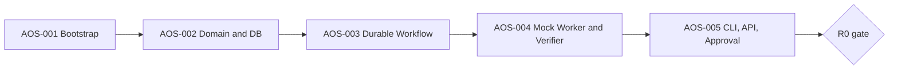

# R0 Build Specification — AOS-001 through AOS-005

**Planning status:** Ready for R0 planning; implementation untested; revision planning-fixes-1.

**Objective:** A real durable control-plane path, using only synthetic data/mock workers, passes restart/replay, verifies artifacts and requires exact user approval. This is **not** an authorization to put Claude Code, external secrets or a personal repository in the runtime.

**Source files:** [001](../specs/AOS-001.md) · [002](../specs/AOS-002.md) · [003](../specs/AOS-003.md) · [004](../specs/AOS-004.md) · [005](../specs/AOS-005.md); [shared domain contracts](../architecture/01-CANONICAL-DATA-AND-API-CONTRACTS.md).

## Milestones and dependency graph



**WIP limit:** one schema-changing task at a time; ship each vertical increment behind an integration test. Parallelize only documentation/security-fixture design while contracts stabilize. Use one Python package, create sub-packages only as needed and enforce boundaries with Import Linter.

## Module tree to implement

```text
pyproject.toml             one Python distribution; uv.lock and .importlinter
src/agentos/contracts/     goal.py, task.py, worker.py, events.py, acceptance.py
src/agentos/kernel/        goal_service.py, task_service.py, approvals.py, repository.py
src/agentos/execution/     dbos_app.py, task_workflow.py, recovery.py
src/agentos/brokers/       harness/mock_worker.py, harness/base.py
src/agentos/policy/        synthetic_policy.py, verifier_registry.py
src/agentos/telemetry/     event_store.py, audit.py
src/agentos/verification/  trusted_runner.py, diff_check.py, evidence.py
src/agentos/api/           main.py, routes/{goals,approvals,artifacts,events}.py
src/agentos/cli/           main.py, commands/{goal,approval,artifact}.py
src/agentos/resources/     staged resource interfaces
src/agentos/memory/        staged memory interfaces
apps/mission-control/     future React app; no Node gate in R0
migrations/versions/      0001_kernel_v1.py
examples/synthetic/       repo-template/, goal-contract.yaml, fixtures/
tests/                    unit/, migration/, contract/, integration/, chaos/, security/
deploy/compose/           postgres.yaml
```

This is a proposal for plan generation; if existing repository or Agent Skills code uses different paths, retain code and document mapping rather than duplicating modules.

## M0: bootstrap (AOS-001)
1. `uv` project with locked Python 3.12 and local-only FastAPI health endpoint. Do not include Node/frontend in the critical path.
2. Postgres Compose ephemeral test fixture and named local developer volume. Avoid adding long-lived Docker root privileges.
3. Lint/type/test/CI and `make r0-demo` placeholders; CI has no AI provider credentials.
4. Create readable `CONTRIBUTING.md`, `SECURITY.md`, `.env.example` with no real values.
**Exit:** fresh Ubuntu checkout runs tests and DB up/migration with only documented prerequisites.

## M1: contracts and migration (AOS-002)
1. Implement `GoalContract` acceptance union from the seven-value type registry; implement only the five R0 check runners and deny unavailable R2 runners. Model has immutable canonical SHA256.
2. SQL entities principal/project/goal/contract/task/attempt/approval/artifact/events/checks/workflow link; use real Postgres constraints and indexes.
3. Database repository with owner-scoped reads, expected-version mutations and atomic state+event writes.
4. A test must deliberately make two attempts update the same task; only one wins. Another must try to change an approved contract in place and fail.
**Exit:** migrations verified; goal/contract/task/check roundtrip; concurrency and DAG validation green.

## M2: DBOS execution (AOS-003)
1. Define a DBOS workflow that decides deterministic task state transitions; write each guarded state transition and task_event inside one tracked datasource transaction; isolate filesystem/process I/O into ordinary persisted steps.
2. Stable workflow ID linked to task and contract hash; duplicate submit returns same logical execution or explicit 409.
3. Initialize the datasource before launch, recover DBOS workflows and read UI state from the same PostgreSQL database; errors are explicit.
4. Use test barriers to SIGKILL at step boundaries and recover; assert rollback before database commit, exactly one transition/event after commit, and idempotent handling of incomplete external steps.
**Exit:** crash/restart test across 3–4 barriers passes and event sequence remains authoritative.

## M3: worker/evidence (AOS-004)
1. Mock adapter implements the full WorkerAdapter lifecycle. It is configured with one of `success`, `bad-test`, `bad-path`, `timeout`, `crash`, `artifact-corrupt` behaviors.
2. Synthesize a miniature Git repo in a disposable root, isolate attempt in fresh Git worktree, never use user HOME paths.
3. Register two verifiers: trusted known test command and diff path check. Capture artifact SHA256 and bounded stdout.
4. Worker narrative 'tests pass' must be ignored if tests actually fail.
**Exit:** mock fixtures deterministically pass/fail with immutable artifact evidence and safe cleanup.

## M4: API/CLI/approval (AOS-005)
1. Minimal loopback API with owner token/session, no wildcard CORS; CLI wraps OpenAPI-generated types.
2. `submit`, `status`, `events`, `show artifact`, `approve/deny`, `cancel` commands; exact-action effect_digest and policy version bind approvals.
3. E2E harness submits synthetic task, observes running state, obtains diff/check evidence, approves, and sees completed result. Restart API before approval and prove result persisted.
4. Negative demo: deny/expired approval and changed payload never execute.
**Exit:** one reproducible command shows completed R0 workflow and another shows negative fixture rejection.

## R0 reference integration contract

```json
{
  "schema_version": 1,
  "kind": "synthetic-build",
  "goal_contract_ref": "goal_uuid/version_1",
  "task": {
    "worker": "mock",
    "privacy_class": "RESTRICTED",
    "network": "deny"
  },
  "acceptance": [
    {
      "id": "AC-001",
      "description": "Example trusted-command-ref",
      "required": true,
      "verifier": {
        "type": "trusted-command-ref",
        "command_ref": "synthetic-test-suite",
        "expected_exit_code": 0,
        "timeout_seconds": 30
      },
      "evidence": {
        "required": true,
        "kind": "trusted-command-ref-report"
      }
    },
    {
      "id": "AC-002",
      "description": "Example git-diff-path-check",
      "required": true,
      "verifier": {
        "type": "git-diff-path-check",
        "allowed_paths": [
          "src/**",
          "tests/**"
        ],
        "forbidden_paths": [
          ".env*",
          ".git/config",
          "secrets/**"
        ]
      },
      "evidence": {
        "required": true,
        "kind": "git-diff-path-check-report"
      }
    },
    {
      "id": "AC-003",
      "description": "Example policy-decision",
      "required": true,
      "verifier": {
        "type": "policy-decision",
        "action": "protected-merge",
        "expected": "approval-required"
      },
      "evidence": {
        "required": true,
        "kind": "policy-decision-report"
      }
    }
  ]
}
```

The executable `GoalContract` schema, not this illustrative JSON, is authoritative after AOS-002 passes its contract tests.

## Negative and failure gate matrix

| Test | Injected failure | Pass condition |
|---|---|---|
| CONTRACT-01 | change approved contract body | immutable version preserved; new version required |
| CONTRACT-02 | two state writes with same expected version | exactly one succeeds |
| DAG-01 | cycle or self-edge | plan rejected |
| WORKFLOW-01 | kill kernel before DBOS step completion | resumes/retries safely; no phantom success |
| WORKFLOW-02 | duplicate workflow request key | one logical workflow |
| WORKER-01 | wrong allowed path | check FAIL, task not COMPLETED |
| WORKER-02 | claimed success with failing test | verifier rejects |
| ARTIFACT-01 | mutate artifact bytes after hash | read refuses or flags tampering |
| APPROVAL-01 | approve changed/expired digest | DENY without effect |
| APPROVAL-02 | concurrent approve/deny | one atomically final decision |
| API-01 | wrong local owner/session | deny, log safe code |
| API-02 | API killed during approval wait | request and event replay intact |

**R0 threat envelope:** no real provider auth, no personal data, no trusted claim about sandboxing arbitrary code. The mock test runner may execute only developer-authored synthetic code, and CI must not have sensitive credentials. R1 security hardening is a blocker before relaxing this envelope.

## R0 artifact checklist
- Source code + pinned lockfile + `compose.yaml` and migration.
- Generated JSON schemas/OpenAPI + migration diagram/ERD.
- DBOS crash-test transcript and replay validation log.
- Synthetic worktree and verifier fixtures with expected output.
- CLI demo transcript, final task/event records and approval audit.
- `ARCHITECTURE.md` delta containing only implementation detail; no speculative new frameworks.
- ADR log records the locked global seq/commit-order rule and effect_digest/project binding; planning verifies approval auth and exact pinned workflow-ID API.

## R0 plan-generation instruction
Use checklist plans for AOS-001/004 and full plans for AOS-002/003/005, one AOS item at a time, with roughly one developer-day per implementation slice. For each: map exact files, code interfaces, schema/SQL, unit + negative fixtures, integration steps, commands, review points and rollback. Prioritize a running test before broad abstract scaffolding. Record actual repository state and first inspect the attached original skills archive, its checksums/inventory and smoke results; re-run relevant tests before adopting code. Do not add R1–R7 features without a written dependency or blocker.
